# Mr Rogers

A map of local know-how from people who actually live nearby. It covers things like drains that back up, footpaths that flood, faulty public bathrooms etc.

This is a learning project for backend development, where Claude Code provides technical guidance and human developer delivers implementation.

- **Build plan:** [docs/build-plan.md](docs/build-plan.md) - backend only
- **Live wireframes:** https://claude.ai/artifact/25cHnCbxeDnWPRAzUySKyN
- **Claude exploration:** [https://claude.ai/artifact/N6ZVFGSE9W8BSSdEmsnnq8#a35f654e-cd87.mwbr49g9p46.53195](https://claude.ai/artifact/N6ZVFGSE9W8BSSdEmsnnq8#a35f654e-cd87.mwbr49g9p46.53195)
- **Notion idea doc:** [https://app.notion.com/p/rachelwong/Mr-Rogers-3fb375d34b3480bb9f4cecab0ecb8576?source=copy_link](https://app.notion.com/p/rachelwong/Mr-Rogers-3fb375d34b3480bb9f4cecab0ecb8576?source=copy_link)

The idea come from this reddit post [https://www.reddit.com/r/brisbane/comments/1x6shn2/my_neighbour_gave_me_a_handdrawn_storm_map_of_our/](https://www.reddit.com/r/brisbane/comments/1x6shn2/my_neighbour_gave_me_a_handdrawn_storm_map_of_our/) [[WaybackMachine Link](https://archive.li/KoFRr)]

> It got me thinking about how much incredibly specific local knowledge must disappear whenever longtime residents move away. Not just flood stuff. Which streets get cut off first, where trees regularly drop branches, which walking shortcuts turn into ankle-deep puddles. The sort of things that never make it into a **suburb guide**. [...]
> Does anyone else have a neighbour who knows the **entire natural history of their particular street**?
> I'm starting to think every Brisbane neighbourhood needs at least one retired person with a notebook.

This project is that retired person with a notebook, wearing a red jumper.

## Key functionalities

- all users/visitors can browse a map with pins that include local information (i.e. drainage gotchas, swooping magpies, reliable public toilets with parent rooms etc.)
- visitors must sign up for an account in order to add a pin, comment on a pin, vote up/down on a pin.
- key to project is the definition of 'neighbour', a real human person who lives within a specific area for a meaningful length of time and has genuine local knowledge to share. All of which is subjective, interpretable and it is not the goal of this project to lay down concrete definitions. Users are only required to provide a valid Brisbane physical residential address.
- moderators and admin can approve an account, delete account, delete comment.

## What is in this repo

| Folder  | What's in it                    |
| ------- | ------------------------------- |
| `web/`  | React + TypeScript web app      |
| `api/`  | Node + Express + TypeScript API |
| `docs/` | Build plan and wireframes       |

## Wireframes

Mobile screens, 390 × 844. Source files are in [docs/wireframes/source](docs/wireframes/source).

### Getting in

|                            Home                             |                             About                             |                             Sign in                              |
| :---------------------------------------------------------: | :-----------------------------------------------------------: | :--------------------------------------------------------------: |
| 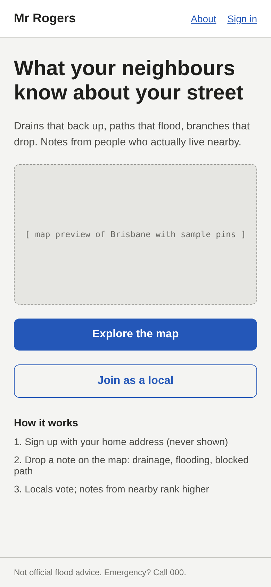 | 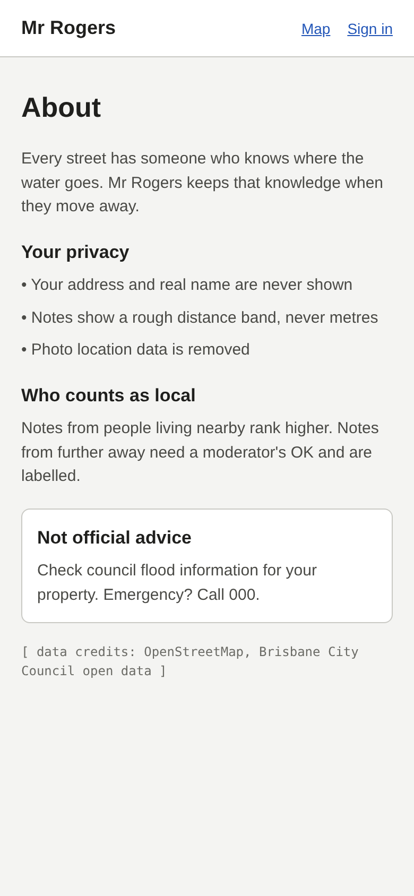 |  |

|                           Sign up 1 · details                            |                           Sign up 2 · address                            |                        Sign up 3 · check details                         |
| :----------------------------------------------------------------------: | :----------------------------------------------------------------------: | :----------------------------------------------------------------------: |
| 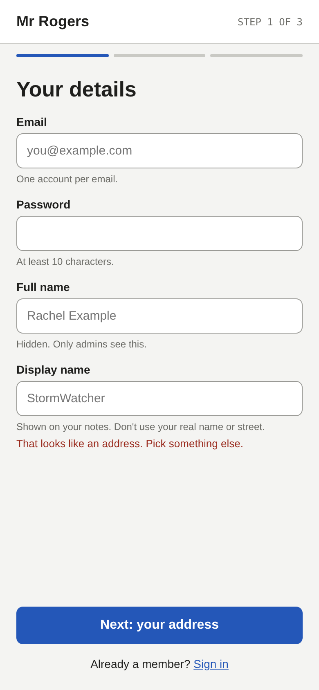 | 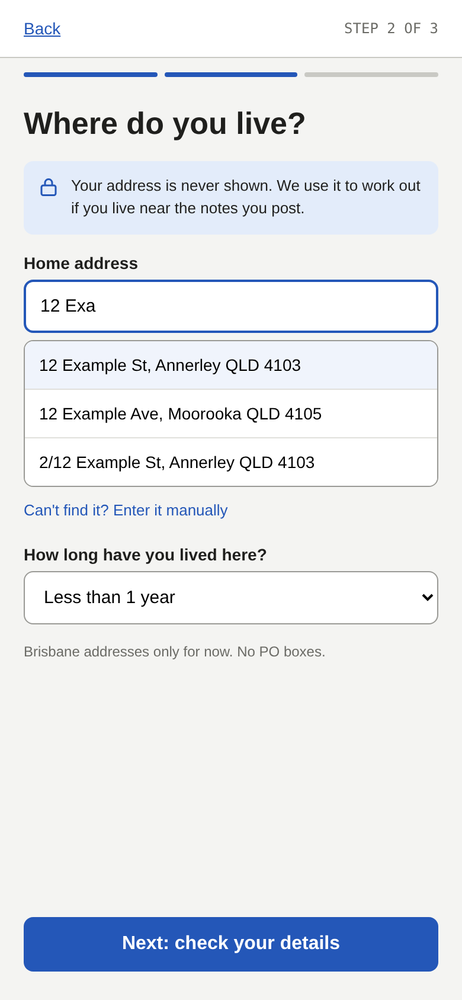 | 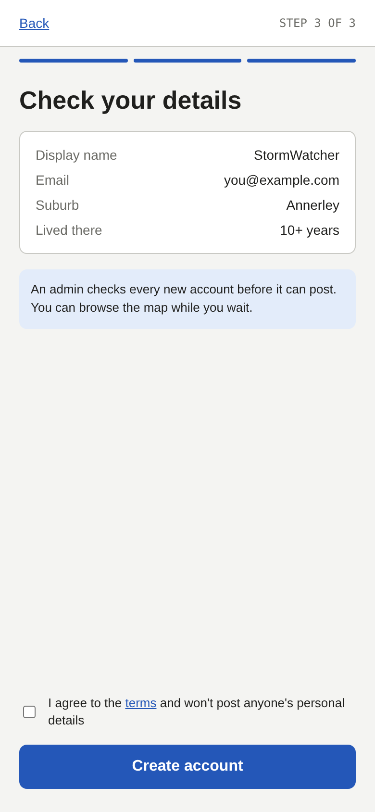 |

|                               Sign up success                                |
| :--------------------------------------------------------------------------: |
| 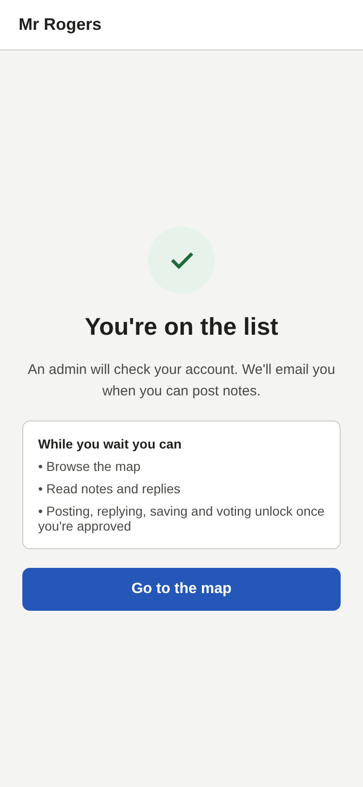 |

### Using it

|                            Map                            |                               Pin detail                               |                             Add pin                              |
| :-------------------------------------------------------: | :--------------------------------------------------------------------: | :--------------------------------------------------------------: |
| 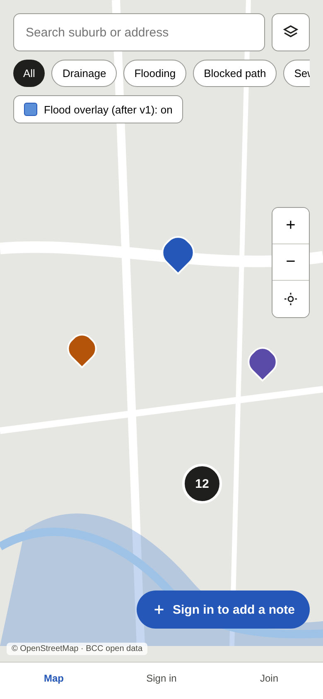 | 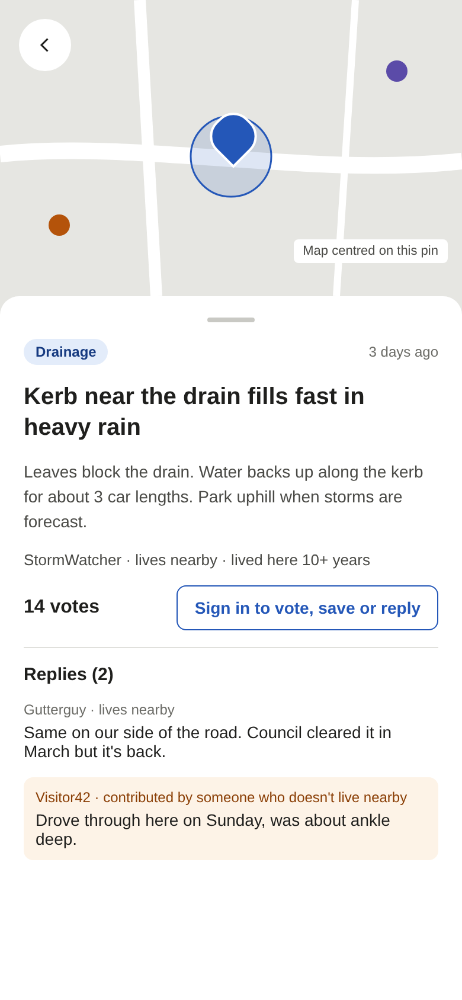 | 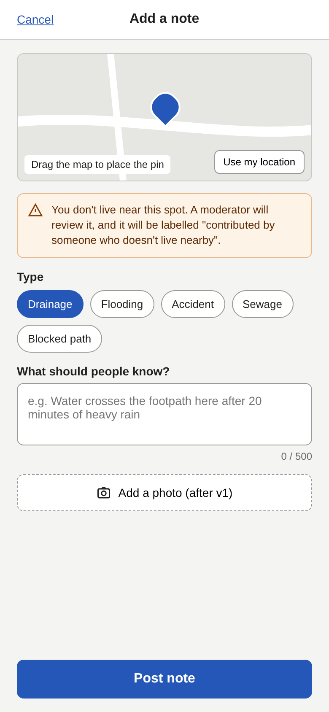 |

|                              Profile                              |                                Edit profile                                |                               Moderation queue                                |
| :---------------------------------------------------------------: | :------------------------------------------------------------------------: | :---------------------------------------------------------------------------: |
| 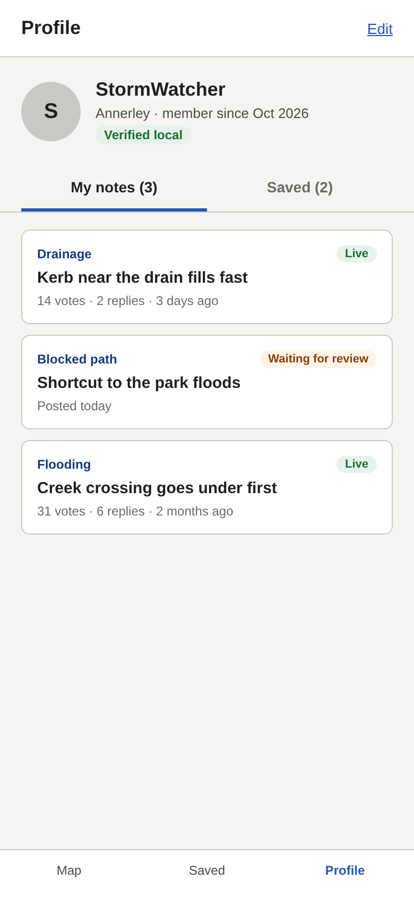 | 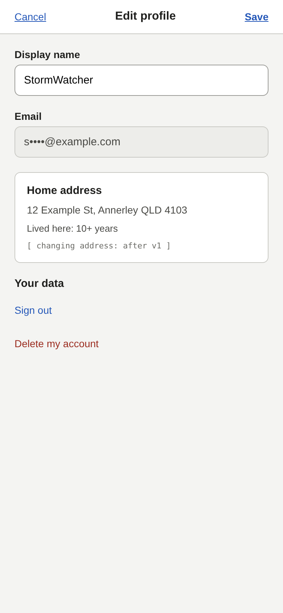 | 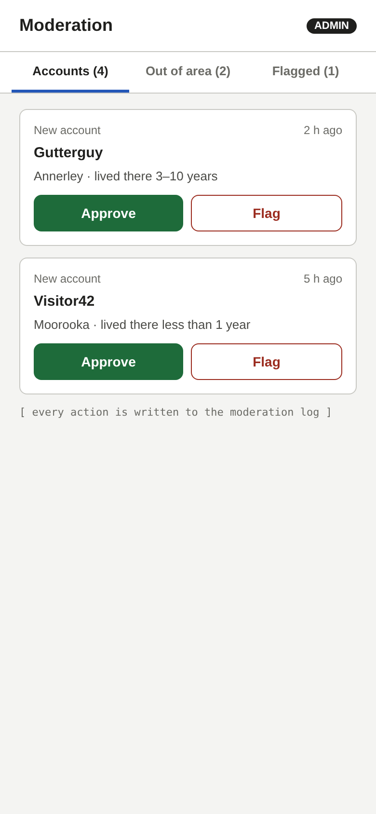 |

|                             Error                             |
| :-----------------------------------------------------------: |
| 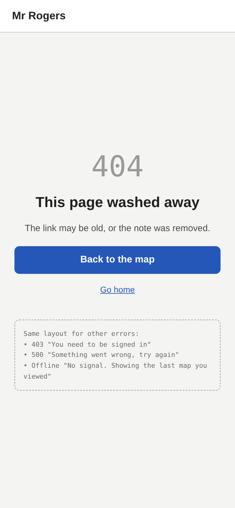 |

## Backend notes

- using typescript version 6.0 for compatibilty with eslint
- use `npx supabase`
- uses session pooler for supabase
- `npm run db:generate` checks typescript schemas and generate migration files
- `npm run db:migrate` runs migration against db online to make sure the structure is consistent
- `npm run db:studio` drizzle studio
- to clear all pins data in supabase SQL editor

```sql
DROP TABLE IF EXISTS public.pins;
DROP TYPE IF EXISTS public."type";
DROP TYPE IF EXISTS public.pin_type;
DROP SCHEMA IF EXISTS drizzle CASCADE;
```

### To run

1. Add `.env` inside root level of `/api` folder
2. Add below example `.env` configuration

```
PORT=3000
CORS_ORIGIN=http://localhost:5173
NODE_ENV=development
NODE_VERSION=24.22.1 // min lts
```

3. Run below terminal commands inside `/api` folder

```
npm i
npm run dev
```
