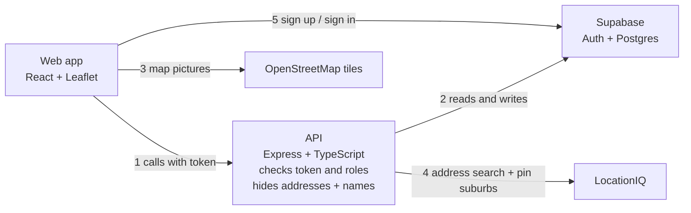

# Mr Rogers — Build Plan

Live version (with comments): https://claude.ai/artifact/N6ZVFGSE9W8BSSdEmsnnq8
Wireframes: https://claude.ai/artifact/25cHnCbxeDnWPRAzUySKyN

## Summary

Mr Rogers is a learning project for backend. The backend plan is 24 small steps, and each step teaches one backend idea. Start local, keep the tools boring, and add extras only after the core works.

**The simple approach**

- **One frontend, one API, one Supabase project.** React + TypeScript web app, Node + Express API, Supabase for the Postgres database and sign-in.
- **Run the API locally, use a hosted database.** The API runs on your machine and connects to a free hosted Supabase project for development, so there's no Docker to install. A second Supabase project is created for the live site when you deploy near the end.
- **No map maths in the database.** Store latitude and longitude as plain numbers. Work out distance with a small function in Node.
- **Supabase Auth for sign-in.** Email + password. Supabase stores passwords and handles sessions; your API only checks the user's token.
- **"Local" is a yes/no.** A pin is either "from someone nearby" or "from someone who doesn't live nearby". No distance in metres, so no way to work out where someone lives.
- **Address check = years lived there + admin approval.** Nothing fancier for v1.

**Left out of v1 (add later if you want)**

- Photos
- Email codes and forgot password
- Flood overlay
- Pin clustering
- "Watch a pin" notifications
- Changing your address. Moving house is part of the plan. A user can submit a new address, and it goes through the same check as the first one: years lived there plus admin approval. Until an admin approves it, the old address stays in use, so "local" pins don't change and nobody can use a move to dodge the check.

## Build plan (backend only)

24 steps in 7 phases, all on the API and database. Each phase ends with something new the API can do. Each step is one PR. The web app is built alongside; its free tools are listed under Tools.

**How each step is written**

- **What it does:** what the API can do after this step, in plain words.
- **How:** the main jobs to get it working.
- **You'll learn:** the backend idea behind it.
- **Done when:** how to check it works.

**Tips**

- Call every new endpoint from a REST client (Bruno, Postman or Thunder Client) before the web app uses it.
- Write an automated test only when a rule matters, like who can do what or who can see what.
- If a step feels too big, split it. Don't add new tools.

**Example requests**

Each phase ends with example requests and responses to aim for in Postman. They assume the API runs at `http://localhost:3000`. Paths and field names are suggestions; change them if you like, but keep the shape and the status codes.

### Phase 1 — The API can save and return pins

By the end, the API stores pins in a real database.

1. **Check the API is running** ✅ Done 25/10/2026
   - What it does: the API answers "I'm OK" when you ask it.
   - How: set up a Node + Express + TypeScript project; add a health endpoint; run it on your machine.
   - You'll learn: what a server and a route are.
   - Done when: calling the health endpoint returns OK.
2. **Create and read pins (no database yet)** ✅ Done 25/10/2026
   - What it does: the API can add a pin, list all pins and return one pin.
   - How: keep pins in a list in memory; add endpoints to create, list and get one; check new pins with zod (type is required, description isn't empty or too long, location has a lat and lng).
   - Naming: one path per resource, and the HTTP method says what to do. `POST /pins` adds a pin, `GET /pins` lists them, `GET /pins/:id` gets one. Avoid `/pin` or `/pins/all`: `/pins/all` would clash with `/pins/:id`, because Express would read "all" as a pin id.
   - You'll learn: REST endpoints, status codes (200, 201, 400, 404), checking input.
   - Done when: a bad pin gets a 400 with a clear message, and a missing pin gets a 404.
3. **Store pins in a database** 🟡 Provisionally done 28/10/2026
   - Verified: migrations rebuild the table, the seed works, and `POST /pins`, `GET /pins` and `GET /pins/:id` work against the database; an id that isn't a UUID, or a UUID no pin has, returns 404. Still to check: the rest of the [build checklist](plans/phase-1-step-3-store-pins-in-a-database.md#build-checklist), especially the API restart cases.
   - What it does: pins are still there after the API restarts.
   - How: connect the API to your development Supabase project; set up Drizzle; create a pins table (location, type, description, created date); write a seed script with sample Brisbane pins; switch the endpoints from the in-memory list to the database.
   - You'll learn: tables, migrations, seed data, environment variables.
   - Done when: you restart the API and the pins are still there.

Full endpoint list, error codes, models and every Postman example for step 2: [plans/phase-1-step-2-create-and-read-pins.md](plans/phase-1-step-2-create-and-read-pins.md).

What to build and every Postman case for step 3: [plans/phase-1-step-3-store-pins-in-a-database.md](plans/phase-1-step-3-store-pins-in-a-database.md).

**Try it in Postman (Phase 1)**

```http
# Step 1 — Check the API is running
GET /health

→ 200 OK
{ "status": "ok" }
```

```http
# Step 2 — Create a pin
POST /pins
Content-Type: application/json

{
  "type": "drainage",
  "description": "Kerb near the drain fills fast in heavy rain",
  "coords": { "lat": -27.5098, "lng": 153.0331 }
}

→ 201 Created
{
  "id": "8f1c2a90-4b7e-4d2a-9c11-3e5f6a7b8c9d",
  "type": "drainage",
  "description": "Kerb near the drain fills fast in heavy rain",
  "coords": { "lat": -27.5098, "lng": 153.0331 },
  "createdAt": "2026-10-24T09:30:00.000Z"
}
```

```http
# Step 2 — Bad pin (empty description)
POST /pins
Content-Type: application/json

{ "type": "drainage", "description": "", "coords": { "lat": -27.5098, "lng": 153.0331 } }

→ 400 Bad Request
{
  "error": "Invalid pin",
  "details": [
    { "field": "description", "message": "Description is required" }
  ]
}
```

```http
# Step 2 — Pin that doesn't exist
GET /pins/does-not-exist

→ 404 Not Found
{ "error": "Pin not found" }
```

Step 3 uses the same requests. The test: create a pin, restart the API, and it still comes back.

### Phase 2 — The API serves the map

By the end, anyone can fetch pins for the map without signing in.

4. **Map data endpoint**
   - What it does: the "list pins" endpoint returns only what a map needs, and a web app on a different address can call it.
   - How: return each pin's id, location and type as JSON; turn on CORS for the web app's address.
   - You'll learn: shaping a response for its user; CORS and why browsers block calls to other sites.
   - Done when: a page on another address (or the web app) can fetch the pins without a CORS error.
5. **Get one pin**
   - What it does: the API returns one pin's full details, so the web app can open a pin straight from a link.
   - How: return type, description, date, vote total, reply count and the poster's public details; return 404 for a pin that doesn't exist.
   - Done when: a real pin id returns its details, and a made-up one returns 404.
6. **Pins in an area, filtered by type**
   - What it does: the API only returns pins inside the area the map is showing, and can filter by type.
   - How: accept the map's edges and an optional type as query parameters; return only pins inside those edges; add a database index on location.
   - You'll learn: query parameters, filtering with WHERE, why indexes make lookups fast.
   - Done when: a small area returns only its pins, and the type filter works.
7. **Pins by suburb or postcode**
   - What it does: users can find pins by suburb name (like "Annerley") or postcode (like "4103") as well as by map area. The type filter still works.
   - How: add suburb and postcode columns to the pins table; when a pin is created, look up its suburb and postcode with LocationIQ reverse geocoding and save them; keep the LocationIQ key in an environment variable; fill in the seed pins and any existing pins with a one-off script; accept `suburb` or `postcode` as query parameters on the list endpoint; match suburb names without caring about capitals; add an index on each column.
   - Why save it on the pin: looking it up once when the pin is made means searches only read your own database. Asking LocationIQ on every search would use up the free limit and make a public endpoint depend on another service.
   - You'll learn: calling another service from your server and keeping its key secret; saving worked-out data so reads stay simple.
   - Done when: searching a suburb or postcode returns only pins in it; a postcode that isn't 4 digits, or mixing map edges with suburb or postcode, returns 400; a suburb with no pins returns an empty list.

**Try it in Postman (Phase 2)**

```http
# Step 4 — Map data (only what the map needs)
GET /pins
Origin: http://localhost:5173

→ 200 OK
Access-Control-Allow-Origin: http://localhost:5173
[
  { "id": "8f1c2a90-...", "type": "drainage", "coords": { "lat": -27.5098, "lng": 153.0331 } },
  { "id": "2b7d4e11-...", "type": "flooding", "coords": { "lat": -27.5121, "lng": 153.0298 } }
]
```

```http
# Step 5 — One pin's full details
GET /pins/8f1c2a90-4b7e-4d2a-9c11-3e5f6a7b8c9d

→ 200 OK
{
  "id": "8f1c2a90-4b7e-4d2a-9c11-3e5f6a7b8c9d",
  "type": "drainage",
  "description": "Kerb near the drain fills fast in heavy rain",
  "coords": { "lat": -27.5098, "lng": 153.0331 },
  "createdAt": "2026-10-21T09:30:00.000Z",
  "votes": 14,
  "replyCount": 2,
  "author": { "displayName": "StormWatcher", "livesNearby": true, "yearsAtAddress": "10+" }
}
```

```http
# Step 6 — Pins in the map area, drainage only
GET /pins?north=-27.49&south=-27.53&east=153.05&west=153.01&type=drainage

→ 200 OK
[
  { "id": "8f1c2a90-...", "type": "drainage", "coords": { "lat": -27.5098, "lng": 153.0331 } }
]
```

```http
# Step 7 — Pins in a suburb
GET /pins?suburb=annerley

→ 200 OK
[
  { "id": "8f1c2a90-...", "type": "drainage", "coords": { "lat": -27.5098, "lng": 153.0331 } },
  { "id": "2b7d4e11-...", "type": "flooding", "coords": { "lat": -27.5121, "lng": 153.0298 } }
]

# Pins in a postcode, flooding only
GET /pins?postcode=4103&type=flooding

→ 200 OK
[
  { "id": "2b7d4e11-...", "type": "flooding", "coords": { "lat": -27.5121, "lng": 153.0298 } }
]

# Postcode that isn't 4 digits
GET /pins?postcode=41

→ 400 Bad Request
{ "error": "Postcode must be 4 digits" }

# Map edges and suburb together
GET /pins?north=-27.49&south=-27.53&east=153.05&west=153.01&suburb=annerley

→ 400 Bad Request
{ "error": "Search by map area, suburb or postcode, not more than one" }
```

### Phase 3 — The API knows who's calling

By the end, reading stays public, but only signed-in users can post.

8. **Set up Supabase Auth**
   - What it does: users can be created and signed in with email and password (the web app does the sign-in screens).
   - How: turn on email sign-in in your development Supabase project, and turn off "Confirm email" so test users don't need real emails (the built-in email sender only allows a few emails an hour); create a test user; sign the test user in through Supabase's REST endpoint to get an access token for testing.
   - You'll learn: what an auth provider does for you, and what an access token (JWT) is.
   - Done when: you have an access token for a test user.
9. **Check the token**
   - What it does: the API can tell which user sent a request.
   - How: add middleware that reads the token from the request header and asks Supabase if it's valid; add a "who am I" endpoint; leave reading pins and replies open to everyone.
   - You'll learn: tokens in request headers, middleware, 401 (not signed in).
   - Done when: "who am I" returns your user with a token and a 401 without one.
10. **Profiles**

- What it does: each user has a profile with a display name (public) and a real name (private).
- How: create a profiles table linked to the Supabase user id; add an endpoint to create the profile straight after sign-up; reject display names that look like an address.
- You'll learn: linking your own table to users stored somewhere else; making sure each user has only one profile.
- Done when: creating a second profile for the same user is refused.

11. **Only signed-in users can post**
    - What it does: creating a pin needs a valid token, and each pin records who posted it.
    - How: put the token check on the "create pin" endpoint; add the poster's user id to the pins table.
    - You'll learn: foreign keys (one table pointing to another).
    - Done when: creating a pin without a token returns 401.

**Try it in Postman (Phase 3)**

```http
# Step 8 — Get a test token from your development Supabase project (not your API)
POST https://your-project-ref.supabase.co/auth/v1/token?grant_type=password
apikey: <your project's anon key>
Content-Type: application/json

{ "email": "test@example.com", "password": "a-long-test-password" }

→ 200 OK
{
  "access_token": "eyJhbGciOi...",
  "token_type": "bearer",
  "expires_in": 3600,
  "user": { "id": "a1b2c3d4-...", "email": "test@example.com" }
}
```

Save `access_token` as a Postman variable and send it as `Authorization: Bearer {{token}}` from now on.

```http
# Step 9 — Who am I
GET /me
Authorization: Bearer {{token}}

→ 200 OK
{ "id": "a1b2c3d4-...", "email": "test@example.com" }

# Same request with no token
→ 401 Unauthorized
{ "error": "Not signed in" }
```

```http
# Step 10 — Create a profile
POST /me/profile
Authorization: Bearer {{token}}
Content-Type: application/json

{ "displayName": "StormWatcher", "realName": "Test Person" }

→ 201 Created
{ "displayName": "StormWatcher" }

# Second time for the same user
→ 409 Conflict
{ "error": "Profile already exists" }

# Display name like "12 Smith St"
→ 400 Bad Request
{ "error": "Display name can't look like an address" }
```

```http
# Step 11 — Create a pin with no token
POST /pins
Content-Type: application/json

{ "type": "drainage", "description": "...", "coords": { "lat": -27.5098, "lng": 153.0331 } }

→ 401 Unauthorized
{ "error": "Not signed in" }
```

### Phase 4 — The API knows if a poster lives nearby

By the end, pins from people who live within 1 km show straight away, and the rest wait for approval.

12. **Home address**
    - What it does: the API suggests addresses as the user types, saves their chosen home address and years lived there, and never shows it to anyone.
    - How: add an address search endpoint that passes the search to LocationIQ Autocomplete (Australian addresses only, at least 3 characters); add a lookup endpoint for addresses typed in manually; save the home location and years lived there on the profile; make every endpoint return only public profile fields.
    - You'll learn: choosing what data leaves the API.
    - Done when: address search returns suggestions with locations, and one test proves no endpoint returns an address or real name.
13. **Decide if a pin is local**
    - What it does: each new pin is marked "local" if the poster lives within 1 km of it. Pins that aren't local wait for approval.
    - How: when a pin is created, work out the distance from the poster's home to the pin; save "local" as yes or no; save non-local pins as pending; leave pending pins out of the map endpoints; return a flag the web app can use to warn the user before posting.
    - You'll learn: why business rules belong on the server, not in the browser.
    - Done when: a pin far from home is saved as pending and doesn't appear in the map data.

**Try it in Postman (Phase 4)**

```http
# Step 12 — Address suggestions while typing
GET /address/search?q=12 Exa
Authorization: Bearer {{token}}

→ 200 OK
[
  { "label": "12 Example Street, Annerley QLD 4103", "lat": -27.5101, "lng": 153.0335 },
  { "label": "12 Example Avenue, Moorooka QLD 4105", "lat": -27.5352, "lng": 153.0241 }
]

# q shorter than 3 characters
→ 400 Bad Request
{ "error": "Type at least 3 characters" }

# LocationIQ limit reached
→ 503 Service Unavailable
{ "error": "Address search is busy. Try again or enter your address manually." }
```

```http
# Step 12 — Look up an address typed in manually
GET /address/lookup?q=12 Example Street, Annerley QLD 4103
Authorization: Bearer {{token}}

→ 200 OK
{ "label": "12 Example Street, Annerley QLD 4103", "lat": -27.5101, "lng": 153.0335 }

# Not found
→ 404 Not Found
{ "error": "We couldn't find that address. Please check it." }
```

```http
# Step 12 — Save home address
PUT /me/home
Authorization: Bearer {{token}}
Content-Type: application/json

{ "label": "12 Example Street, Annerley QLD 4103", "lat": -27.5101, "lng": 153.0335, "yearsAtAddress": "10+" }

→ 200 OK
{ "saved": true }
```

No response anywhere in the API should ever include `label`, `lat` or `lng` of a home, or `realName`.

```http
# Step 13 — Warn before posting
GET /pins/local-check?lat=-27.6012&lng=153.1020
Authorization: Bearer {{token}}

→ 200 OK
{ "isLocal": false }
```

```http
# Step 13 — Post a pin far from home
POST /pins
Authorization: Bearer {{token}}
Content-Type: application/json

{ "type": "flooding", "description": "Underpass ankle deep on Sunday", "coords": { "lat": -27.6012, "lng": 153.1020 } }

→ 201 Created
{ "id": "c3d4e5f6-...", "status": "pending", "isLocal": false }

# A pin within 1 km of home comes back as
{ "id": "d4e5f6a7-...", "status": "live", "isLocal": true }
```

### Phase 5 — The API handles conversation

By the end, the API supports replies, votes, saved pins and deleting your own pins.

14. **Replies**
    - What it does: anyone can read replies on a pin; signed-in users can add one.
    - How: create a replies table linked to pins and users; add endpoints to list and add replies.
    - You'll learn: one-to-many relationships, joining tables.
    - Done when: a new reply comes back when you list that pin's replies.
15. **Votes**
    - What it does: signed-in users can vote a pin up or down, once each.
    - How: create a votes table with one row per user per pin; voting again changes the vote; include the total in the pin details; refuse votes on your own pin.
    - You'll learn: unique rules in the database, update-or-insert, counting in SQL.
    - Done when: voting twice changes your vote instead of adding a second one.
16. **Saved pins**
    - What it does: signed-in users can save and unsave pins.
    - How: create a bookmarks table; add save and unsave endpoints.
    - You'll learn: many-to-many relationships.
    - Done when: saving the same pin twice still leaves one saved pin.
17. **My pins and my saved pins**
    - What it does: the API returns a user's own pins and saved pins, and lets them change their display name.
    - How: add "my pins" (including pending ones, with their status) and "my saved pins" endpoints; return each pin's id and location so the web app can open it on the map; add an endpoint to update the display name.
    - Done when: each list returns the right pins for the signed-in user only.
18. **Delete your own pin**
    - What it does: users can delete pins they posted.
    - How: mark the pin as deleted instead of removing it; check the user deleting is the poster; saved copies come back with status "inactive".
    - You'll learn: soft delete; 401 (not signed in) vs 403 (not allowed).
    - Done when: deleting someone else's pin returns 403.

**Try it in Postman (Phase 5)**

```http
# Step 14 — Read replies (no token needed)
GET /pins/8f1c2a90-.../replies

→ 200 OK
[
  {
    "id": "r1...",
    "text": "Same on our side of the road.",
    "createdAt": "2026-10-22T08:00:00.000Z",
    "author": { "displayName": "Gutterguy", "livesNearby": true }
  }
]
```

```http
# Step 14 — Add a reply
POST /pins/8f1c2a90-.../replies
Authorization: Bearer {{token}}
Content-Type: application/json

{ "text": "Council cleared it in March but it's back." }

→ 201 Created
{ "id": "r2...", "text": "Council cleared it in March but it's back.", "createdAt": "2026-10-24T10:00:00.000Z" }
```

```http
# Step 15 — Vote (1 = up, -1 = down, 0 = remove vote)
PUT /pins/8f1c2a90-.../vote
Authorization: Bearer {{token}}
Content-Type: application/json

{ "value": 1 }

→ 200 OK
{ "votes": 15, "myVote": 1 }

# Voting on your own pin
→ 403 Forbidden
{ "error": "You can't vote on your own pin" }
```

```http
# Step 16 — Save and unsave
PUT /pins/8f1c2a90-.../save
Authorization: Bearer {{token}}

→ 200 OK
{ "saved": true }

DELETE /pins/8f1c2a90-.../save
Authorization: Bearer {{token}}

→ 200 OK
{ "saved": false }
```

```http
# Step 17 — My pins (includes pending ones)
GET /me/pins
Authorization: Bearer {{token}}

→ 200 OK
[
  { "id": "8f1c2a90-...", "type": "drainage", "description": "Kerb near the drain...", "coords": { "lat": -27.5098, "lng": 153.0331 }, "status": "live" },
  { "id": "c3d4e5f6-...", "type": "flooding", "description": "Underpass ankle deep...", "coords": { "lat": -27.6012, "lng": 153.1020 }, "status": "pending" }
]
```

```http
# Step 17 — My saved pins
GET /me/saved
Authorization: Bearer {{token}}

→ 200 OK
[
  { "id": "2b7d4e11-...", "type": "flooding", "coords": { "lat": -27.5121, "lng": 153.0298 }, "status": "active" },
  { "id": "9e8f7a6b-...", "type": "drainage", "coords": null, "status": "inactive" }
]
```

```http
# Step 17 — Change display name
PATCH /me/profile
Authorization: Bearer {{token}}
Content-Type: application/json

{ "displayName": "DrainWatcher" }

→ 200 OK
{ "displayName": "DrainWatcher" }
```

```http
# Step 18 — Delete your own pin
DELETE /pins/8f1c2a90-...
Authorization: Bearer {{token}}

→ 204 No Content

# Someone else's pin
→ 403 Forbidden
{ "error": "You can only delete your own pins" }
```

### Phase 6 — Admins and moderators

By the end, new accounts and non-local pins need approval, and moderators can remove bad replies.

19. **Roles and account approval**
    - What it does: every account is a member, moderator or admin. New accounts start as pending: they can read everything but can't post, reply, save or vote until approved.
    - How: add role and status to profiles; add middleware that checks role and status; return 403 for pending users on those endpoints; create one admin account in the seed.
    - You'll learn: the difference between "who are you" (authentication) and "what can you do" (authorisation).
    - Done when: a pending user can read pins but gets 403 when posting.
20. **Admin approval queue**
    - What it does: admins can approve or flag new accounts, and approve or reject non-local pins.
    - How: add admin-only endpoints to list what's waiting and to record each decision; approved non-local pins come back labelled "from someone who doesn't live nearby".
    - Done when: an approved account can post, and an approved non-local pin appears in the map data with its label.
21. **Moderator tools**
    - What it does: moderators and admins can flag and delete replies, and reset an unsuitable display name.
    - How: add those endpoints and protect them with the role check.
    - Done when: a member gets 403 on these endpoints.

**Try it in Postman (Phase 6)**

```http
# Step 19 — A pending user tries to post
POST /pins
Authorization: Bearer {{pendingUserToken}}
Content-Type: application/json

{ "type": "drainage", "description": "...", "coords": { "lat": -27.5098, "lng": 153.0331 } }

→ 403 Forbidden
{ "error": "Your account is waiting for approval" }
```

```http
# Step 20 — What's waiting for an admin
GET /admin/queue
Authorization: Bearer {{adminToken}}

→ 200 OK
{
  "accounts": [
    { "userId": "a1b2c3d4-...", "displayName": "Gutterguy", "suburb": "Annerley", "yearsAtAddress": "3-10" }
  ],
  "pins": [
    { "id": "c3d4e5f6-...", "type": "flooding", "description": "Underpass ankle deep on Sunday" }
  ]
}
```

```http
# Step 20 — Approve an account
POST /admin/accounts/a1b2c3d4-.../approve
Authorization: Bearer {{adminToken}}

→ 200 OK
{ "status": "active" }
```

```http
# Step 20 — Approve a non-local pin
POST /admin/pins/c3d4e5f6-.../approve
Authorization: Bearer {{adminToken}}

→ 200 OK
{ "status": "live", "label": "From someone who doesn't live nearby" }
```

```http
# Step 21 — Flag and delete a reply
POST /replies/r1.../flag
Authorization: Bearer {{moderatorToken}}

→ 200 OK
{ "flagged": true }

DELETE /replies/r1...
Authorization: Bearer {{moderatorToken}}

→ 204 No Content
```

```http
# Step 21 — Reset a display name
PATCH /admin/users/a1b2c3d4-.../display-name
Authorization: Bearer {{moderatorToken}}
Content-Type: application/json

{ "displayName": "Member 1043" }

→ 200 OK
{ "displayName": "Member 1043" }

# Any of these with a member's token
→ 403 Forbidden
{ "error": "You don't have permission to do that" }
```

### Phase 7 — The API is live

By the end, the API runs online and stays running.

22. **Put the API online**
    - What it does: the API works on a real web address with a real database.
    - How: create a second hosted Supabase project (free plan) for the live site, separate from your development one, turn on "Enforce SSL" for it (so the database refuses unencrypted connections from the internet), connect with its CA certificate so the API checks it's talking to the real database, and run your migrations on it; deploy the API to Render's free plan and connect your GitHub repo so it redeploys whenever you merge; set environment variables; allow the live web app's address in CORS.
    - You'll learn: how running locally and running live are different.
    - Done when: the live API returns pins from the hosted database, and merging a PR redeploys it.
    - Watch out: Render's free plan sleeps after 15 quiet minutes, so the next request takes about a minute.
23. **Basic protection**
    - What it does: the API is harder to attack or spam, and the live database only accepts connections from where the API runs.
    - How: add helmet for security headers; add a rate limit on every endpoint that creates or changes data, and on address search; in the live Supabase project, turn on Network Restrictions (Project Settings → Database) and allow only Render's outbound IP ranges for your region (listed in the Render dashboard).
    - Why the IP allowlist: the database can only filter by IP address, not by domain. With the allowlist, someone who gets hold of the connection string still can't connect from anywhere else. Other Render customers share those IP ranges, so it's an extra layer on top of the strong password and SSL, not a replacement for them.
    - Done when: 30 fast posts in a row get blocked, the live API still returns pins, and connecting to the live database from your own machine is refused.
    - Watch out: the allowlist only covers Postgres connections. Supabase Auth and its REST Data API stay open to the internet, so row level security still matters. To run migrations on the live database from your machine, add your current IP address for the run and remove it afterwards.
24. **Keep Supabase awake**
    - What it does: stops the free Supabase project pausing after a quiet week.
    - How: add a health endpoint that runs a tiny database query; add a GitHub Actions scheduled job that calls it every 3 days.
    - You'll learn: scheduled jobs (cron) and health checks.
    - Done when: the job runs on schedule and gets an OK back.
    - Watch out: GitHub can turn off scheduled jobs when a repo has no commits for 60 days. Turn it back on in the Actions tab if that happens.

**Try it in Postman (Phase 7)**

```http
# Step 22 — The live API (your Render address will differ)
GET https://mister-rogers-api.onrender.com/pins

→ 200 OK
[ { "id": "...", "type": "drainage", "coords": { "lat": -27.5098, "lng": 153.0331 } } ]
```

```http
# Step 23 — Too many posts in a row
POST /pins   (the 31st time within a minute)
Authorization: Bearer {{token}}

→ 429 Too Many Requests
{ "error": "Too many requests. Try again in a minute." }
```

```http
# Step 24 — Health check that touches the database
GET /health/db

→ 200 OK
{ "status": "ok", "database": "ok" }

# Database not reachable
→ 503 Service Unavailable
{ "status": "error", "database": "unreachable" }
```

### After v1

Pick one at a time: photos, forgot password, flood overlay, watch-a-pin emails, changing address.

## TypeScript models

The shapes the API sends and receives, matching the example requests above. Put them in one file, like `api/src/models.ts`, and add each one in the step that first needs it. Field names are suggestions; keep them in step with the Postman examples.

**Tips**

- A model describes what goes over the wire, not the database table. The table can have more columns (like a home address) than any response.
- Once zod is in (step 2), write the schema first and get the type from it with `z.infer`, so the check and the type can't drift apart.
- Dates are ISO strings (`"2026-10-24T09:30:00.000Z"`), because JSON has no date type.

### Shared values

```ts
// Add more types as you go, like "magpies" or "toilets"
export const PIN_TYPES = [
  "drainage",
  "flooding",
  "wildlife",
  "amenity",
  "children",
  "parking",
  "traffic",
  "recreation",
  "disability",
  "signage",
  "none",
] as const;
export type PinType = (typeof PIN_TYPES)[number];

export type PinStatus = "pending" | "live" | "rejected"; // step 13, 20
export type YearsAtAddress = "under-3" | "3-10" | "more-than-10"; // step 12
export type Role = "member" | "moderator" | "admin"; // step 19
export type AccountStatus = "pending" | "active" | "flagged"; // step 19
export type SavedPinStatus = "active" | "inactive"; // inactive = poster deleted it, step 18
```

### Pins

```ts
export type Coords = {
  lat: number;
  lng: number;
} | null;

// What a user sends to create a pin (step 2)
export interface NewPin {
  type: PinType;
  description: string; // 10–500 characters
  coords: Coords;
}

// One pin on the map: only what the map needs (step 4)
export interface PinMapItem {
  id: string;
  type: PinType;
  coords: Coords;
}

// One pin's full details (step 5)
export interface PinDetail extends PinMapItem {
  description: string;
  createdAt: string;
  votes: number; // step 15
  replyCount: number; // step 14
  author: PublicAuthor; // step 11
  label?: string; // "From someone who doesn't live nearby", step 20
}

// Response after creating a pin (step 13)
export interface CreatePinResponse {
  id: string;
  status: PinStatus;
  isLocal: boolean;
}

// "My pins" includes pending ones (step 17)
export interface MyPin extends PinMapItem {
  description: string;
  status: PinStatus;
}

// "My saved pins": a deleted pin comes back inactive, with no location (step 17, 18)
export interface SavedPin {
  id: string;
  type: PinType;
  coords: Coords; // null when inactive
  status: SavedPinStatus;
}
```

### Users

```ts
// The signed-in user, from the token (step 9)
export interface Me {
  id: string;
  email: string;
}

// What a user sends to create a profile (step 10)
export interface NewProfile {
  displayName: string;
  realName: string;
}

// The only user details anyone else ever sees (step 10, 12)
export interface PublicProfile {
  displayName: string;
  livesNearby: boolean;
  yearsAtAddress?: YearsAtAddress;
}

// The full profile. Stays inside the API: never send it in a response (step 12, 19)
export interface Profile {
  userId: string; // Supabase user id
  displayName: string;
  realName: string;
  address: {
    text: string; // "12 Example Street, Annerley QLD 4103" (LocationIQ's label)
    coords: Coords;
  } | null;
  yearsAtAddress: YearsAtAddress | null;
  role: Role;
  status: AccountStatus;
}
```

`Profile` is the one model with private fields. The step 12 test should check that no response contains `realName`, `address`, or the address's `lat` and `lng`.

### Replies (comments)

The API calls comments "replies", to match `/pins/:id/replies`.

```ts
// What a user sends to add a reply (step 14)
// No pinId: it comes from the URL (POST /pins/:id/replies → req.params.id)
export interface NewReply {
  text: string;
}

// One reply on a pin (step 14)
export interface Reply {
  id: string;
  text: string;
  createdAt: string;
  author: PublicAuthor;
  flagged?: boolean; // only shown to moderators, step 21
}
```

### Errors

Every error response has the same shape, so the web app can read any of them the same way.

```ts
// One problem with one field, from zod (step 2)
export interface FieldError {
  field: string;
  message: string;
}

// Every 4xx and 5xx response body
export interface ApiError {
  error: string; // a message a person can read, like "Pin not found"
  details?: FieldError[]; // only on 400s from bad input
}
```

| Status | When                               | Example `error`                             |
| ------ | ---------------------------------- | ------------------------------------------- |
| 400    | Bad input                          | "Invalid pin" (with `details`)              |
| 401    | No token, or a bad one             | "Not signed in"                             |
| 403    | Signed in but not allowed          | "You can only delete your own pins"         |
| 404    | Doesn't exist                      | "Pin not found"                             |
| 409    | Already exists                     | "Profile already exists"                    |
| 429    | Too many requests                  | "Too many requests. Try again in a minute." |
| 500    | Something broke in the API         | "Something went wrong"                      |
| 503    | LocationIQ is down or at its limit | "Address search is busy. Try again or ..."  |

Send every error through one Express error handler, so no endpoint builds its own error body and a 500 never leaks a stack trace. The one exception is `/health/db` (step 24), which keeps its own `{ status, database }` shape for the scheduled job.

## Questions for Rachel

Answers needed before Phase 4. Everything else can wait.

- [x] **What counts as "nearby"?** Decided: within 1 km of home counts as nearby.
- [x] **Votes on pins, replies or both?** Decided: votes on pins only.
- [x] **Can pending accounts browse the map?** Decided: they can browse the map, but can't add, reply to, bookmark or vote on pins until approved.

## Edge cases

Handle these in v1. Each one is in the step where it comes up.

| Edge case                                                      | What the API does                                            | Step   |
| -------------------------------------------------------------- | ------------------------------------------------------------ | ------ |
| Bad input (missing type, empty description, 10,000 characters) | Returns 400 with a clear message                             | 2      |
| Pin id that doesn't exist                                      | Returns 404                                                  | 5      |
| Suburb lookup fails when a pin is made (LocationIQ down)       | Saves the pin without a suburb; a script fills it in later   | 7      |
| Postcode isn't 4 digits, or area and suburb sent together      | Returns 400                                                  | 7      |
| Same email signs up twice                                      | Supabase Auth rejects it                                     | 8      |
| Wrong password                                                 | Supabase Auth returns one general error                      | 8      |
| Someone guesses passwords                                      | Supabase Auth limits sign-in tries                           | 8      |
| Display name looks like an address                             | Rejects it; moderators can reset it later                    | 10, 21 |
| Address can't be found                                         | Returns a clear error; the account isn't saved without one   | 12     |
| LocationIQ limit reached (daily cap or too many at once)       | Returns a clear error so the web app can offer manual entry  | 12     |
| Address or real name leaks in a response                       | Only public profile fields leave the API; one test checks it | 12     |
| Poster doesn't live nearby                                     | Saves the pin as pending; labels it once approved            | 13, 20 |
| Voting twice                                                   | One vote per user per pin                                    | 15     |
| Deleting a pin that has replies and saves                      | Soft delete; saved copies come back with status "inactive"   | 18     |
| Deleting someone else's pin                                    | Returns 403                                                  | 18     |
| Member calls an admin endpoint                                 | Returns 403                                                  | 19     |
| Supabase project pauses after a quiet week                     | Scheduled ping every 3 days                                  | 24     |

**Leave for later:** several pins at one spot (for now, many pins can share a spot, with one comment per person per pin per location), old pins that are no longer true, people moving house, emergencies (add a "Call 000" line on the About page for now).

## Tools

Everything here is free for a hobby project.

### Backend tools

| Job                | Pick                                     | Why this one                                                                                                                                                     |
| ------------------ | ---------------------------------------- | ---------------------------------------------------------------------------------------------------------------------------------------------------------------- |
| API                | Node + Express + TypeScript              | Most tutorials and answers use it                                                                                                                                |
| Database + sign-in | Supabase free plan (dev + live projects) | Postgres plus ready-made sign-up, sign-in and password storage in one service                                                                                    |
| Database code      | Drizzle                                  | Close to plain SQL, you already know it                                                                                                                          |
| Validation         | zod                                      | Same schemas can be shared with the web app                                                                                                                      |
| Address search     | LocationIQ (free plan)                   | Autocomplete and lookup in one service. 5,000 requests a day, 2 a second. The web app must show a "Search by LocationIQ.com" link. Backup: Photon (free, no key) |
| Testing            | Vitest + Supertest                       | Fast tests that call your endpoints like a real client                                                                                                           |
| Trying endpoints   | Bruno, Postman or Thunder Client         | Free REST clients                                                                                                                                                |
| Security           | helmet + express-rate-limit              | Standard Express add-ons                                                                                                                                         |
| API hosting        | Render (free plan)                       | Free with no card; redeploys from GitHub on merge. Sleeps after 15 minutes idle (about a minute to wake)                                                         |
| Keep-alive         | GitHub Actions scheduled workflow        | Stops the Supabase project pausing (step 24)                                                                                                                     |

### Frontend tools (list only)

- **Framework:** React + TypeScript, built with Vite
- **Routing:** React Router
- **Map:** Leaflet + react-leaflet, with OpenStreetMap tiles (free with attribution)
- **Sign-in:** Supabase JS client (talks to Supabase Auth directly)
- **Calling the API:** TanStack Query
- **Forms:** React Hook Form + zod
- **Testing:** Vitest + React Testing Library
- **Hosting:** Vercel Hobby plan (or Netlify / Cloudflare Pages free plans)

**Watch out:** Supabase's free plan pauses a project after 7 days with no activity. Step 24 keeps it awake.

**Only if you build the "after v1" extras:** photo storage (Supabase Storage), emails (Resend, 100 a day free), flood overlay (Brisbane City Council open data).

Sources: [LocationIQ pricing](https://web.locationiq.com/pricing) · [LocationIQ geocoding and autocomplete](https://LocationIQ.com/geocoding) · [Supabase free plan](https://www.cloudzero.com/blog/supabase-pricing/) · [Map library comparison](https://storerocket.io/learn/mapbox-alternatives) · [Resend free plan](https://www.usecarly.com/blog/resend-pricing/) · [BCC flood data](https://data.gov.au/data/dataset/flood-awareness-extents)

## Architecture

Two parts you build (web app, API), Supabase for the database and sign-in, and two free services you call. Only the API can read addresses and real names.



1. The web app calls the API and sends the user's access token, so the API knows who you are.
2. The API checks the token with Supabase, then reads and writes the database. It decides which fields go back to the browser.
3. Map pictures come straight from OpenStreetMap. No user data goes there.
4. At sign-up, the API asks LocationIQ for address suggestions, each with its latitude and longitude. When a pin is made, it asks LocationIQ for the pin's suburb and postcode. Searches never call LocationIQ.
5. The web app signs up and signs in with Supabase Auth directly and gets the access token.
