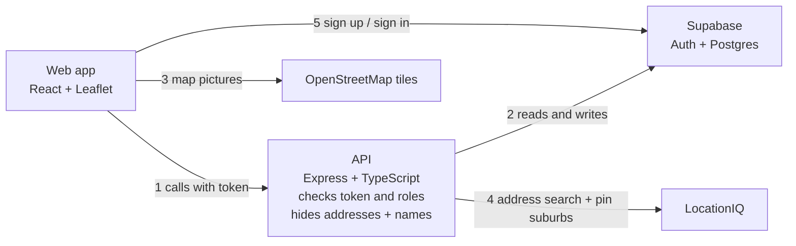

# Mr Rogers — Build Plan

Live version (with comments): https://claude.ai/artifact/N6ZVFGSE9W8BSSdEmsnnq8
Wireframes: https://claude.ai/artifact/25cHnCbxeDnWPRAzUySKyN

## Summary

Mr Rogers is a learning project for backend. The backend plan is 28 small steps, and each step teaches one backend idea. Start local, keep the tools boring, and add extras only after the core works.

**The simple approach**

- **One frontend, one API, one Supabase project.** React + TypeScript web app, Node + Express API, Supabase for the Postgres database and sign-in.
- **Run the API locally, use a hosted database.** The API runs on your machine and connects to a free hosted Supabase project for development, so there's no Docker to install. A second Supabase project is created for the live site when you deploy near the end.
- **No map maths in the database.** Store latitude and longitude as plain numbers. Work out distance with a small function in Node.
- **Supabase Auth for sign-in.** Email + password. Supabase stores passwords and handles sessions; your API only checks the user's token.
- **"Local" is a yes/no.** A pin is either "from someone nearby" or "from someone who doesn't live nearby". No distance in metres, so no way to work out where someone lives.
- **Address check = years lived there + admin approval.** Nothing fancier for v1.

**Left out of v1 (add later if you want)**

- Photos
- Email codes and forgot password
- Flood overlay
- Pin clustering
- "Watch a pin" notifications
- Flagging replies (moderators delete them instead)
- Limiting which IP addresses can connect to the live database
- Changing your address. Moving house is part of the plan. A user can submit a new address, and it goes through the same check as the first one: years lived there plus admin approval. Until an admin approves it, the old address stays in use, so "local" pins don't change and nobody can use a move to dodge the check.

## Build plan (backend only)

28 steps in 7 phases, all on the API and database. Each phase ends with something new the API can do. Each step is one PR. The web app is built alongside; its free tools are listed under Tools.

**How each step is written**

- **What it does:** what the API can do after this step, in plain words.
- **How:** the main jobs to get it working, one per line.
- **You'll learn:** the backend idea behind it.
- **Done when:** how to check it works.

**Rules for every step**

- Each step adds something the API couldn't do before, and you check it with real data.
- If a feature needs a new field or count (like `votes` or `replyCount`), the same step adds it. No field is added before the step that fills it in.
- Earlier steps must keep working. Claude checks this in `/review-this`, so it isn't part of the step.

**Tips**

- Call every new endpoint from a REST client (Bruno, Postman or Thunder Client) before the web app uses it.
- Write an automated test only when a rule matters, like who can do what or who can see what.
- If a step feels too big, split it. Don't add new tools.

**Example requests**

Each phase ends with example requests and responses to aim for in Postman. They assume the API runs at `http://localhost:3000`. Paths and field names are suggestions; change them if you like, but keep the shape and the status codes.

### Phase 1 — The API can save and return pins

By the end, the API stores pins in a real database.

1. **Check the API is running** ✅ Done 25/10/2026
   - What it does: the API answers "I'm OK" when you ask it.
   - How: set up a Node + Express + TypeScript project; add a health endpoint; run it on your machine.
   - You'll learn: what a server and a route are.
   - Done when: calling the health endpoint returns OK.
2. **Create and read pins (no database yet)** ✅ Done 25/10/2026
   - What it does: the API can add a pin, list all pins and return one pin.
   - How: keep pins in a list in memory; add endpoints to create, list and get one; check new pins with zod (type is required, description isn't empty or too long, location has a lat and lng).
   - Naming: one path per resource, and the HTTP method says what to do. `POST /pins` adds a pin, `GET /pins` lists them, `GET /pins/:id` gets one. Avoid `/pin` or `/pins/all`: `/pins/all` would clash with `/pins/:id`, because Express would read "all" as a pin id.
   - You'll learn: REST endpoints, status codes (200, 201, 400, 404), checking input.
   - Done when: a bad pin gets a 400 with a clear message, and a missing pin gets a 404.
3. **Store pins in a database** 🟡 Provisionally done 28/10/2026
   - Verified: migrations rebuild the table, the seed works, and `POST /pins`, `GET /pins` and `GET /pins/:id` work against the database; an id that isn't a UUID, or a UUID no pin has, returns 404. Still to check: the rest of the [build checklist](plans/phase-1-step-3-store-pins-in-a-database.md#build-checklist), especially the API restart cases.
   - What it does: pins are still there after the API restarts.
   - How: connect the API to your development Supabase project; set up Drizzle; create a pins table (location, type, description, created date); write a seed script with sample Brisbane pins; switch the endpoints from the in-memory list to the database.
   - You'll learn: tables, migrations, seed data, environment variables.
   - Done when: you restart the API and the pins are still there.

Full endpoint list, error codes, models and every Postman example for step 2: [plans/phase-1-step-2-create-and-read-pins.md](plans/phase-1-step-2-create-and-read-pins.md).

What to build and every Postman case for step 3: [plans/phase-1-step-3-store-pins-in-a-database.md](plans/phase-1-step-3-store-pins-in-a-database.md).

**Try it in Postman (Phase 1)**

```http
# Step 1 — Check the API is running
GET /health

→ 200 OK
{ "status": "ok" }
```

```http
# Step 2 — Create a pin
POST /pins
Content-Type: application/json

{
  "type": "drainage",
  "description": "Kerb near the drain fills fast in heavy rain",
  "coords": { "lat": -27.5098, "lng": 153.0331 }
}

→ 201 Created
{
  "id": "8f1c2a90-4b7e-4d2a-9c11-3e5f6a7b8c9d",
  "type": "drainage",
  "description": "Kerb near the drain fills fast in heavy rain",
  "coords": { "lat": -27.5098, "lng": 153.0331 },
  "createdAt": "2026-10-24T09:30:00.000Z"
}
```

```http
# Step 2 — Bad pin (empty description)
POST /pins
Content-Type: application/json

{ "type": "drainage", "description": "", "coords": { "lat": -27.5098, "lng": 153.0331 } }

→ 400 Bad Request
{
  "error": "Invalid pin",
  "details": [
    { "field": "description", "message": "Description is required" }
  ]
}
```

```http
# Step 2 — Pin that doesn't exist
GET /pins/does-not-exist

→ 404 Not Found
{ "error": "Pin not found" }
```

Step 3 uses the same requests. The test: create a pin, restart the API, and it still comes back.

### Phase 2 — The API serves the map

By the end, anyone can fetch pins for the map without signing in, by map area, suburb or postcode.

4. **Map data endpoint** 🟡 Provisionally done 28/10/2026
   - Verified in Postman: `GET /pins` returns only `id`, `type` and `coords` (including an empty list and a newly created pin); `POST /pins` and `GET /pins/:id` still return the full pin; `CORS_ORIGIN` is required; allowed addresses get `Access-Control-Allow-Origin` and `Vary: Origin` on every response, including created pins, 400s, 404s and 500s; other addresses get no permission. Still to check: the [real browser cases](plans/phase-2-step-4-map-data-endpoint.md#in-a-real-browser) (this step's "done when"). The step 2 and 3 regression run happens in `/review-this`.
   - What it does: the "list pins" endpoint returns only what a map needs, and a web app on a different address can call it.
   - How: return each pin's id, location and type as JSON; turn on CORS for the web app's address.
   - You'll learn: shaping a response for its user; CORS and why browsers block calls to other sites.
   - Done when: a page on another address (or the web app) can fetch the pins without a CORS error.
5. **Pins in an area, filtered by type**
   - What it does: the API only returns pins inside the area the map is showing, and can filter by type.
   - How:
     - Accept the map's four edges and an optional type as query parameters on `GET /pins`.
     - Return only the pins inside the edges, and of that type if one is given.
     - Return `400` for a bad search, like a missing edge or an unknown type.
     - Add a database index on location.
   - You'll learn: query parameters, filtering with WHERE, why indexes make lookups fast.
   - Done when: a small area returns only its pins, and the type filter works.
6. **Pins by suburb or postcode**
   - What it does: users can find pins by suburb (like "Annerley") or postcode (like "4103"). Each pin shows its suburb and postcode.
   - How, looking up the suburb:
     - Add suburb and postcode columns to the pins table.
     - When a pin is created, your API (not the web app) sends the pin's lat and lng to LocationIQ's reverse geocoding endpoint (`GET https://us1.locationiq.com/v1/reverse?key=<your key>&lat=<lat>&lon=<lng>&format=json&normalizeaddress=1`). The web app never calls LocationIQ for this, so the key stays on the server. `normalizeaddress=1` makes LocationIQ use the same address field names every time.
     - LocationIQ sends back the address at that spot. Save its `address.suburb` as the suburb and `address.postcode` as the postcode. If either is missing, save `null` for it.
     - Keep the LocationIQ key in an environment variable. The API refuses to start without it, like `CORS_ORIGIN` in step 4.
     - For the seed pins, you send the same request yourself once for each pin (in Postman or the browser), and copy the suburb and postcode into the seed data.
   - How, when LocationIQ fails:
     - The pin always saves, whatever LocationIQ does. A failed lookup never stops someone posting.
     - Wait at most 3 seconds for LocationIQ to answer.
     - Save a lookup status on each pin (not returned in any response):
       - `done`: LocationIQ answered with an address.
       - `no-address`: LocationIQ answered `404` "Unable to geocode", for example a pin out in Moreton Bay. Never try again.
       - `failed`: LocationIQ didn't answer in time, answered `429` (too many requests), or answered with a `5xx` error. Try again later.
     - Also save how many tries each pin has had.
     - If LocationIQ answers `401` or `403` (key wrong, turned off or restricted) or `400` (the request is malformed), save the pin as `failed` and log an error. These mean your setup is broken, so you need to notice and fix it.
   - How, retrying automatically:
     - Retry straight away: if the first try fails, wait 1 second and try once more before saving the pin.
     - Retry later: every 10 minutes, the API looks up to 10 `failed` pins again, one a second, so it stays under LocationIQ's limit of 2 a second.
     - If the 10-minute run gets a `429` (too many requests), it stops and waits for the next run. It doesn't carry on through the other pins and hit the limit again.
     - Give up on a pin after 5 tries in total. It keeps `null` for suburb and postcode, and the API logs it.
     - A `429` doesn't count towards the 5 tries, because LocationIQ never looked at the pin.
     - Nobody has to run anything by hand.
   - Full details of every LocationIQ call, error and limit: [locationiq.md](locationiq.md).
   - How, searching:
     - Accept `suburb` or `postcode` on `GET /pins`. Match suburbs whether they're typed in capitals or not.
     - Return `suburb` and `postcode` in the full pin.
   - Why save it on the pin: looking it up once, when the pin is made, means searches only read your own database. They don't use up LocationIQ's free limit, and they still work if LocationIQ is down.
   - You'll learn: calling another service from your server, keeping its key secret, and retrying when it fails.
   - Done when:
     - A new pin comes back with its suburb and postcode.
     - Searching by suburb or postcode returns only the pins in it.
     - A pin made while LocationIQ can't be reached (for example, with its address set to one that doesn't answer) still saves, with `null` for suburb and postcode. Within 10 minutes of LocationIQ working again, the pin has its suburb and postcode.
     - A pin out in Moreton Bay saves with `null` and is never looked up again.

Task list and every Postman case for step 4: [plans/phase-2-step-4-map-data-endpoint.md](plans/phase-2-step-4-map-data-endpoint.md).

Task list and every Postman case for step 5: [plans/phase-2-step-5-pins-in-an-area.md](plans/phase-2-step-5-pins-in-an-area.md).

**Try it in Postman (Phase 2)**

```http
# Step 4 — Map data (only what the map needs)
GET /pins
Origin: http://localhost:5173

→ 200 OK
Access-Control-Allow-Origin: http://localhost:5173
[
  { "id": "8f1c2a90-...", "type": "drainage", "coords": { "lat": -27.5098, "lng": 153.0331 } },
  { "id": "2b7d4e11-...", "type": "flooding", "coords": { "lat": -27.5121, "lng": 153.0298 } }
]
```

```http
# Step 5 — Pins in the map area, drainage only
GET /pins?north=-27.49&south=-27.53&east=153.05&west=153.01&type=drainage

→ 200 OK
[
  { "id": "00000000-0000-4000-8000-000000000001", "type": "drainage", "coords": { "lat": -27.5098, "lng": 153.0331 } }
]
```

```http
# Step 6 — The call your API makes to LocationIQ when a pin is created
# (send it yourself in Postman to see what comes back)
GET https://us1.locationiq.com/v1/reverse?key={{locationIqKey}}&lat=-27.5085&lon=153.023&format=json&normalizeaddress=1

→ 200 OK
{
  "lat": "-27.5085",
  "lon": "153.023",
  "display_name": "Ipswich Road, Annerley, Brisbane City, Queensland, 4103, Australia",
  "address": {
    "road": "Ipswich Road",
    "suburb": "Annerley",
    "city": "Brisbane City",
    "state": "Queensland",
    "postcode": "4103",
    "country": "Australia",
    "country_code": "au"
  }
}
```

The API only keeps `address.suburb` and `address.postcode`. LocationIQ sends more fields than shown here; ignore them. The exact road and suburb names depend on what LocationIQ returns for that spot.

```http
# Step 6 — A new pin comes back with its suburb and postcode
POST /pins
Content-Type: application/json

{ "type": "flooding", "description": "Water across the footpath after an hour of rain", "coords": { "lat": -27.5085, "lng": 153.023 } }

→ 201 Created
{
  "id": "4c2e8a17-6b3d-4f9a-8e21-7d5c0b9a3f64",
  "type": "flooding",
  "description": "Water across the footpath after an hour of rain",
  "coords": { "lat": -27.5085, "lng": 153.023 },
  "createdAt": "2026-10-29T08:15:00.000Z",
  "suburb": "Annerley",
  "postcode": "4103"
}

# Same request while LocationIQ is down: the pin still saves
→ 201 Created
{
  "id": "6e9a0d3c-2f7b-4a1e-9c58-b0d4e7f2a813",
  "type": "flooding",
  "description": "Water across the footpath after an hour of rain",
  "coords": { "lat": -27.5085, "lng": 153.023 },
  "createdAt": "2026-10-29T08:20:00.000Z",
  "suburb": null,
  "postcode": null
}
```

```http
# Step 6 — Pins in a suburb (capitals don't matter)
GET /pins?suburb=annerley

→ 200 OK
[
  { "id": "00000000-0000-4000-8000-000000000001", "type": "drainage", "coords": { "lat": -27.5098, "lng": 153.0331 } },
  { "id": "00000000-0000-4000-8000-000000000002", "type": "flooding", "coords": { "lat": -27.5085, "lng": 153.023 } }
]

# Pins in a postcode, flooding only
GET /pins?postcode=4103&type=flooding

→ 200 OK
[
  { "id": "00000000-0000-4000-8000-000000000002", "type": "flooding", "coords": { "lat": -27.5085, "lng": 153.023 } }
]

# Postcode that isn't 4 digits
GET /pins?postcode=41

→ 400 Bad Request
{
  "error": "Invalid search",
  "details": [{ "field": "postcode", "message": "Postcode must be 4 digits" }]
}
```

### Phase 3 — The API knows who's calling

By the end, reading stays public, but only signed-in users with a profile can post.

7. **Sign in and check the token**
   - What it does: the API can tell which user sent a request.
   - How:
     - In your development Supabase project, turn on email sign-in.
     - Turn off "Confirm email", so test users don't need real email addresses.
     - Create a test user, and sign it in through Supabase to get an access token.
     - Add middleware that reads the token from the request and asks Supabase if it's valid.
     - Add a "who am I" endpoint, `GET /me`.
   - You'll learn: what an auth provider does for you, what an access token (JWT) is, middleware, 401 (not signed in).
   - Done when: `GET /me` returns your test user with a token, and a 401 without one.
8. **Create a profile**
   - What it does: a signed-in user can create a profile with a display name (public) and a real name (private).
   - How:
     - Create a profiles table, linked to the Supabase user id.
     - Add `POST /me/profile`.
     - Refuse a second profile for the same user.
     - Refuse a display name that starts with a number and a word, like "12 Smith St", so nobody posts their address as their name.
     - Return `displayName` from `GET /me` (`null` until the profile exists).
   - You'll learn: linking your own table to users stored somewhere else; making sure each user has only one profile.
   - Done when: `GET /me` shows the new display name, and creating a second profile is refused.
9. **Change your display name**
   - What it does: users can change their display name.
   - How:
     - Add `PATCH /me/profile`.
     - Use the same display name rules as step 8.
   - You'll learn: updating part of a record (PATCH vs PUT).
   - Done when: `GET /me` shows the new name.
10. **Only signed-in users can post**
    - What it does: creating a pin needs a valid token and a profile, and each pin shows who posted it.
    - How:
      - Put the token check on `POST /pins`.
      - Refuse users who have no profile yet.
      - Save the poster's user id on the pin.
      - Return `userDetails` with the poster's display name in the full pin. Seed pins have no poster, so theirs is `null`.
    - You'll learn: foreign keys (one table pointing to another).
    - Done when: a pin created with a token shows your display name, and creating a pin without a token returns 401.

**Try it in Postman (Phase 3)**

```http
# Step 7 — Get a test token from your development Supabase project (not your API)
POST https://your-project-ref.supabase.co/auth/v1/token?grant_type=password
apikey: <your project's anon key>
Content-Type: application/json

{ "email": "test@example.com", "password": "a-long-test-password" }

→ 200 OK
{
  "access_token": "<a long string starting with eyJ>",
  "token_type": "bearer",
  "expires_in": 3600,
  "user": { "id": "5b0e7c2a-91d4-4f3e-8a6b-2c7d9e1f4a30", "email": "test@example.com" }
}
```

Save `access_token` as a Postman variable and send it as `Authorization: Bearer {{token}}` from now on.

```http
# Step 7 — Who am I
GET /me
Authorization: Bearer {{token}}

→ 200 OK
{ "id": "5b0e7c2a-91d4-4f3e-8a6b-2c7d9e1f4a30", "email": "test@example.com" }

# Same request with no token
→ 401 Unauthorized
{ "error": "Not signed in" }
```

```http
# Step 8 — Create a profile
POST /me/profile
Authorization: Bearer {{token}}
Content-Type: application/json

{ "displayName": "StormWatcher", "realName": "Test Person" }

→ 201 Created
{ "displayName": "StormWatcher" }

# Second time for the same user
→ 409 Conflict
{ "error": "Profile already exists" }

# Display name like "12 Smith St"
→ 400 Bad Request
{
  "error": "Invalid profile",
  "details": [{ "field": "displayName", "message": "Display name can't look like an address" }]
}
```

```http
# Step 8 — Who am I, now with a display name
GET /me
Authorization: Bearer {{token}}

→ 200 OK
{ "id": "5b0e7c2a-91d4-4f3e-8a6b-2c7d9e1f4a30", "email": "test@example.com", "displayName": "StormWatcher" }
```

```http
# Step 9 — Change display name
PATCH /me/profile
Authorization: Bearer {{token}}
Content-Type: application/json

{ "displayName": "DrainWatcher" }

→ 200 OK
{ "displayName": "DrainWatcher" }
```

```http
# Step 10 — Create a pin while signed in
POST /pins
Authorization: Bearer {{token}}
Content-Type: application/json

{ "type": "drainage", "description": "Drain grate blocked with leaves again", "coords": { "lat": -27.5101, "lng": 153.0335 } }

→ 201 Created
{
  "id": "9d3f1b62-0a7e-4c58-b4d9-3e6a2f8c1b07",
  "type": "drainage",
  "description": "Drain grate blocked with leaves again",
  "coords": { "lat": -27.5101, "lng": 153.0335 },
  "createdAt": "2026-10-30T07:45:00.000Z",
  "suburb": "Annerley",
  "postcode": "4103",
  "userDetails": { "displayName": "DrainWatcher" }
}

# No token
→ 401 Unauthorized
{ "error": "Not signed in" }

# Signed in, but no profile yet
→ 403 Forbidden
{ "error": "Create a profile before posting" }
```

### Phase 4 — The API knows if a poster lives nearby

By the end, pins from people who live within 1 km show straight away, and the rest wait for approval.

11. **Address search**
    - What it does: the API suggests Australian addresses as the user types.
    - How:
      - Add `GET /address/search?q=`, for signed-in users only.
      - Your API passes the search to LocationIQ Autocomplete, limited to Australia. The web app calls your API, never LocationIQ directly, so the key stays on the server.
      - `q` must be 3 to 200 characters. A missing, shorter or longer `q` gets a `400`.
      - Return each suggestion's label, lat and lng.
      - When LocationIQ fails:
        - No matches (LocationIQ answers `404` "Unable to geocode"): return `200 []`, not an error.
        - No answer within 3 seconds, `429` (too many requests) or a `5xx` error: return `503`, so the web app can say "try again".
        - `401` or `403` (key wrong, turned off or restricted) or `400` (the request is malformed): return the generic `500` and log an error. It's your setup that's broken, not LocationIQ.
      - No retries here. The user is waiting, and their next keystroke sends a new search anyway.
      - The web app waits until the user has stopped typing for about half a second before it searches. This keeps everyone's searches together under LocationIQ's limit of 60 a minute.
      - Full details of every LocationIQ call, error and limit: [locationiq.md](locationiq.md).
    - You'll learn: wrapping another service in your own endpoint, and handling it failing.
    - Done when: typing part of a real Brisbane address returns suggestions with locations.
12. **Save your home address**
    - What it does: users save their home address and how long they've lived there. Nobody else ever sees the address. Their pins show how long they've lived nearby.
    - How:
      - Add `PUT /me/home` with the chosen address (label, lat, lng) and years lived there.
      - Save them on the profile.
      - Return `yearsAtAddress` in each pin's `userDetails`.
      - Write one automated test that checks no response ever includes an address or a real name.
    - You'll learn: choosing what data leaves the API.
    - Done when: your pins show your years at the address, and the test passes.
13. **Decide if a pin is local**
    - What it does: each new pin is marked "local" if the poster lives within 1 km of it. Pins that aren't local wait for an admin.
    - How:
      - Refuse to create a pin if the poster has no home address yet.
      - When a pin is created, work out the distance from the poster's home to the pin.
      - Save `status` on the pin: `live` if it's within 1 km, `pending` if not.
      - Return `status` and `userDetails.livesNearby` in the full pin. The web app uses them to say "a moderator will review it".
      - Leave pending pins out of `GET /pins`, and return 404 for them from `GET /pins/:id`.
    - You'll learn: why business rules belong on the server, not in the browser.
    - Done when: a pin far from home comes back `pending` and doesn't appear in the map data, and a pin near home comes back `live`.

**Try it in Postman (Phase 4)**

```http
# Step 11 — Address suggestions while typing
GET /address/search?q=12 Exa
Authorization: Bearer {{token}}

→ 200 OK
[
  { "label": "12 Example Street, Annerley QLD 4103", "lat": -27.5101, "lng": 153.0335 },
  { "label": "12 Example Avenue, Moorooka QLD 4105", "lat": -27.5352, "lng": 153.0241 }
]

# q shorter than 3 characters
→ 400 Bad Request
{
  "error": "Invalid search",
  "details": [{ "field": "q", "message": "Type at least 3 characters" }]
}

# No address matches (LocationIQ answered 404)
→ 200 OK
[]

# LocationIQ slow, down or at its limit
→ 503 Service Unavailable
{ "error": "Address search is busy. Try again in a minute." }
```

```http
# Step 12 — Save home address
PUT /me/home
Authorization: Bearer {{token}}
Content-Type: application/json

{ "label": "12 Example Street, Annerley QLD 4103", "lat": -27.5101, "lng": 153.0335, "yearsAtAddress": "more-than-10" }

→ 200 OK
{ "saved": true }
```

No response anywhere in the API should ever include the home's `label`, `lat` or `lng`, or `realName`.

```http
# Step 12 — Your pin now shows how long you've lived there
GET /pins/9d3f1b62-0a7e-4c58-b4d9-3e6a2f8c1b07

→ 200 OK
{
  "id": "9d3f1b62-0a7e-4c58-b4d9-3e6a2f8c1b07",
  "type": "drainage",
  "description": "Drain grate blocked with leaves again",
  "coords": { "lat": -27.5101, "lng": 153.0335 },
  "createdAt": "2026-10-30T07:45:00.000Z",
  "suburb": "Annerley",
  "postcode": "4103",
  "userDetails": { "displayName": "DrainWatcher", "yearsAtAddress": "more-than-10" }
}
```

```http
# Step 13 — Post a pin far from home
POST /pins
Authorization: Bearer {{token}}
Content-Type: application/json

{ "type": "flooding", "description": "Underpass ankle deep on Sunday", "coords": { "lat": -27.6012, "lng": 153.102 } }

→ 201 Created
{
  "id": "c3d4e5f6-a7b8-4c9d-8e0f-1a2b3c4d5e6f",
  "type": "flooding",
  "description": "Underpass ankle deep on Sunday",
  "coords": { "lat": -27.6012, "lng": 153.102 },
  "createdAt": "2026-10-31T06:00:00.000Z",
  "suburb": "Springwood",
  "postcode": "4127",
  "status": "pending",
  "userDetails": { "displayName": "DrainWatcher", "yearsAtAddress": "more-than-10", "livesNearby": false }
}

# A pin within 1 km of home comes back with
"status": "live"
"userDetails": { "displayName": "DrainWatcher", "yearsAtAddress": "more-than-10", "livesNearby": true }

# No home address saved yet
→ 403 Forbidden
{ "error": "Add your home address before posting" }
```

### Phase 5 — The API handles conversation

By the end, users can reply, vote, save pins, see their own pins and delete them.

14. **Add a reply**
    - What it does: signed-in users can reply to a pin, and each pin shows how many replies it has.
    - How:
      - Create a replies table, linked to pins and users.
      - Add `POST /pins/:id/replies`. Replying needs a profile and a home address, the same as posting.
      - Text is 1 to 500 characters.
      - Work out if the replier lives within 1 km of the pin, and save it on the reply.
      - Return `replyCount` in the full pin.
    - You'll learn: one-to-many relationships.
    - Done when: adding a reply makes the pin's `replyCount` go up by one.
15. **Read replies**
    - What it does: anyone can read the replies on a pin.
    - How:
      - Add `GET /pins/:id/replies`, oldest first.
      - Return each reply with the replier's display name and whether they live nearby.
    - You'll learn: joining tables.
    - Done when: a reply you added comes back in the list, with your display name.
16. **Votes**
    - What it does: signed-in users can vote a pin up or down, once each, and each pin shows its total.
    - How:
      - Create a votes table with one row per user per pin.
      - Add `PUT /pins/:id/vote` with `1` (up), `-1` (down) or `0` (remove the vote).
      - Voting again changes your vote.
      - Refuse votes on your own pin.
      - Return `votes` (the total) in the full pin.
    - You'll learn: unique rules in the database, update-or-insert, adding up in SQL.
    - Done when: voting twice changes your vote instead of adding a second one.
17. **Saved pins**
    - What it does: signed-in users can save pins, unsave them, and see the list of pins they've saved.
    - How:
      - Create a saved pins table with one row per user per pin.
      - Add `PUT /pins/:id/save` and `DELETE /pins/:id/save`.
      - Add `GET /me/saved`, returning each saved pin's id, type and location.
    - You'll learn: many-to-many relationships.
    - Done when: a saved pin appears in `GET /me/saved`, saving it twice still lists it once, and unsaving removes it.
18. **My pins**
    - What it does: users can see every pin they've posted, including ones waiting for approval.
    - How:
      - Add `GET /me/pins`, newest first.
      - Return each pin's id, type, description, location and status.
    - Done when: the list shows your pins, including pending ones, and nobody else's.
19. **Delete your own pin**
    - What it does: users can delete pins they posted.
    - How:
      - Add `DELETE /pins/:id`.
      - Only the poster can delete it.
      - Mark the pin as deleted instead of removing the row.
      - Leave deleted pins out of the map, `GET /pins/:id` and `GET /me/pins`.
      - In `GET /me/saved`, show a deleted pin with status `inactive` and no location. Other saved pins show `active`.
    - You'll learn: soft delete; 401 (not signed in) vs 403 (not allowed).
    - Done when: your deleted pin is gone from the map, and deleting someone else's pin returns 403.

**Try it in Postman (Phase 5)**

```http
# Step 14 — Add a reply
POST /pins/00000000-0000-4000-8000-000000000001/replies
Authorization: Bearer {{token}}
Content-Type: application/json

{ "text": "Council cleared it in March but it's back." }

→ 201 Created
{
  "id": "7a1b2c3d-4e5f-4a6b-8c7d-9e0f1a2b3c4d",
  "text": "Council cleared it in March but it's back.",
  "createdAt": "2026-11-01T10:00:00.000Z",
  "userDetails": { "displayName": "DrainWatcher", "livesNearby": true }
}

# The pin now counts it
GET /pins/00000000-0000-4000-8000-000000000001

→ 200 OK
{
  "id": "00000000-0000-4000-8000-000000000001",
  "type": "drainage",
  "description": "Kerb near the drain fills fast in heavy rain",
  "coords": { "lat": -27.5098, "lng": 153.0331 },
  "createdAt": "2026-10-21T09:30:00.000Z",
  "suburb": "Annerley",
  "postcode": "4103",
  "status": "live",
  "userDetails": null,
  "replyCount": 1
}
```

```http
# Step 15 — Read replies (no token needed)
GET /pins/00000000-0000-4000-8000-000000000001/replies

→ 200 OK
[
  {
    "id": "7a1b2c3d-4e5f-4a6b-8c7d-9e0f1a2b3c4d",
    "text": "Council cleared it in March but it's back.",
    "createdAt": "2026-11-01T10:00:00.000Z",
    "userDetails": { "displayName": "DrainWatcher", "livesNearby": true }
  }
]
```

```http
# Step 16 — Vote (1 = up, -1 = down, 0 = remove vote)
PUT /pins/00000000-0000-4000-8000-000000000001/vote
Authorization: Bearer {{token}}
Content-Type: application/json

{ "value": 1 }

→ 200 OK
{ "votes": 1, "myVote": 1 }

# Same user votes -1: the vote changes, it isn't added
→ 200 OK
{ "votes": -1, "myVote": -1 }

# Voting on your own pin
→ 403 Forbidden
{ "error": "You can't vote on your own pin" }
```

```http
# Step 17 — Save, list, unsave
PUT /pins/00000000-0000-4000-8000-000000000002/save
Authorization: Bearer {{token}}

→ 200 OK
{ "saved": true }

GET /me/saved
Authorization: Bearer {{token}}

→ 200 OK
[
  { "id": "00000000-0000-4000-8000-000000000002", "type": "flooding", "coords": { "lat": -27.5085, "lng": 153.023 } }
]

DELETE /pins/00000000-0000-4000-8000-000000000002/save
Authorization: Bearer {{token}}

→ 200 OK
{ "saved": false }
```

```http
# Step 18 — My pins (includes pending ones)
GET /me/pins
Authorization: Bearer {{token}}

→ 200 OK
[
  {
    "id": "c3d4e5f6-a7b8-4c9d-8e0f-1a2b3c4d5e6f",
    "type": "flooding",
    "description": "Underpass ankle deep on Sunday",
    "coords": { "lat": -27.6012, "lng": 153.102 },
    "status": "pending"
  },
  {
    "id": "9d3f1b62-0a7e-4c58-b4d9-3e6a2f8c1b07",
    "type": "drainage",
    "description": "Drain grate blocked with leaves again",
    "coords": { "lat": -27.5101, "lng": 153.0335 },
    "status": "live"
  }
]
```

```http
# Step 19 — Delete your own pin
DELETE /pins/9d3f1b62-0a7e-4c58-b4d9-3e6a2f8c1b07
Authorization: Bearer {{token}}

→ 204 No Content

# Someone else's pin
→ 403 Forbidden
{ "error": "You can only delete your own pins" }

# Another user who had saved it now sees
GET /me/saved
Authorization: Bearer {{otherUserToken}}

→ 200 OK
[
  { "id": "9d3f1b62-0a7e-4c58-b4d9-3e6a2f8c1b07", "type": "drainage", "coords": null, "status": "inactive" }
]
```

### Phase 6 — Admins and moderators

By the end, new accounts and non-local pins need approval, and moderators can remove bad replies and names.

20. **Roles and account approval**
    - What it does: every account is a member, moderator or admin. New accounts start as pending: they can read everything, but can't post, reply, vote or save until an admin approves them.
    - How:
      - Add role and status to profiles. Existing profiles become active members; new ones start pending.
      - Add middleware that checks role and status.
      - Return 403 for pending and flagged users on posting, replying, voting and saving.
      - Return `role` and `status` from `GET /me`.
      - Make your test user an admin by changing its role in the Supabase table editor.
    - You'll learn: the difference between "who are you" (authentication) and "what can you do" (authorisation).
    - Done when: a new user can read pins but gets 403 when posting.
21. **Admins approve accounts**
    - What it does: admins see the accounts waiting for approval, and approve or flag each one.
    - How:
      - Add `GET /admin/accounts`, listing pending accounts with display name and years at address.
      - Add `POST /admin/accounts/:userId/approve` and `POST /admin/accounts/:userId/flag`.
      - Admins only. Everyone else gets 403.
    - Done when: an approved account can post, and a member gets 403 on these endpoints.
22. **Admins approve non-local pins**
    - What it does: admins see the pins waiting for approval, and approve or reject each one.
    - How:
      - Add `GET /admin/pins`, listing pending pins.
      - Add `POST /admin/pins/:id/approve` (status becomes `live`) and `POST /admin/pins/:id/reject` (status becomes `rejected`).
      - Admins only.
    - Done when: an approved pin appears in the map data, still showing `livesNearby: false`, and a rejected pin shows as `rejected` in its poster's `GET /me/pins`.
23. **Moderators delete replies**
    - What it does: moderators and admins can delete any reply.
    - How:
      - Add `DELETE /replies/:id`, for moderators and admins only.
      - The pin's `replyCount` goes down.
    - Done when: a deleted reply is gone from the list, and a member gets 403.
24. **Moderators reset display names**
    - What it does: moderators and admins can replace an unsuitable display name.
    - How:
      - Add `PATCH /admin/users/:userId/display-name`, for moderators and admins only.
      - Use the same display name rules as step 8.
    - Done when: the user's pins and replies show the new name, and a member gets 403.

**Try it in Postman (Phase 6)**

```http
# Step 20 — A pending user tries to post
POST /pins
Authorization: Bearer {{pendingUserToken}}
Content-Type: application/json

{ "type": "drainage", "description": "Gutter overflowing outside number 40", "coords": { "lat": -27.5098, "lng": 153.0331 } }

→ 403 Forbidden
{ "error": "Your account is waiting for approval" }
```

```http
# Step 20 — Who am I, now with role and status
GET /me
Authorization: Bearer {{pendingUserToken}}

→ 200 OK
{
  "id": "e2a9c4b1-7f3d-4c8e-9b2a-6d1f0e8c5a47",
  "email": "new@example.com",
  "displayName": "Gutterguy",
  "role": "member",
  "status": "pending"
}
```

```http
# Step 21 — Accounts waiting for an admin
GET /admin/accounts
Authorization: Bearer {{adminToken}}

→ 200 OK
[
  { "userId": "e2a9c4b1-7f3d-4c8e-9b2a-6d1f0e8c5a47", "displayName": "Gutterguy", "yearsAtAddress": "3-10" }
]

POST /admin/accounts/e2a9c4b1-7f3d-4c8e-9b2a-6d1f0e8c5a47/approve
Authorization: Bearer {{adminToken}}

→ 200 OK
{ "status": "active" }

# Any admin endpoint with a member's token
→ 403 Forbidden
{ "error": "You don't have permission to do that" }
```

```http
# Step 22 — Approve a non-local pin
GET /admin/pins
Authorization: Bearer {{adminToken}}

→ 200 OK
[
  {
    "id": "c3d4e5f6-a7b8-4c9d-8e0f-1a2b3c4d5e6f",
    "type": "flooding",
    "description": "Underpass ankle deep on Sunday",
    "coords": { "lat": -27.6012, "lng": 153.102 },
    "status": "pending"
  }
]

POST /admin/pins/c3d4e5f6-a7b8-4c9d-8e0f-1a2b3c4d5e6f/approve
Authorization: Bearer {{adminToken}}

→ 200 OK
{ "status": "live" }
```

```http
# Step 23 — Delete a reply
DELETE /replies/7a1b2c3d-4e5f-4a6b-8c7d-9e0f1a2b3c4d
Authorization: Bearer {{moderatorToken}}

→ 204 No Content
```

```http
# Step 24 — Reset a display name
PATCH /admin/users/e2a9c4b1-7f3d-4c8e-9b2a-6d1f0e8c5a47/display-name
Authorization: Bearer {{moderatorToken}}
Content-Type: application/json

{ "displayName": "Member 1043" }

→ 200 OK
{ "displayName": "Member 1043" }
```

### Phase 7 — The API is live

By the end, the API runs online, is protected from spam, and stays running.

25. **Put the API online**
    - What it does: the API works on a real web address with a real database.
    - How:
      - Create a second free Supabase project for the live site, and run your migrations on it.
      - Connect with SSL and the CA certificate, the same way as your development project (step 3).
      - Deploy the API to Render's free plan, and connect your GitHub repo so it redeploys when you merge.
      - Set the environment variables on Render.
      - Allow the live web app's address in CORS.
    - You'll learn: how running locally and running live are different.
    - Done when: the live API returns pins from the hosted database, and merging a PR redeploys it.
    - Watch out: Render's free plan sleeps after 15 quiet minutes, so the next request takes about a minute.
26. **Security headers**
    - What it does: every response tells browsers to turn on their built-in protections.
    - How: add helmet.
    - You'll learn: what security headers do, and why the API shouldn't say it runs Express.
    - Done when: responses include headers like `X-Content-Type-Options: nosniff`, and no longer include `X-Powered-By`.
27. **Rate limits**
    - What it does: one person can't flood the API with posts or address searches.
    - How:
      - Add express-rate-limit.
      - Limit every endpoint that creates or changes data, and address search, to 30 requests a minute from one address.
    - You'll learn: rate limiting, and status 429.
    - Done when: the 31st post in a minute gets a 429, and reading pins still works.
28. **Keep Supabase awake**
    - What it does: stops the free Supabase project pausing after a quiet week.
    - How:
      - Add `GET /health/db`, which runs a tiny database query.
      - Add a GitHub Actions scheduled job that calls it every 3 days.
    - You'll learn: scheduled jobs (cron) and health checks.
    - Done when: the job runs on schedule and gets an OK back.
    - Watch out: GitHub can turn off scheduled jobs when a repo has no commits for 60 days. Turn it back on in the Actions tab if that happens.

**Try it in Postman (Phase 7)**

```http
# Step 25 — The live API (your Render address will differ)
GET https://mister-rogers-api.onrender.com/pins

→ 200 OK
[
  { "id": "00000000-0000-4000-8000-000000000001", "type": "drainage", "coords": { "lat": -27.5098, "lng": 153.0331 } }
]
```

```http
# Step 26 — Security headers on any response
GET /health

→ 200 OK
X-Content-Type-Options: nosniff
Strict-Transport-Security: max-age=31536000; includeSubDomains
(no X-Powered-By header)
```

```http
# Step 27 — Too many posts in a row
POST /pins   (the 31st time within a minute)
Authorization: Bearer {{token}}

→ 429 Too Many Requests
{ "error": "Too many requests. Try again in a minute." }
```

```http
# Step 28 — Health check that touches the database
GET /health/db

→ 200 OK
{ "status": "ok", "database": "ok" }

# Database not reachable
→ 503 Service Unavailable
{ "status": "error", "database": "unreachable" }
```

### After v1

Pick one at a time: photos, forgot password, flood overlay, watch-a-pin emails, changing address, flagging replies, limiting live database connections to Render's IP addresses.

## Data shapes

What the API sends and receives, matching the example requests above. Field names are suggestions; keep them in step with the Postman examples.

- A shape describes what goes over the wire, not the database table. The table can have more columns (like a home address) than any response.
- Add each field in the step that first fills it in, never earlier.
- Dates are ISO strings (`"2026-10-24T09:30:00.000Z"`), because JSON has no date type.
- Once zod is in (step 2), write the schema first and get the type from it, so the check and the type can't drift apart.

### Shared values

| Name               | Values                                                                                                            | Step |
| ------------------ | ----------------------------------------------------------------------------------------------------------------- | ---- |
| Pin type           | drainage, flooding, wildlife, amenity, children, parking, traffic, recreation, disability, signage, none          | 2    |
| Years at address   | under-3, 3-10, more-than-10                                                                                       | 12   |
| Pin status         | live, pending (step 13), rejected (step 22)                                                                       | 13   |
| Saved pin status   | active, inactive (the poster deleted it)                                                                          | 19   |
| Role               | member, moderator, admin                                                                                          | 20   |
| Account status     | pending, active, flagged                                                                                          | 20   |

### Pins

**Location (`coords`):** `lat` and `lng`, both numbers. `null` only for a deleted pin in a saved list (step 19).

**New pin** (what a user sends, step 2)

| Field         | What it is              |
| ------------- | ----------------------- |
| `type`        | A pin type              |
| `description` | 10 to 500 characters    |
| `coords`      | Where the pin is        |

**Map pin** (one item in `GET /pins`, step 4): `id`, `type`, `coords`.

**Full pin** (`GET /pins/:id` and the `POST /pins` response)

| Field          | What it is                                                                   | Step |
| -------------- | ---------------------------------------------------------------------------- | ---- |
| `id`           | The pin's id                                                                 | 2    |
| `type`         | A pin type                                                                   | 2    |
| `description`  | What the poster wrote                                                        | 2    |
| `coords`       | Where the pin is                                                             | 2    |
| `createdAt`    | When it was posted                                                           | 2    |
| `suburb`       | `address.suburb` from LocationIQ reverse geocoding, or `null` if missing     | 6    |
| `postcode`     | `address.postcode` from LocationIQ reverse geocoding, or `null` if missing   | 6    |
| `userDetails`  | The poster's public details, or `null` for seed pins                         | 10   |
| `status`       | Pin status                                                                   | 13   |
| `replyCount`   | How many replies it has                                                      | 14   |
| `votes`        | Up votes minus down votes                                                    | 16   |

**My pin** (one item in `GET /me/pins`, step 18): `id`, `type`, `description`, `coords`, `status`.

**Saved pin** (one item in `GET /me/saved`): `id`, `type`, `coords` (step 17), and `status` (step 19).

### Users

**Me** (`GET /me`)

| Field         | What it is                              | Step |
| ------------- | --------------------------------------- | ---- |
| `id`          | The Supabase user id                    | 7    |
| `email`       | The user's email                        | 7    |
| `displayName` | `null` until the profile exists         | 8    |
| `role`        | Role                                    | 20   |
| `status`      | Account status                          | 20   |

**New profile** (what a user sends, step 8): `displayName`, `realName`.

**Public user details** (`userDetails`): the only user details anyone else ever sees.

| Field            | What it is                                                   | Step |
| ---------------- | ------------------------------------------------------------ | ---- |
| `displayName`    | The public name                                              | 10   |
| `yearsAtAddress` | Years at address, on pins only                               | 12   |
| `livesNearby`    | Whether they live within 1 km of the pin                     | 13   |

**Full profile:** stays inside the API, and is never sent in a response. It holds the user id, display name, real name, home address (label, lat, lng), years at address, role and status. The step 12 test checks that no response contains `realName` or any part of the home address.

### Replies

The API calls comments "replies", to match `/pins/:id/replies`.

- **New reply** (what a user sends, step 14): `text`, 1 to 500 characters. No pin id: it comes from the URL.
- **Reply** (step 14 and 15): `id`, `text`, `createdAt`, `userDetails` (display name and `livesNearby`).

### Errors

Every error response has the same shape, so the web app can read any of them the same way.

- `error`: a message a person can read, like "Pin not found".
- `details`: only on 400s from bad input. A list of `{ field, message }`, one per broken rule.

| Status | When                               | Example `error`                                 |
| ------ | ---------------------------------- | ----------------------------------------------- |
| 400    | Bad input                          | "Invalid pin" (with `details`)                  |
| 401    | No token, or a bad one             | "Not signed in"                                 |
| 403    | Signed in but not allowed          | "You can only delete your own pins"             |
| 404    | Doesn't exist                      | "Pin not found"                                 |
| 409    | Already exists                     | "Profile already exists"                        |
| 429    | Too many requests                  | "Too many requests. Try again in a minute."     |
| 500    | Something broke in the API         | "Something went wrong"                          |
| 503    | LocationIQ is down or at its limit | "Address search is busy. Try again in a minute." |

Send every error through one Express error handler, so no endpoint builds its own error body and a 500 never leaks a stack trace. The one exception is `/health/db` (step 28), which keeps its own `{ status, database }` shape for the scheduled job.

## Questions for Rachel

Answers needed before Phase 4. Everything else can wait.

- [x] **What counts as "nearby"?** Decided: within 1 km of home counts as nearby.
- [x] **Votes on pins, replies or both?** Decided: votes on pins only.
- [x] **Can pending accounts browse the map?** Decided: they can browse the map, but can't add, reply to, bookmark or vote on pins until approved.

## Edge cases

Handle these in v1. Each one is in the step where it comes up.

| Edge case                                                      | What the API does                                                     | Step   |
| -------------------------------------------------------------- | --------------------------------------------------------------------- | ------ |
| Bad input (missing type, empty description, 10,000 characters) | Returns 400 with a clear message                                      | 2      |
| Pin id that doesn't exist                                      | Returns 404                                                           | 2      |
| Bad map search (missing edge, unknown type)                    | Returns 400 with every broken rule                                    | 5      |
| Suburb lookup fails when a pin is made (slow, down, too many)  | Saves the pin with no suburb; retries once, then every 10 minutes, up to 5 tries | 6 |
| Pin somewhere with no address (out in Moreton Bay)            | Saves the pin with no suburb and never looks it up again              | 6      |
| LocationIQ key missing or wrong                                | Missing: the API won't start. Wrong: logs an error                    | 6, 11  |
| Postcode isn't 4 digits                                        | Returns 400                                                           | 6      |
| Same email signs up twice                                      | Supabase Auth rejects it                                              | 7      |
| Wrong password                                                 | Supabase Auth returns one general error                               | 7      |
| Someone guesses passwords                                      | Supabase Auth limits sign-in tries                                    | 7      |
| Display name looks like an address                             | Rejects it; moderators can reset it later                             | 8, 24  |
| Posting with no profile, or no home address                    | Returns 403 with what to do first                                     | 10, 13 |
| Address search matches nothing                                 | Returns `200 []`                                                      | 11     |
| LocationIQ slow, down or at its limit during address search    | Returns 503 so the web app can say "try again"                        | 11     |
| Address or real name leaks in a response                       | Only public profile fields leave the API; one test checks it          | 12     |
| Poster doesn't live nearby                                     | Saves the pin as pending; it shows `livesNearby: false` once approved | 13, 22 |
| Voting twice                                                   | One vote per user per pin                                             | 16     |
| Deleting a pin that has replies and saves                      | Soft delete; saved copies come back with status "inactive"            | 19     |
| Deleting someone else's pin                                    | Returns 403                                                           | 19     |
| Member calls an admin or moderator endpoint                    | Returns 403                                                           | 21     |
| Supabase project pauses after a quiet week                     | Scheduled ping every 3 days                                           | 28     |

**Leave for later:** several pins at one spot (for now, many pins can share a spot, with one comment per person per pin per location), old pins that are no longer true, people moving house, emergencies (add a "Call 000" line on the About page for now).

## Tools

Everything here is free for a hobby project.

### Backend tools

| Job                | Pick                                     | Why this one                                                                                                                                                     |
| ------------------ | ---------------------------------------- | ---------------------------------------------------------------------------------------------------------------------------------------------------------------- |
| API                | Node + Express + TypeScript              | Most tutorials and answers use it                                                                                                                                |
| Database + sign-in | Supabase free plan (dev + live projects) | Postgres plus ready-made sign-up, sign-in and password storage in one service                                                                                    |
| Database code      | Drizzle                                  | Close to plain SQL, you already know it                                                                                                                          |
| Validation         | zod                                      | Same schemas can be shared with the web app                                                                                                                      |
| Address search     | LocationIQ (free plan)                   | Autocomplete and suburb lookup in one service. 5,000 requests a day, 2 a second. The web app must show a "Search by LocationIQ.com" link. Backup: Photon (free, no key) |
| Testing            | Vitest + Supertest                       | Fast tests that call your endpoints like a real client                                                                                                           |
| Trying endpoints   | Bruno, Postman or Thunder Client         | Free REST clients                                                                                                                                                |
| Security           | helmet + express-rate-limit              | Standard Express add-ons                                                                                                                                         |
| API hosting        | Render (free plan)                       | Free with no card; redeploys from GitHub on merge. Sleeps after 15 minutes idle (about a minute to wake)                                                         |
| Keep-alive         | GitHub Actions scheduled workflow        | Stops the Supabase project pausing (step 28)                                                                                                                     |

### Frontend tools (list only)

- **Framework:** React + TypeScript, built with Vite
- **Routing:** React Router
- **Map:** Leaflet + react-leaflet, with OpenStreetMap tiles (free with attribution)
- **Sign-in:** Supabase JS client (talks to Supabase Auth directly)
- **Calling the API:** TanStack Query
- **Forms:** React Hook Form + zod
- **Testing:** Vitest + React Testing Library
- **Hosting:** Vercel Hobby plan (or Netlify / Cloudflare Pages free plans)

**Watch out:** Supabase's free plan pauses a project after 7 days with no activity. Step 28 keeps it awake.

**Only if you build the "after v1" extras:** photo storage (Supabase Storage), emails (Resend, 100 a day free), flood overlay (Brisbane City Council open data).

Sources: [LocationIQ pricing](https://web.locationiq.com/pricing) · [LocationIQ geocoding and autocomplete](https://LocationIQ.com/geocoding) · [Supabase free plan](https://www.cloudzero.com/blog/supabase-pricing/) · [Map library comparison](https://storerocket.io/learn/mapbox-alternatives) · [Resend free plan](https://www.usecarly.com/blog/resend-pricing/) · [BCC flood data](https://data.gov.au/data/dataset/flood-awareness-extents)

## Architecture

Two parts you build (web app, API), Supabase for the database and sign-in, and two free services you call. Only the API can read addresses and real names.



1. The web app calls the API and sends the user's access token, so the API knows who you are.
2. The API checks the token with Supabase, then reads and writes the database. It decides which fields go back to the browser.
3. Map pictures come straight from OpenStreetMap. No user data goes there.
4. When a user saves their home, the API asks LocationIQ for address suggestions, each with its latitude and longitude. When a pin is made, it asks LocationIQ for the pin's suburb and postcode. Searches never call LocationIQ.
5. The web app signs up and signs in with Supabase Auth directly and gets the access token.
