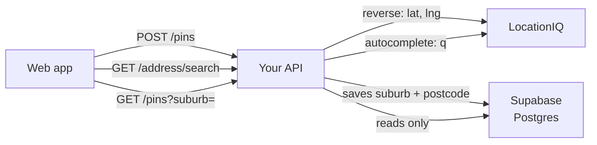
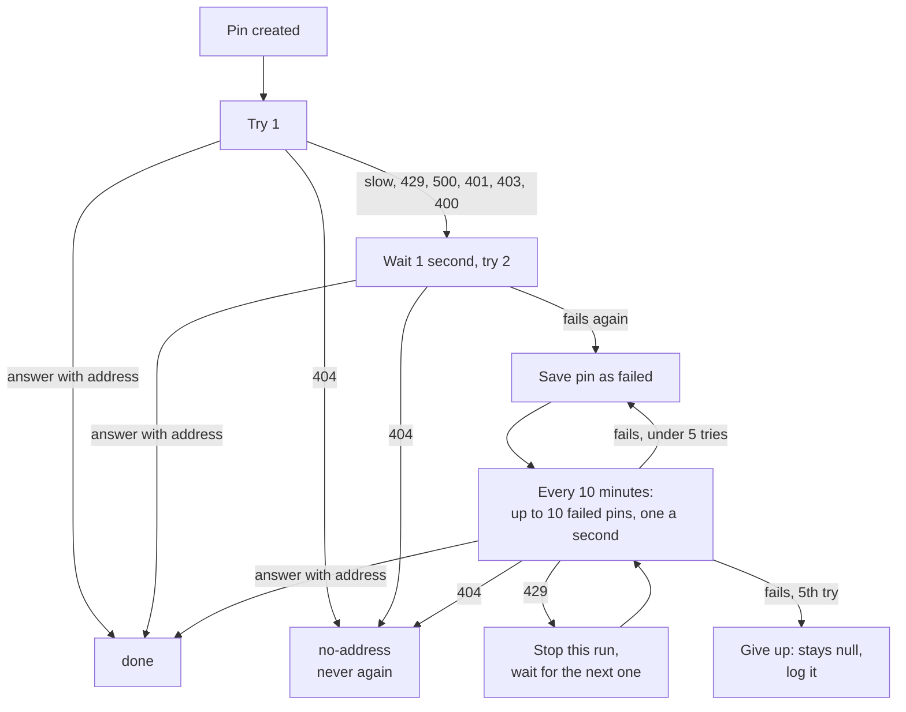

# LocationIQ in Mr Rogers

How the API calls LocationIQ, what it may store, how it handles every error, and how it stays within the free plan. Part of the [build plan](build-plan.md).

- Steps that use it: [step 6](build-plan.md#phase-2--the-api-serves-the-map) (a pin's suburb and postcode) and [step 11](build-plan.md#phase-4--the-api-knows-if-a-poster-lives-nearby) (address search)
- Only your API calls LocationIQ. The web app calls your API, never LocationIQ, so the key never reaches a browser
- Searching pins never calls LocationIQ. It only reads your own database

## The two calls

| Call                                    | Used in | When                           | Who's waiting                         | Retries                              |
| --------------------------------------- | ------- | ------------------------------ | ------------------------------------- | ------------------------------------ |
| Reverse geocoding (location → address)  | Step 6  | Every time a pin is created    | The person posting, for a moment      | Yes: once straight away, then every 10 minutes |
| Autocomplete (typing → addresses)       | Step 11 | While a user types their home  | The person typing                     | No                                   |



## Free plan limits and rules

| Rule                | What it says                                                                                       |
| ------------------- | -------------------------------------------------------------------------------------------------- |
| Requests a day      | 5,000                                                                                              |
| Requests a second   | 2                                                                                                  |
| Requests a minute   | 60                                                                                                 |
| Failed requests     | Not counted against the limits                                                                     |
| Storing results     | Allowed forever ("You can store the output forever")                                               |
| Caching             | At most 48 hours on the free plan. Caching means keeping a request and its answer so you can skip calling LocationIQ next time |
| Commercial use      | Allowed, if the site shows a visible "Search by LocationIQ.com" link to locationiq.com              |

- All three limits are shared by every call that uses your key: step 6, the 10-minute retry run, step 11, and any request you send yourself in Postman
- Map tiles come from OpenStreetMap, not LocationIQ, so LocationIQ's tile rules don't apply

## What the project stores, and what it doesn't

Stores (allowed: this is storing the output)

- The suburb and postcode on each pin, for as long as the pin exists
- The suburb and postcode copied into the seed data
- The home address label, lat and lng a user picks from address search (step 12)

Doesn't do (this would be caching)

- Keep LocationIQ's answers to reuse for other requests, for example reusing a suburb for a pin next door, or saving search results to answer the next person who types the same thing
- If you ever want this, the free plan only allows it for 48 hours

## Call 1: reverse geocoding (step 6)

Request

`GET https://us1.locationiq.com/v1/reverse?key=<key>&lat=<lat>&lon=<lng>&format=json&normalizeaddress=1`

| Parameter          | Value               | Why                                                                         |
| ------------------ | ------------------- | --------------------------------------------------------------------------- |
| `key`              | Your LocationIQ key | Comes from the `LOCATIONIQ_KEY` environment variable                        |
| `lat`              | The pin's lat       |                                                                             |
| `lon`              | The pin's lng       | LocationIQ calls it `lon`, not `lng`                                        |
| `format`           | `json`              |                                                                             |
| `normalizeaddress` | `1`                 | LocationIQ uses the same address field names every time, which LocationIQ recommends for new projects |

What the API keeps from the answer

| Pin field  | Comes from         | If it's missing |
| ---------- | ------------------ | --------------- |
| `suburb`   | `address.suburb`   | `null`          |
| `postcode` | `address.postcode` | `null`          |

- Everything else in the answer is ignored
- Only `address.suburb` is used. Don't fall back to other fields like `city` or `neighbourhood`, so every saved suburb means the same thing

Example answer, `200 OK`

```json
{
  "lat": "-27.5085",
  "lon": "153.023",
  "display_name": "Ipswich Road, Annerley, Brisbane City, Queensland, 4103, Australia",
  "address": {
    "road": "Ipswich Road",
    "suburb": "Annerley",
    "city": "Brisbane City",
    "state": "Queensland",
    "postcode": "4103",
    "country": "Australia",
    "country_code": "au"
  }
}
```

- This is a sample of the shape, not a real answer. Send the request for a seed pin in Postman to see the real one

## Call 2: autocomplete (step 11)

Request

`GET https://api.locationiq.com/v1/autocomplete?key=<key>&q=<search>&countrycodes=au&limit=5&dedupe=1`

| Parameter      | Value                         | Why                                                         |
| -------------- | ----------------------------- | ----------------------------------------------------------- |
| `key`          | Your LocationIQ key           |                                                             |
| `q`            | What the user typed, 3 to 200 characters | Your API checks the length before calling LocationIQ |
| `countrycodes` | `au`                          | Australian addresses only                                   |
| `limit`        | `5`                           | Enough for a dropdown; the default is 10                    |
| `dedupe`       | `1`                           | Leaves out repeats of the same place                        |

- Note the different address: autocomplete is on `api.locationiq.com`, reverse geocoding is on `us1.locationiq.com`

What the API keeps from each suggestion

| Your field | Comes from     | Note                                                   |
| ---------- | -------------- | ------------------------------------------------------ |
| `label`    | `display_name` |                                                        |
| `lat`      | `lat`          | LocationIQ sends it as text. Turn it into a number      |
| `lng`      | `lon`          | LocationIQ sends it as text. Turn it into a number      |

Example: what your API returns for `GET /address/search?q=12 Exa`

```json
[
  { "label": "12 Example Street, Annerley QLD 4103", "lat": -27.5101, "lng": 153.0335 },
  { "label": "12 Example Avenue, Moorooka QLD 4105", "lat": -27.5352, "lng": 153.0241 }
]
```

## Every LocationIQ answer, and what the API does

| LocationIQ answers                                         | What it means                                       | Step 6 (new pin)                                              | Step 11 (address search)                     |
| ---------------------------------------------------------- | --------------------------------------------------- | ------------------------------------------------------------- | -------------------------------------------- |
| `200` with an address                                      | Found it                                            | Save suburb and postcode. Status `done`                        | Return the suggestions                        |
| `200` with no `suburb` or `postcode`                       | Found a place, but it has no suburb or postcode      | Save `null` for whichever is missing. Status `done`            | Not possible                                  |
| `404` "Unable to geocode"                                  | No address there (step 6) or no matches (step 11)    | Save `null`. Status `no-address`. Never try again              | Return `200 []`                               |
| No answer within 3 seconds                                 | LocationIQ is slow or unreachable                   | Save `null`. Status `failed`. Retry                            | Return `503`                                  |
| `429` "Rate Limited Second" or "Rate Limited Minute"       | Too many requests just now                          | Save `null`. Status `failed`. Retry. Doesn't count as a try    | Return `503`                                  |
| `429` "Rate Limited Day"                                   | The 5,000 for today are used up                     | Same as above                                                  | Return `503`                                  |
| `500` "Unknown error"                                      | Something broke at LocationIQ, usually briefly      | Save `null`. Status `failed`. Retry                            | Return `503`                                  |
| `401` "Invalid key" or "Key not active"                    | Your key is wrong or turned off                     | Save `null`. Status `failed`. Log an error                     | Return the generic `500`. Log an error        |
| `403` "Access restricted" or "Service not enabled"         | Your key isn't allowed to make this call            | Same as `401`                                                  | Same as `401`                                 |
| `400` "Invalid Request"                                    | Your API sent a malformed request (a bug)           | Same as `401`                                                  | Same as `401`                                 |

- Step 6: the pin always saves, whatever LocationIQ answers. Someone posting never sees a LocationIQ error
- Step 11: the `503` body is `{ "error": "Address search is busy. Try again in a minute." }`, so the web app can say "try again"
- `401`, `403` and `400` mean your own setup or code is broken. Retrying can't fix them, so the log is how you find out

## Retries (step 6 only)

Each pin keeps two things about its lookup. Neither is ever returned in a response:

- Lookup status: `done`, `no-address` or `failed`
- Number of tries



| Rule                          | Value                                                         | Why                                                          |
| ----------------------------- | ------------------------------------------------------------- | ------------------------------------------------------------ |
| Wait for an answer            | At most 3 seconds                                             | Posting a pin never hangs on LocationIQ                       |
| Retry straight away           | Once, after 1 second                                          | Catches short blips and the 2-a-second limit                 |
| Retry later                   | Every 10 minutes, up to 10 `failed` pins, one a second        | Stays under 2 a second, even with a new pin at the same time   |
| When a run gets a `429`       | Stop the run                                                  | Carrying on would only hit the limit again                   |
| Give up                       | After 5 tries in total                                        | A pin can't use up the daily limit forever                   |
| Does a `429` count as a try?  | No                                                            | LocationIQ never looked at the pin                           |

- The 10-minute run happens inside the API, so it only runs while the API is awake. On Render's free plan the API sleeps after 15 quiet minutes, but new pins only arrive while it's awake, so failed pins are retried soon after
- Step 11 never retries. The user is waiting, and their next keystroke sends a new search anyway

## Staying under the limits

| Limit        | Biggest users                                            | Worst case                                                           | How the plan keeps under it                                                |
| ------------ | -------------------------------------------------------- | -------------------------------------------------------------------- | -------------------------------------------------------------------------- |
| 2 a second   | The 10-minute run, new pins, address searches             | The run sends 1 a second, plus a new pin and a search in the same second | The run goes one a second; a `429` stops the run, and new pins just retry later |
| 60 a minute  | Address searches                                         | One call per keystroke, from several users typing at once             | The web app waits until the user stops typing for about half a second; step 27 limits one address to 30 searches a minute |
| 5,000 a day  | New pins and address searches                            | The run sends at most 1,440 a day if many pins keep failing           | 5 tries per pin at most; failed requests aren't counted                    |

- If you hit "Rate Limited Day" often, the free plan is too small for the app. Upgrade, or switch to Photon (in the Tools table) instead of LocationIQ. Don't run both: two services can name the same suburb differently, which breaks suburb search

## The key

- Keep it in the `LOCATIONIQ_KEY` environment variable, in `.env` locally and in Render's settings when live (step 25)
- The API refuses to start without it, like `CORS_ORIGIN` in step 4
- Never send it to the web app, and never commit it
- Never log a full LocationIQ request address: the key is part of it. Log the status code and LocationIQ's error message instead
- Use the same key in development and live, or a separate one for each, but remember they share limits if it's the same key

## Showing LocationIQ's credit

- The web app shows a visible "Search by LocationIQ.com" link to locationiq.com wherever address search appears
- This is the condition for using the free plan in a commercial project

## Checking it works

| What to check                         | How to cause it                                                                       | What should happen                                                       |
| ------------------------------------- | ------------------------------------------------------------------------------------- | ------------------------------------------------------------------------ |
| A normal lookup                       | Create a pin in Annerley                                                              | The pin comes back with `"suburb": "Annerley"` and `"postcode": "4103"`   |
| LocationIQ can't be reached           | Point the API at a LocationIQ address that doesn't answer, then create a pin           | The pin saves with `null`. After you point it back, the pin has its suburb within 10 minutes |
| No address there                      | Create a pin out in Moreton Bay                                                       | The pin saves with `null`, and the 10-minute run never retries it         |
| Wrong key                             | Set `LOCATIONIQ_KEY` to a made-up value, then create a pin and search for an address   | The pin saves with `null` and an error is logged. The search gets a `500` and an error is logged |
| Missing key                           | Remove `LOCATIONIQ_KEY` and start the API                                              | The API refuses to start and says the key is missing                     |
| Address search with no matches        | Search for `zzzzqqq`                                                                  | `200 []`                                                                  |

- Pointing the API at another LocationIQ address is easiest if the address is also an environment variable, with the real address as its default. That's a suggestion, not a requirement

## Sources

- [LocationIQ pricing](https://locationiq.com/pricing): limits, failed requests, commercial use, credit
- [Can I save addresses from API output?](https://help.locationiq.com/support/solutions/articles/36000216111-can-i-save-addresses-from-api-output-): storing and caching
- [LocationIQ errors](https://docs.locationiq.com/docs/errors): every status code and message
- [Request parameters](https://docs.locationiq.com/docs/request-parameters): `normalizeaddress`
- [Autocomplete reference](https://docs.locationiq.com/reference/autocomplete): autocomplete address and parameters
- [Convert coordinates to addresses](https://docs.locationiq.com/docs/quickstart-convert-coordinates-to-addresses): reverse geocoding address
- [Why am I getting a lot of "Unable to geocode" responses?](https://help.locationiq.com/support/solutions/articles/36000216082-why-am-i-getting-a-lot-of-unable-to-geocode-responses-): `404` for points in the ocean
