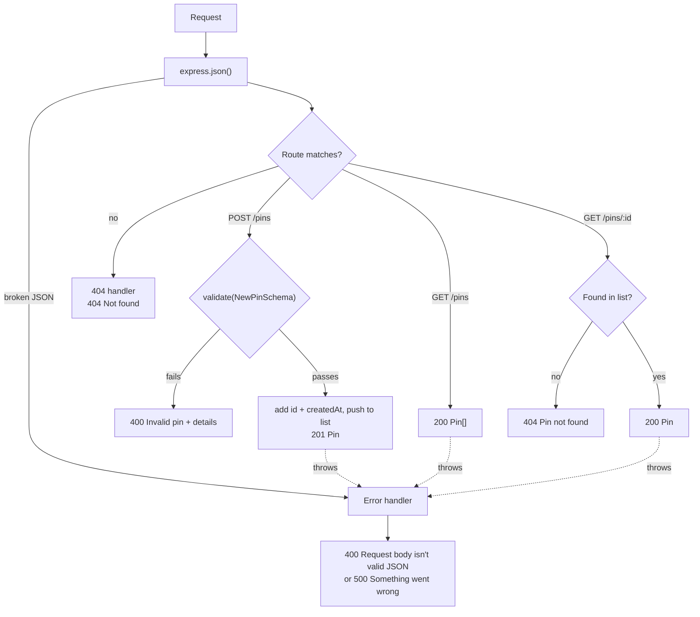

# Phase 1, Step 2 — Create and read pins (no database yet)

Part of the [build plan](../build-plan.md#phase-1--the-api-can-save-and-return-pins). Pins are kept in an in-memory list; step 3 moves them to the database.

## What to build

Endpoints

| Method | Path          | Does            | Success                     | Errors            |
| ------ | ------------- | --------------- | --------------------------- | ----------------- |
| `POST` | `/pins`       | Adds a pin      | `201` the new `Pin`         | `400`, `500`      |
| `GET`  | `/pins`       | Lists all pins  | `200` `Pin[]` (can be `[]`) | `500`             |
| `GET`  | `/pins/:id`   | Returns one pin | `200` the `Pin`             | `404`, `500`      |
| any    | anything else | Nothing         | —                           | `404` "Not found" |

Error codes

- `400` "Invalid pin" + `details`: a field breaks a rule below (`POST /pins`)
- `400` "Request body isn't valid JSON": broken JSON (`POST /pins`)
- `400` "Send the pin as JSON …": `Content-Type` isn't `application/json` (`POST /pins`)
- `404` "Pin not found": no pin has that id (`GET /pins/:id`)
- `404` "Not found": no route matches the method and path
- `500` "Something went wrong": anything thrown that isn't handled; no stack trace

Field rules for `POST /pins`

- `type`: required; one of `PIN_TYPES`
- `description`: required; 1–500 characters after trimming spaces
- `coords`: required; an object, not `null`
- `coords.lat`: required number, -90 to 90
- `coords.lng`: required number, -180 to 180
- any other field: dropped; the API sets `id` and `createdAt` itself

Models

```ts
// What the client sends
const NewPinSchema = z.object({
  type: z.enum(PIN_TYPES, {
    error: (issue) =>
      issue.input === undefined
        ? "Type is required"
        : `Type must be one of: ${PIN_TYPES.join(", ")}`,
  }),
  description: z
    .string({ error: "Description is required" })
    .trim()
    .min(1, "Description is required")
    .max(500, "Description must be 500 characters or fewer"),
  coords: z.object(
    {
      lat: z
        .number({ error: "Latitude must be a number" })
        .min(-90, "Latitude must be between -90 and 90")
        .max(90, "Latitude must be between -90 and 90"),
      lng: z
        .number({ error: "Longitude must be a number" })
        .min(-180, "Longitude must be between -180 and 180")
        .max(180, "Longitude must be between -180 and 180"),
    },
    { error: "Location is required" },
  ),
});
type NewPin = z.infer<typeof NewPinSchema>;

// What the API sends back
interface Pin extends NewPin {
  id: string; // randomUUID()
  createdAt: string; // new Date().toISOString()
}

// Every error
interface ApiError {
  error: string;
  details?: { field: string; message: string }[]; // 400 "Invalid pin" only
}
```

How a request flows through `app.ts`



Order in `app.ts`

1. `express.json()`
2. `app.get('/health', …)`
3. `app.use('/pins', pinsRouter)`
4. 404 handler: `app.use((req, res) => …)`
5. Error handler: `app.use((err, req, res, next) => …)` (4 arguments, always last)

## Try it in Postman

Assumes the API runs at `http://localhost:3000`.

```http
# Step 2 — Create a pin
POST /pins
Content-Type: application/json

{
  "type": "drainage",
  "description": "Kerb near the drain fills fast in heavy rain",
  "coords": { "lat": -27.5098, "lng": 153.0331 }
}

→ 201 Created
{
  "id": "8f1c2a90-4b7e-4d2a-9c11-3e5f6a7b8c9d",
  "type": "drainage",
  "description": "Kerb near the drain fills fast in heavy rain",
  "coords": { "lat": -27.5098, "lng": 153.0331 },
  "createdAt": "2026-10-24T09:30:00.000Z"
}
```

```http
# Step 2 — Create a pin with extra fields
# zod drops fields it doesn't know about, so the API always sets its own id and date
POST /pins
Content-Type: application/json

{
  "id": "my-own-id",
  "createdAt": "1999-01-01T00:00:00.000Z",
  "type": "flooding",
  "description": "Water over the footpath after storms",
  "coords": { "lat": -27.5121, "lng": 153.0298 }
}

→ 201 Created
{
  "id": "2b7d4e11-9a3c-4f5e-8d21-7c6b5a4e3f2d",
  "type": "flooding",
  "description": "Water over the footpath after storms",
  "coords": { "lat": -27.5121, "lng": 153.0298 },
  "createdAt": "2026-10-24T09:31:00.000Z"
}
```

```http
# Step 2 — Bad pin (empty description)
POST /pins
Content-Type: application/json

{ "type": "drainage", "description": "", "coords": { "lat": -27.5098, "lng": 153.0331 } }

→ 400 Bad Request
{
  "error": "Invalid pin",
  "details": [
    { "field": "description", "message": "Description is required" }
  ]
}
```

```http
# Step 2 — Bad pin (description is only spaces)
# Trim the description before checking it, so "   " counts as empty
POST /pins
Content-Type: application/json

{ "type": "drainage", "description": "   ", "coords": { "lat": -27.5098, "lng": 153.0331 } }

→ 400 Bad Request
{
  "error": "Invalid pin",
  "details": [
    { "field": "description", "message": "Description is required" }
  ]
}
```

```http
# Step 2 — Bad pin (description too long: 501 characters)
POST /pins
Content-Type: application/json

{ "type": "drainage", "description": "aaaa…(501 characters)", "coords": { "lat": -27.5098, "lng": 153.0331 } }

→ 400 Bad Request
{
  "error": "Invalid pin",
  "details": [
    { "field": "description", "message": "Description must be 500 characters or fewer" }
  ]
}
```

```http
# Step 2 — Bad pin (missing type)
POST /pins
Content-Type: application/json

{ "description": "Kerb near the drain fills fast in heavy rain", "coords": { "lat": -27.5098, "lng": 153.0331 } }

→ 400 Bad Request
{
  "error": "Invalid pin",
  "details": [
    { "field": "type", "message": "Type is required" }
  ]
}
```

```http
# Step 2 — Bad pin (type not in the list)
POST /pins
Content-Type: application/json

{ "type": "magpies", "description": "Swooping magpie near the bus stop", "coords": { "lat": -27.5098, "lng": 153.0331 } }

→ 400 Bad Request
{
  "error": "Invalid pin",
  "details": [
    { "field": "type", "message": "Type must be one of: drainage, flooding, wildlife, amenity, children, parking, traffic, recreation, disability, signage, none" }
  ]
}
```

```http
# Step 2 — Bad pin (no location)
# coords can be null in a saved pin (step 18), but a new pin must have one
POST /pins
Content-Type: application/json

{ "type": "drainage", "description": "Kerb near the drain fills fast in heavy rain", "coords": null }

→ 400 Bad Request
{
  "error": "Invalid pin",
  "details": [
    { "field": "coords", "message": "Location is required" }
  ]
}
```

```http
# Step 2 — Bad pin (lat and lng not real places)
# lat is -90 to 90, lng is -180 to 180
POST /pins
Content-Type: application/json

{ "type": "drainage", "description": "Kerb near the drain fills fast in heavy rain", "coords": { "lat": -127.5, "lng": 253.0 } }

→ 400 Bad Request
{
  "error": "Invalid pin",
  "details": [
    { "field": "coords.lat", "message": "Latitude must be between -90 and 90" },
    { "field": "coords.lng", "message": "Longitude must be between -180 and 180" }
  ]
}
```

```http
# Step 2 — Bad pin (lat and lng sent as text)
POST /pins
Content-Type: application/json

{ "type": "drainage", "description": "Kerb near the drain fills fast in heavy rain", "coords": { "lat": "-27.5098", "lng": "153.0331" } }

→ 400 Bad Request
{
  "error": "Invalid pin",
  "details": [
    { "field": "coords.lat", "message": "Latitude must be a number" },
    { "field": "coords.lng", "message": "Longitude must be a number" }
  ]
}
```

```http
# Step 2 — Bad pin (several problems at once)
# Return every problem, not just the first, so the form can show them all
POST /pins
Content-Type: application/json

{ "type": "magpies", "description": "" }

→ 400 Bad Request
{
  "error": "Invalid pin",
  "details": [
    { "field": "type", "message": "Type must be one of: drainage, flooding, wildlife, amenity, children, parking, traffic, recreation, disability, signage, none" },
    { "field": "description", "message": "Description is required" },
    { "field": "coords", "message": "Location is required" }
  ]
}
```

```http
# Step 2 — Broken JSON (missing closing brace)
# express.json() throws before your route runs; the error handler turns it into a 400
POST /pins
Content-Type: application/json

{ "type": "drainage", "description": "Kerb near the drain"

→ 400 Bad Request
{ "error": "Request body isn't valid JSON" }
```

```http
# Step 2 — Body sent without the JSON header
# In Postman: Body → raw → Text instead of JSON. express.json() skips it, so req.body is undefined
POST /pins
Content-Type: text/plain

{ "type": "drainage", "description": "Kerb near the drain fills fast in heavy rain", "coords": { "lat": -27.5098, "lng": 153.0331 } }

→ 400 Bad Request
{ "error": "Send the pin as JSON (Content-Type: application/json)" }
```

```http
# Step 2 — List all pins
# Full pins for now; step 4 trims this to id, type and coords
GET /pins

→ 200 OK
[
  {
    "id": "8f1c2a90-4b7e-4d2a-9c11-3e5f6a7b8c9d",
    "type": "drainage",
    "description": "Kerb near the drain fills fast in heavy rain",
    "coords": { "lat": -27.5098, "lng": 153.0331 },
    "createdAt": "2026-10-24T09:30:00.000Z"
  },
  {
    "id": "2b7d4e11-9a3c-4f5e-8d21-7c6b5a4e3f2d",
    "type": "flooding",
    "description": "Water over the footpath after storms",
    "coords": { "lat": -27.5121, "lng": 153.0298 },
    "createdAt": "2026-10-24T09:31:00.000Z"
  }
]
```

```http
# Step 2 — List pins when there are none (fresh start, or after a restart)
# An empty list is still a success: 200, not 404
GET /pins

→ 200 OK
[]
```

```http
# Step 2 — Get one pin
# Same shape as the create response; step 5 adds votes, replies and author
GET /pins/8f1c2a90-4b7e-4d2a-9c11-3e5f6a7b8c9d

→ 200 OK
{
  "id": "8f1c2a90-4b7e-4d2a-9c11-3e5f6a7b8c9d",
  "type": "drainage",
  "description": "Kerb near the drain fills fast in heavy rain",
  "coords": { "lat": -27.5098, "lng": 153.0331 },
  "createdAt": "2026-10-24T09:30:00.000Z"
}
```

```http
# Step 2 — Pin that doesn't exist
GET /pins/does-not-exist

→ 404 Not Found
{ "error": "Pin not found" }
```

```http
# Step 2 — Pin that used to exist (made before the API restarted)
# The in-memory list empties on restart; step 3 fixes this
GET /pins/8f1c2a90-4b7e-4d2a-9c11-3e5f6a7b8c9d

→ 404 Not Found
{ "error": "Pin not found" }
```

```http
# Step 2 — Method the API doesn't support yet
# Express has no route for it, so it falls through to the 404 handler
DELETE /pins/8f1c2a90-4b7e-4d2a-9c11-3e5f6a7b8c9d

→ 404 Not Found
{ "error": "Not found" }
```

```http
# Step 2 — Something breaks inside the API
# Any thrown error ends up here; never send the stack trace
GET /pins

→ 500 Internal Server Error
{ "error": "Something went wrong" }
```
