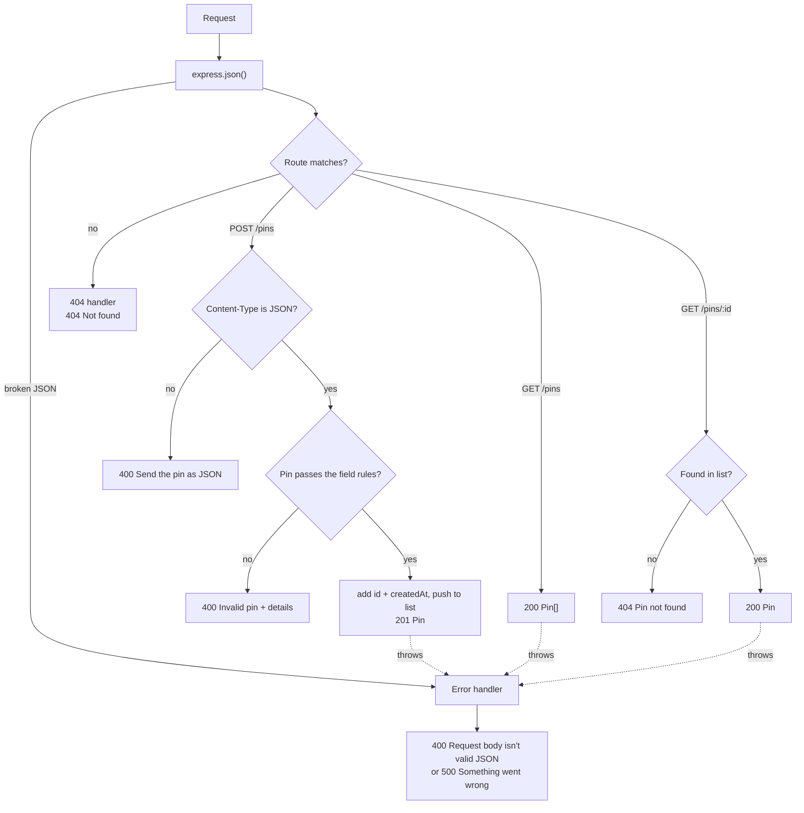

# Phase 1, Step 2 — Create and read pins (no database yet)

Part of the [build plan](../build-plan.md#phase-1--the-api-can-save-and-return-pins).

- Pins live in an in-memory list
- The list empties every time the API restarts
- Step 3 moves pins into the database

## What to build

Endpoints

| Method | Path          | Does            | Success                     | Errors            |
| ------ | ------------- | --------------- | --------------------------- | ----------------- |
| `POST` | `/pins`       | Adds a pin      | `201` the new `Pin`         | `400`, `500`      |
| `GET`  | `/pins`       | Lists all pins  | `200` `Pin[]` (can be `[]`) | `500`             |
| `GET`  | `/pins/:id`   | Returns one pin | `200` the `Pin`             | `404`, `500`      |
| any    | anything else | Nothing         | —                           | `404` "Not found" |

Error codes

| Code  | `error` message                                         | When                                               | Endpoint        |
| ----- | ------------------------------------------------------- | -------------------------------------------------- | --------------- |
| `400` | "Invalid pin" + `details`                               | A field breaks a rule below                        | `POST /pins`    |
| `400` | "Request body isn't valid JSON"                         | The JSON is broken                                 | `POST /pins`    |
| `400` | "Send the pin as JSON (Content-Type: application/json)" | `Content-Type` isn't `application/json`            | `POST /pins`    |
| `404` | "Pin not found"                                         | No pin has that id                                 | `GET /pins/:id` |
| `404` | "Not found"                                             | No route matches the method and path               | any             |
| `500` | "Something went wrong"                                  | Anything thrown that isn't handled; no stack trace | any             |

Field rules for `POST /pins`

| Field         | Rule                                         | Message when it breaks                                                                                                          |
| ------------- | -------------------------------------------- | ------------------------------------------------------------------------------------------------------------------------------- |
| `type`        | Required                                     | "Type is required"                                                                                                              |
| `type`        | One of `PIN_TYPES`                           | "Type must be one of: drainage, flooding, wildlife, amenity, children, parking, traffic, recreation, disability, signage, none" |
| `description` | Required text                                | "Description is required"                                                                                                       |
| `description` | Not empty after trimming spaces              | "Description is required"                                                                                                       |
| `description` | At least 10 characters after trimming spaces | "Description must be at least 10 characters"                                                                                    |
| `description` | At most 500 characters after trimming spaces | "Description must be 500 characters or fewer"                                                                                   |
| `coords`      | Required object, not `null`                  | "Location is required"                                                                                                          |
| `coords.lat`  | Required number                              | "Latitude must be a number"                                                                                                     |
| `coords.lat`  | -90 to 90                                    | "Latitude must be between -90 and 90"                                                                                           |
| `coords.lng`  | Required number                              | "Longitude must be a number"                                                                                                    |
| `coords.lng`  | -180 to 180                                  | "Longitude must be between -180 and 180"                                                                                        |
| anything else | Dropped silently                             | — (the API sets `id` and `createdAt` itself)                                                                                    |

- Report every broken rule at once, not just the first
- `field` in `details` is the path to the field, joined with dots (`coords.lat`)

Models

- `NewPin` (what the client sends): `type`, `description`, `coords { lat, lng }`
- `Pin` (what the API sends back): `NewPin` plus `id` (a UUID) and `createdAt` (an ISO date string)
- `ApiError` (every error): `error`, plus `details` (a list of `{ field, message }`) on `400` "Invalid pin" only
- Responses are sent as is, with no wrapper (no `status`, `message` or `data` keys)

How a request flows through `app.ts`



Order in `app.ts`

1. JSON body parser
2. `GET /health` route
3. Pins router, mounted at `/pins`
4. 404 handler
5. Error handler (takes 4 arguments, always last)

## Build checklist

Each case below is one Postman request (left) and the response it should get (right). Done when Postman shows exactly that for every case.

- Base URL: `http://localhost:3000`
- `id` and `createdAt` in responses will differ from the examples

## `POST /pins`

Content-Type: application/json

- In Postman: Body → raw → JSON, unless the case says otherwise

### Creates a pin from a valid request

<div class="req-res" style="display: flex; gap: 16px; width: 100%;">
<div style="flex: 1 1 0; min-width: 0;">
<strong>Request body</strong>

```json
{
  "type": "drainage",
  "description": "Kerb near the drain fills fast in heavy rain",
  "coords": { "lat": -27.5098, "lng": 153.0331 }
}
```

</div>
<div style="flex: 1 1 0; min-width: 0;">
<strong>Response body — <code>201 Created</code></strong>

```json
{
  "id": "8f1c2a90-4b7e-4d2a-9c11-3e5f6a7b8c9d",
  "type": "drainage",
  "description": "Kerb near the drain fills fast in heavy rain",
  "coords": { "lat": -27.5098, "lng": 153.0331 },
  "createdAt": "2026-10-24T09:30:00.000Z"
}
```

</div>
</div>

### Ignores a client-sent id, createdAt and other unknown fields

- The API always sets its own `id` and `createdAt`

<div class="req-res" style="display: flex; gap: 16px; width: 100%;">
<div style="flex: 1 1 0; min-width: 0;">
<strong>Request body</strong>

```json
{
  "id": "my-own-id",
  "createdAt": "1999-01-01T00:00:00.000Z",
  "votes": 999,
  "type": "flooding",
  "description": "Water over the footpath after storms",
  "coords": { "lat": -27.5121, "lng": 153.0298 }
}
```

</div>
<div style="flex: 1 1 0; min-width: 0;">
<strong>Response body — <code>201 Created</code></strong>

```json
{
  "id": "2b7d4e11-9a3c-4f5e-8d21-7c6b5a4e3f2d",
  "type": "flooding",
  "description": "Water over the footpath after storms",
  "coords": { "lat": -27.5121, "lng": 153.0298 },
  "createdAt": "2026-10-24T09:31:00.000Z"
}
```

</div>
</div>

### Trims spaces around the description before saving

<div class="req-res" style="display: flex; gap: 16px; width: 100%;">
<div style="flex: 1 1 0; min-width: 0;">
<strong>Request body</strong>

```json
{
  "type": "wildlife",
  "description": "   Possum in the park bins   ",
  "coords": { "lat": -27.5098, "lng": 153.0331 }
}
```

</div>
<div style="flex: 1 1 0; min-width: 0;">
<strong>Response body — <code>201 Created</code></strong>

```json
{
  "id": "5c9e1f22-7b3d-4a6e-9f10-2d4c6b8a0e1f",
  "type": "wildlife",
  "description": "Possum in the park bins",
  "coords": { "lat": -27.5098, "lng": 153.0331 },
  "createdAt": "2026-10-24T09:32:00.000Z"
}
```

</div>
</div>

### Accepts a description at the 500-character maximum

- `description` is one unbroken string of 500 `a`s, split into lines of 40 here so it fits on screen
- In Postman, send it as one line with no spaces or line breaks

<div class="req-res" style="display: flex; gap: 16px; width: 100%;">
<div style="flex: 1 1 0; min-width: 0;">
<strong>Request body</strong>

```json
{
  "type": "drainage",
  "description": "aaaaaaaaaaaaaaaaaaaaaaaaaaaaaaaaaaaaaaaa
                   aaaaaaaaaaaaaaaaaaaaaaaaaaaaaaaaaaaaaaaa
                   aaaaaaaaaaaaaaaaaaaaaaaaaaaaaaaaaaaaaaaa
                   aaaaaaaaaaaaaaaaaaaaaaaaaaaaaaaaaaaaaaaa
                   aaaaaaaaaaaaaaaaaaaaaaaaaaaaaaaaaaaaaaaa
                   aaaaaaaaaaaaaaaaaaaaaaaaaaaaaaaaaaaaaaaa
                   aaaaaaaaaaaaaaaaaaaaaaaaaaaaaaaaaaaaaaaa
                   aaaaaaaaaaaaaaaaaaaaaaaaaaaaaaaaaaaaaaaa
                   aaaaaaaaaaaaaaaaaaaaaaaaaaaaaaaaaaaaaaaa
                   aaaaaaaaaaaaaaaaaaaaaaaaaaaaaaaaaaaaaaaa
                   aaaaaaaaaaaaaaaaaaaaaaaaaaaaaaaaaaaaaaaa
                   aaaaaaaaaaaaaaaaaaaaaaaaaaaaaaaaaaaaaaaa
                   aaaaaaaaaaaaaaaaaaaa",
  "coords": { "lat": -27.5098, "lng": 153.0331 }
}
```

</div>
<div style="flex: 1 1 0; min-width: 0;">
<strong>Response body — <code>201 Created</code></strong>

```json
{
  "id": "e3a7c4d1-2f6b-4c8e-a9d0-1b2c3d4e5f60",
  "type": "drainage",
  "description": "aaaaaaaaaaaaaaaaaaaaaaaaaaaaaaaaaaaaaaaa
                   aaaaaaaaaaaaaaaaaaaaaaaaaaaaaaaaaaaaaaaa
                   aaaaaaaaaaaaaaaaaaaaaaaaaaaaaaaaaaaaaaaa
                   aaaaaaaaaaaaaaaaaaaaaaaaaaaaaaaaaaaaaaaa
                   aaaaaaaaaaaaaaaaaaaaaaaaaaaaaaaaaaaaaaaa
                   aaaaaaaaaaaaaaaaaaaaaaaaaaaaaaaaaaaaaaaa
                   aaaaaaaaaaaaaaaaaaaaaaaaaaaaaaaaaaaaaaaa
                   aaaaaaaaaaaaaaaaaaaaaaaaaaaaaaaaaaaaaaaa
                   aaaaaaaaaaaaaaaaaaaaaaaaaaaaaaaaaaaaaaaa
                   aaaaaaaaaaaaaaaaaaaaaaaaaaaaaaaaaaaaaaaa
                   aaaaaaaaaaaaaaaaaaaaaaaaaaaaaaaaaaaaaaaa
                   aaaaaaaaaaaaaaaaaaaaaaaaaaaaaaaaaaaaaaaa
                   aaaaaaaaaaaaaaaaaaaa",
  "coords": { "lat": -27.5098, "lng": 153.0331 },
  "createdAt": "2026-10-24T09:33:00.000Z"
}
```

</div>
</div>

### Accepts a description at the 10-character minimum

- `"Broken tap"` is exactly 10 characters

<div class="req-res" style="display: flex; gap: 16px; width: 100%;">
<div style="flex: 1 1 0; min-width: 0;">
<strong>Request body</strong>

```json
{
  "type": "none",
  "description": "Broken tap",
  "coords": { "lat": -27.5098, "lng": 153.0331 }
}
```

</div>
<div style="flex: 1 1 0; min-width: 0;">
<strong>Response body — <code>201 Created</code></strong>

```json
{
  "id": "a1b2c3d4-5e6f-4a7b-8c9d-0e1f2a3b4c5d",
  "type": "none",
  "description": "Broken tap",
  "coords": { "lat": -27.5098, "lng": 153.0331 },
  "createdAt": "2026-10-24T09:34:00.000Z"
}
```

</div>
</div>

### Accepts coordinates exactly on the lat and lng limits

- -90, 90, -180 and 180 are all allowed

<div class="req-res" style="display: flex; gap: 16px; width: 100%;">
<div style="flex: 1 1 0; min-width: 0;">
<strong>Request body</strong>

```json
{
  "type": "signage",
  "description": "Sign at the edge of the map",
  "coords": { "lat": 90, "lng": -180 }
}
```

</div>
<div style="flex: 1 1 0; min-width: 0;">
<strong>Response body — <code>201 Created</code></strong>

```json
{
  "id": "9d8c7b6a-5f4e-4d3c-b2a1-0f9e8d7c6b5a",
  "type": "signage",
  "description": "Sign at the edge of the map",
  "coords": { "lat": 90, "lng": -180 },
  "createdAt": "2026-10-24T09:35:00.000Z"
}
```

</div>
</div>

### Rejects an empty description

<div class="req-res" style="display: flex; gap: 16px; width: 100%;">
<div style="flex: 1 1 0; min-width: 0;">
<strong>Request body</strong>

```json
{
  "type": "drainage",
  "description": "",
  "coords": { "lat": -27.5098, "lng": 153.0331 }
}
```

</div>
<div style="flex: 1 1 0; min-width: 0;">
<strong>Response body — <code>400 Bad Request</code></strong>

```json
{
  "error": "Invalid pin",
  "details": [{ "field": "description", "message": "Description is required" }]
}
```

</div>
</div>

### Rejects a description that is only spaces

- Trimmed first, so `"   "` counts as empty

<div class="req-res" style="display: flex; gap: 16px; width: 100%;">
<div style="flex: 1 1 0; min-width: 0;">
<strong>Request body</strong>

```json
{
  "type": "drainage",
  "description": "   ",
  "coords": { "lat": -27.5098, "lng": 153.0331 }
}
```

</div>
<div style="flex: 1 1 0; min-width: 0;">
<strong>Response body — <code>400 Bad Request</code></strong>

```json
{
  "error": "Invalid pin",
  "details": [{ "field": "description", "message": "Description is required" }]
}
```

</div>
</div>

### Rejects a description under 10 characters

- `"Bad drain"` is 9 characters
- Spaces are trimmed first, so `"   Bad drain   "` is also 9

<div class="req-res" style="display: flex; gap: 16px; width: 100%;">
<div style="flex: 1 1 0; min-width: 0;">
<strong>Request body</strong>

```json
{
  "type": "drainage",
  "description": "Bad drain",
  "coords": { "lat": -27.5098, "lng": 153.0331 }
}
```

</div>
<div style="flex: 1 1 0; min-width: 0;">
<strong>Response body — <code>400 Bad Request</code></strong>

```json
{
  "error": "Invalid pin",
  "details": [
    {
      "field": "description",
      "message": "Description must be at least 10 characters"
    }
  ]
}
```

</div>
</div>

### Rejects a description over 500 characters

- `description` is one unbroken string of 501 `a`s, split into lines of 40 here so it fits on screen
- In Postman, send it as one line with no spaces or line breaks

<div class="req-res" style="display: flex; gap: 16px; width: 100%;">
<div style="flex: 1 1 0; min-width: 0;">
<strong>Request body</strong>

```json
{
  "type": "drainage",
  "description": "aaaaaaaaaaaaaaaaaaaaaaaaaaaaaaaaaaaaaaaa
                   aaaaaaaaaaaaaaaaaaaaaaaaaaaaaaaaaaaaaaaa
                   aaaaaaaaaaaaaaaaaaaaaaaaaaaaaaaaaaaaaaaa
                   aaaaaaaaaaaaaaaaaaaaaaaaaaaaaaaaaaaaaaaa
                   aaaaaaaaaaaaaaaaaaaaaaaaaaaaaaaaaaaaaaaa
                   aaaaaaaaaaaaaaaaaaaaaaaaaaaaaaaaaaaaaaaa
                   aaaaaaaaaaaaaaaaaaaaaaaaaaaaaaaaaaaaaaaa
                   aaaaaaaaaaaaaaaaaaaaaaaaaaaaaaaaaaaaaaaa
                   aaaaaaaaaaaaaaaaaaaaaaaaaaaaaaaaaaaaaaaa
                   aaaaaaaaaaaaaaaaaaaaaaaaaaaaaaaaaaaaaaaa
                   aaaaaaaaaaaaaaaaaaaaaaaaaaaaaaaaaaaaaaaa
                   aaaaaaaaaaaaaaaaaaaaaaaaaaaaaaaaaaaaaaaa
                   aaaaaaaaaaaaaaaaaaaaa",
  "coords": { "lat": -27.5098, "lng": 153.0331 }
}
```

</div>
<div style="flex: 1 1 0; min-width: 0;">
<strong>Response body — <code>400 Bad Request</code></strong>

```json
{
  "error": "Invalid pin",
  "details": [
    {
      "field": "description",
      "message": "Description must be 500 characters or fewer"
    }
  ]
}
```

</div>
</div>

### Rejects a description that isn't text

<div class="req-res" style="display: flex; gap: 16px; width: 100%;">
<div style="flex: 1 1 0; min-width: 0;">
<strong>Request body</strong>

```json
{
  "type": "drainage",
  "description": 42,
  "coords": { "lat": -27.5098, "lng": 153.0331 }
}
```

</div>
<div style="flex: 1 1 0; min-width: 0;">
<strong>Response body — <code>400 Bad Request</code></strong>

```json
{
  "error": "Invalid pin",
  "details": [{ "field": "description", "message": "Description is required" }]
}
```

</div>
</div>

### Rejects a pin with no type

<div class="req-res" style="display: flex; gap: 16px; width: 100%;">
<div style="flex: 1 1 0; min-width: 0;">
<strong>Request body</strong>

```json
{
  "description": "Kerb near the drain fills fast in heavy rain",
  "coords": { "lat": -27.5098, "lng": 153.0331 }
}
```

</div>
<div style="flex: 1 1 0; min-width: 0;">
<strong>Response body — <code>400 Bad Request</code></strong>

```json
{
  "error": "Invalid pin",
  "details": [{ "field": "type", "message": "Type is required" }]
}
```

</div>
</div>

### Rejects a type that isn't in the pin type list

<div class="req-res" style="display: flex; gap: 16px; width: 100%;">
<div style="flex: 1 1 0; min-width: 0;">
<strong>Request body</strong>

```json
{
  "type": "magpies",
  "description": "Swooping magpie near the bus stop",
  "coords": { "lat": -27.5098, "lng": 153.0331 }
}
```

</div>
<div style="flex: 1 1 0; min-width: 0;">
<strong>Response body — <code>400 Bad Request</code></strong>

```json
{
  "error": "Invalid pin",
  "details": [
    {
      "field": "type",
      "message": "Type must be one of: drainage, flooding, wildlife, amenity, children, parking, traffic, recreation, disability, signage, none"
    }
  ]
}
```

</div>
</div>

### Rejects a pin with no location

- `coords` can be `null` in a saved pin (step 18), but a new pin must have one

<div class="req-res" style="display: flex; gap: 16px; width: 100%;">
<div style="flex: 1 1 0; min-width: 0;">
<strong>Request body</strong>

```json
{
  "type": "drainage",
  "description": "Kerb near the drain fills fast in heavy rain",
  "coords": null
}
```

</div>
<div style="flex: 1 1 0; min-width: 0;">
<strong>Response body — <code>400 Bad Request</code></strong>

```json
{
  "error": "Invalid pin",
  "details": [{ "field": "coords", "message": "Location is required" }]
}
```

</div>
</div>

### Rejects a location with no lng

<div class="req-res" style="display: flex; gap: 16px; width: 100%;">
<div style="flex: 1 1 0; min-width: 0;">
<strong>Request body</strong>

```json
{
  "type": "drainage",
  "description": "Kerb near the drain fills fast in heavy rain",
  "coords": {
    "lat": -27.5098
  }
}
```

</div>
<div style="flex: 1 1 0; min-width: 0;">
<strong>Response body — <code>400 Bad Request</code></strong>

```json
{
  "error": "Invalid pin",
  "details": [
    { "field": "coords.lng", "message": "Longitude must be a number" }
  ]
}
```

</div>
</div>

### Rejects lat and lng outside real-world ranges

<div class="req-res" style="display: flex; gap: 16px; width: 100%;">
<div style="flex: 1 1 0; min-width: 0;">
<strong>Request body</strong>

```json
{
  "type": "drainage",
  "description": "Kerb near the drain fills fast in heavy rain",
  "coords": { "lat": -127.5, "lng": 253.0 }
}
```

</div>
<div style="flex: 1 1 0; min-width: 0;">
<strong>Response body — <code>400 Bad Request</code></strong>

```json
{
  "error": "Invalid pin",
  "details": [
    { "field": "coords.lat", "message": "Latitude must be between -90 and 90" },
    {
      "field": "coords.lng",
      "message": "Longitude must be between -180 and 180"
    }
  ]
}
```

</div>
</div>

### Rejects lat and lng sent as text instead of numbers

<div class="req-res" style="display: flex; gap: 16px; width: 100%;">
<div style="flex: 1 1 0; min-width: 0;">
<strong>Request body</strong>

```json
{
  "type": "drainage",
  "description": "Kerb near the drain fills fast in heavy rain",
  "coords": { "lat": "-27.5098", "lng": "153.0331" }
}
```

</div>
<div style="flex: 1 1 0; min-width: 0;">
<strong>Response body — <code>400 Bad Request</code></strong>

```json
{
  "error": "Invalid pin",
  "details": [
    { "field": "coords.lat", "message": "Latitude must be a number" },
    { "field": "coords.lng", "message": "Longitude must be a number" }
  ]
}
```

</div>
</div>

### Reports every broken rule in one response

- Every problem comes back, so the form can show them all

<div class="req-res" style="display: flex; gap: 16px; width: 100%;">
<div style="flex: 1 1 0; min-width: 0;">
<strong>Request body</strong>

```json
{
  "type": "magpies",
  "description": ""
}
```

</div>
<div style="flex: 1 1 0; min-width: 0;">
<strong>Response body — <code>400 Bad Request</code></strong>

```json
{
  "error": "Invalid pin",
  "details": [
    {
      "field": "type",
      "message": "Type must be one of: drainage, flooding, wildlife, amenity, children, parking, traffic, recreation, disability, signage, none"
    },
    { "field": "description", "message": "Description is required" },
    { "field": "coords", "message": "Location is required" }
  ]
}
```

</div>
</div>

### Rejects an empty object and lists every required field

<div class="req-res" style="display: flex; gap: 16px; width: 100%;">
<div style="flex: 1 1 0; min-width: 0;">
<strong>Request body</strong>

```json
{}
```

</div>
<div style="flex: 1 1 0; min-width: 0;">
<strong>Response body — <code>400 Bad Request</code></strong>

```json
{
  "error": "Invalid pin",
  "details": [
    { "field": "type", "message": "Type is required" },
    { "field": "description", "message": "Description is required" },
    { "field": "coords", "message": "Location is required" }
  ]
}
```

</div>
</div>

### Rejects broken JSON with a 400, not a 500

- The JSON parser fails before the route runs; the error handler turns it into a `400`

<div class="req-res" style="display: flex; gap: 16px; width: 100%;">
<div style="flex: 1 1 0; min-width: 0;">
<strong>Request body</strong>

```text
{ "type": "drainage", "description": "Kerb near the drain"
```

</div>
<div style="flex: 1 1 0; min-width: 0;">
<strong>Response body — <code>400 Bad Request</code></strong>

```json
{ "error": "Request body isn't valid JSON" }
```

</div>
</div>

### Rejects a body that isn't sent as JSON

- In Postman: Body → raw → Text instead of JSON

Content-Type: text/plain

<div class="req-res" style="display: flex; gap: 16px; width: 100%;">
<div style="flex: 1 1 0; min-width: 0;">
<strong>Request body</strong>

```json
{
  "type": "drainage",
  "description": "Kerb near the drain fills fast in heavy rain",
  "coords": { "lat": -27.5098, "lng": 153.0331 }
}
```

</div>
<div style="flex: 1 1 0; min-width: 0;">
<strong>Response body — <code>400 Bad Request</code></strong>

```json
{ "error": "Send the pin as JSON (Content-Type: application/json)" }
```

</div>
</div>

### Rejects a request with no body

<div class="req-res" style="display: flex; gap: 16px; width: 100%;">
<div style="flex: 1 1 0; min-width: 0;">
<strong>Request body</strong>
None (in Postman: Body → none)
</div>
<div style="flex: 1 1 0; min-width: 0;">
<strong>Response body — <code>400 Bad Request</code></strong>

```json
{ "error": "Send the pin as JSON (Content-Type: application/json)" }
```

</div>
</div>

### Hides unexpected errors behind a generic 500

- To try it: temporarily throw an error inside the `POST /pins` route
- Never send the stack trace

<div class="req-res" style="display: flex; gap: 16px; width: 100%;">
<div style="flex: 1 1 0; min-width: 0;">
<strong>Request body</strong>

```json
{
  "type": "drainage",
  "description": "Kerb near the drain fills fast in heavy rain",
  "coords": { "lat": -27.5098, "lng": 153.0331 }
}
```

</div>
<div style="flex: 1 1 0; min-width: 0;">
<strong>Response body — <code>500 Internal Server Error</code></strong>

```json
{ "error": "Something went wrong" }
```

</div>
</div>

## `GET /pins`

### Returns every saved pin

- Full pins for now; step 4 trims this to `id`, `type` and `coords`

<div class="req-res" style="display: flex; gap: 16px; width: 100%;">
<div style="flex: 1 1 0; min-width: 0;">
<strong>Request body</strong>
None
</div>
<div style="flex: 1 1 0; min-width: 0;">
<strong>Response body — <code>200 OK</code></strong>

```json
[
  {
    "id": "8f1c2a90-4b7e-4d2a-9c11-3e5f6a7b8c9d",
    "type": "drainage",
    "description": "Kerb near the drain fills fast in heavy rain",
    "coords": { "lat": -27.5098, "lng": 153.0331 },
    "createdAt": "2026-10-24T09:30:00.000Z"
  },
  {
    "id": "2b7d4e11-9a3c-4f5e-8d21-7c6b5a4e3f2d",
    "type": "flooding",
    "description": "Water over the footpath after storms",
    "coords": { "lat": -27.5121, "lng": 153.0298 },
    "createdAt": "2026-10-24T09:31:00.000Z"
  }
]
```

</div>
</div>

### Returns an empty list, not a 404, when there are no pins

- An empty list is still a success: `200`, not `404`

<div class="req-res" style="display: flex; gap: 16px; width: 100%;">
<div style="flex: 1 1 0; min-width: 0;">
<strong>Request body</strong>
None
</div>
<div style="flex: 1 1 0; min-width: 0;">
<strong>Response body — <code>200 OK</code></strong>

```json
[]
```

</div>
</div>

### Hides unexpected errors behind a generic 500

- To try it: temporarily throw an error inside the `GET /pins` route
- Never send the stack trace

<div class="req-res" style="display: flex; gap: 16px; width: 100%;">
<div style="flex: 1 1 0; min-width: 0;">
<strong>Request body</strong>
None
</div>
<div style="flex: 1 1 0; min-width: 0;">
<strong>Response body — <code>500 Internal Server Error</code></strong>

```json
{ "error": "Something went wrong" }
```

</div>
</div>

## `GET /pins/:id`

### Returns the pin with a matching id

- Same shape as the create response; step 5 adds votes, replies and author

Request: `GET /pins/8f1c2a90-4b7e-4d2a-9c11-3e5f6a7b8c9d`

<div class="req-res" style="display: flex; gap: 16px; width: 100%;">
<div style="flex: 1 1 0; min-width: 0;">
<strong>Request body</strong>
None
</div>
<div style="flex: 1 1 0; min-width: 0;">
<strong>Response body — <code>200 OK</code></strong>

```json
{
  "id": "8f1c2a90-4b7e-4d2a-9c11-3e5f6a7b8c9d",
  "type": "drainage",
  "description": "Kerb near the drain fills fast in heavy rain",
  "coords": { "lat": -27.5098, "lng": 153.0331 },
  "createdAt": "2026-10-24T09:30:00.000Z"
}
```

</div>
</div>

### Returns 404 for an id that was never created

Request: `GET /pins/does-not-exist`

<div class="req-res" style="display: flex; gap: 16px; width: 100%;">
<div style="flex: 1 1 0; min-width: 0;">
<strong>Request body</strong>
None
</div>
<div style="flex: 1 1 0; min-width: 0;">
<strong>Response body — <code>404 Not Found</code></strong>

```json
{ "error": "Pin not found" }
```

</div>
</div>

### Returns 404 for a pin lost when the API restarted

- The in-memory list empties on restart; step 3 fixes this

Request: `GET /pins/8f1c2a90-4b7e-4d2a-9c11-3e5f6a7b8c9d`

<div class="req-res" style="display: flex; gap: 16px; width: 100%;">
<div style="flex: 1 1 0; min-width: 0;">
<strong>Request body</strong>
None
</div>
<div style="flex: 1 1 0; min-width: 0;">
<strong>Response body — <code>404 Not Found</code></strong>

```json
{ "error": "Pin not found" }
```

</div>
</div>

### Hides unexpected errors behind a generic 500

- To try it: temporarily throw an error inside the `GET /pins/:id` route
- Never send the stack trace

Request: `GET /pins/8f1c2a90-4b7e-4d2a-9c11-3e5f6a7b8c9d`

<div class="req-res" style="display: flex; gap: 16px; width: 100%;">
<div style="flex: 1 1 0; min-width: 0;">
<strong>Request body</strong>
None
</div>
<div style="flex: 1 1 0; min-width: 0;">
<strong>Response body — <code>500 Internal Server Error</code></strong>

```json
{ "error": "Something went wrong" }
```

</div>
</div>

## Any other method or path

### Returns 404 for a method with no route

- No route matches, so it falls through to the 404 handler

Request: `DELETE /pins/8f1c2a90-4b7e-4d2a-9c11-3e5f6a7b8c9d`

<div class="req-res" style="display: flex; gap: 16px; width: 100%;">
<div style="flex: 1 1 0; min-width: 0;">
<strong>Request body</strong>
None
</div>
<div style="flex: 1 1 0; min-width: 0;">
<strong>Response body — <code>404 Not Found</code></strong>

```json
{ "error": "Not found" }
```

</div>
</div>

### Returns 404 for a path with no route

Request: `GET /pins`

<div class="req-res" style="display: flex; gap: 16px; width: 100%;">
<div style="flex: 1 1 0; min-width: 0;">
<strong>Request body</strong>
None
</div>
<div style="flex: 1 1 0; min-width: 0;">
<strong>Response body — <code>404 Not Found</code></strong>

```json
{ "error": "Not found" }
```

</div>
</div>

## Every response

- Sent as is, with no `status` / `message` / `data` wrapper
- `500`s never include the stack trace
