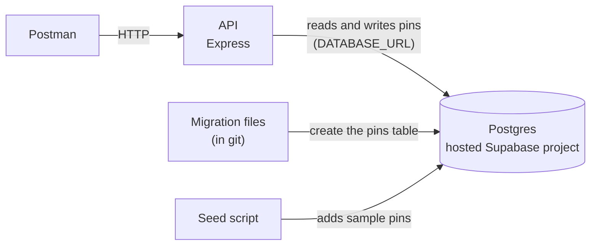
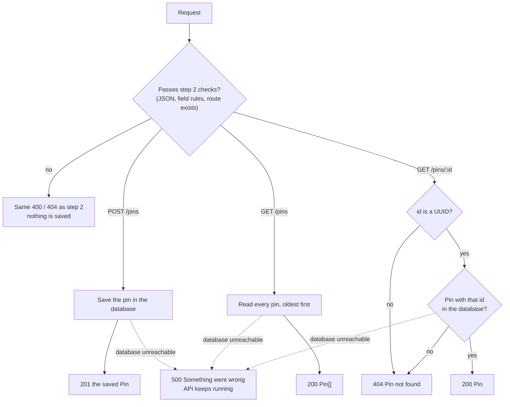

# Phase 1, Step 3 — Store pins in a database

Part of the [build plan](../build-plan.md#phase-1--the-api-can-save-and-return-pins).

- Starting point: [step 2](phase-1-step-2-create-and-read-pins.md) is built. `POST /pins`, `GET /pins` and `GET /pins/:id` already work, with every field rule and error message, but they keep pins in an in-memory list that empties whenever the API restarts
- This step connects the API to a Postgres database in your hosted Supabase project (the free-plan development project, not the one step 22 deploys to), then switches those three endpoints from the in-memory list to the database
- Requests and responses stay the same. The only difference you'll see is that pins are still there after the API restarts

## What to build

The build checklist below is the definition of done. The step is complete when every case in it passes.

Already built in step 2 (don't rebuild)

- `POST /pins`, `GET /pins`, `GET /pins/:id` and `GET /health`
- Every field rule, and every `400`, `404` and generic `500` message
- The `Pin` response shape

Left to do

| Work                                                                           | Proved by these checklist cases                                                                               |
| ------------------------------------------------------------------------------ | ------------------------------------------------------------------------------------------------------------- |
| Create the `pins` table from a migration file kept in git                      | [Builds the pins table from the migration files alone](#builds-the-pins-table-from-the-migration-files-alone) |
| Write the seed script for the sample Brisbane pins                             | Every case under [Seed script](#seed-script)                                                                  |
| Switch `POST /pins` from the in-memory list to the database                    | Every case under [`POST /pins`](#post-pins)                                                                   |
| Switch `GET /pins` and `GET /pins/:id` from the in-memory list to the database | Every case under [`GET /pins`](#get-pins) and [`GET /pins/:id`](#get-pinsid)                                  |
| Return the generic `500` when the database can't be reached, without crashing  | The "Returns a generic 500 when the database is down" and "Recovers once the database is back" cases          |
| Stop using the in-memory list for anything                                     | "Still returns every pin after the API restarts" and "Still returns a pin after the API restarts"             |

Endpoints

| Method | Path        | Does            | What changes in this step                                                       |
| ------ | ----------- | --------------- | ------------------------------------------------------------------------------- |
| `POST` | `/pins`     | Adds a pin      | Saves the pin to the database instead of the in-memory list                     |
| `GET`  | `/pins`     | Lists all pins  | Reads from the database instead of the in-memory list, oldest pin first         |
| `GET`  | `/pins/:id` | Returns one pin | Reads from the database; an id that isn't a UUID still returns `404`, not `500` |
| `GET`  | `/health`   | Says "ok"       | Nothing (step 24 adds a database check)                                         |

Error codes (new or changed in this step only; every step 2 error still applies)

| Code  | `error` message        | When                                                 | Endpoint                                   |
| ----- | ---------------------- | ---------------------------------------------------- | ------------------------------------------ |
| `404` | "Pin not found"        | The id isn't a UUID, like `does-not-exist`           | `GET /pins/:id`                            |
| `404` | "Pin not found"        | The id is a UUID, but no pin has it                  | `GET /pins/:id`                            |
| `500` | "Something went wrong" | The database can't be reached; the API keeps running | `POST /pins`, `GET /pins`, `GET /pins/:id` |

Field rules

- Unchanged from step 2: see [Field rules for `POST /pins`](phase-1-step-2-create-and-read-pins.md#what-to-build)
- A pin that breaks a rule is never written to the database

What is stored

- One `pins` table, with one row per pin
- Each row holds: id (a UUID), type, description, latitude, longitude, created date
- Nothing else yet: step 7 adds suburb and postcode, step 11 adds who posted it, step 13 adds status
- The table is created by a migration file kept in git, not by hand in a database tool
- The responses are the same `Pin` shape as step 2: `id`, `type`, `description`, `coords { lat, lng }`, `createdAt`
- `lat` and `lng` come back as numbers, exactly as they were sent (not as text, no extra decimals)
- `createdAt` comes back as an ISO date string in UTC, ending in `Z`

Seed script

- One command fills the database with the sample Brisbane pins listed under [Seed script](#seed-script) in the checklist
- Running it twice still leaves one copy of each sample pin
- It never changes or deletes pins you created yourself
- Every sample pin passes step 2's field rules and has a fixed id and date, so the checklist responses always match

Configuration

- The API reads the database address from a `DATABASE_URL` environment variable in `api/.env`
- `api/.env` stays out of git, because the real connection string contains your database password
- The API won't start without `DATABASE_URL`, and says why in the terminal

How the pieces connect



How a request flows



## Consider these approaches

Suggestions only. These are not acceptance criteria; any approach that passes the build checklist is fine.

✅ marks a suggestion that's been built (code review, 28 Oct 2026).

Packages you've already installed

- `drizzle-orm`, `drizzle-kit` and the `postgres` driver (postgres.js) are all this step needs
- `@supabase/supabase-js`, `@supabase/server` and the generated `api/database.types.ts` aren't needed yet
  - supabase-js reaches your tables through Supabase's REST API with a project key; this API talks to Postgres directly through Drizzle instead
  - Drizzle gets its types from its own schema file, so the generated types file would be a second copy that can drift. `database.types.ts` is also empty until the table exists
  - They may be useful in phase 3, when the API checks sign-in tokens
- `dotenv`: `npm run dev` and `npm start` already load `api/.env` through `--env-file`, so the API itself doesn't need it. drizzle-kit and the seed command don't get that flag, so they need to load `api/.env` some other way (dotenv in the drizzle config, or running the seed with tsx's `--env-file`)
- The Supabase CLI is installed too. If you keep it, use it for things like the dashboard link or type generation, not for creating the `pins` table (see "Let one tool own migrations" below)

Hosted database

- No Docker needed: Postgres runs in your Supabase project, and the API connects to it over the internet
- ✅ Get the connection string from the project dashboard's Connect button, and pick the Session pooler one
  - The Direct connection is IPv6-only, which many home networks can't reach
  - The Transaction pooler (port 6543) doesn't support prepared statements, which postgres.js uses by default
- Put your database password into the connection string yourself; if you've lost it, reset it in Project Settings → Database
- The dashboard's Table Editor shows your tables and rows, and its SQL Editor runs SQL by hand
- Free projects pause after about a week with no activity; restore yours from the dashboard if requests start failing after a break
- ✅ Turn on row level security for the `pins` table, with no policies
  - Supabase also lets anyone with your project's public (anon) key read and change tables in the `public` schema through its own REST API
  - With row level security on and no policies, that route is blocked, and the API still works because it connects as the `postgres` user, which skips the policies
- Turn on "Enforce SSL" in Project Settings → Database → SSL Configuration
  - Why: the API reaches the database over the public internet. Without enforcement, Supabase also accepts unencrypted connections, and some drivers don't ask for SSL unless told to, so pin data could travel unencrypted while everything still seems to work
  - With enforcement on, an unencrypted connection is refused, so a misconfigured driver fails loudly instead
- ✅ Connect with SSL and verify Supabase's certificate (`sslmode=verify-full`), not just `sslmode=require`
  - Download the CA certificate from the same dashboard page, keep it in `api/`, and pass its contents to postgres.js's `ssl` option as the CA to trust
  - Why: `require` encrypts the connection but, in most drivers, doesn't check who's on the other end, so something pretending to be your database could still read everything. Checking the certificate against Supabase's CA proves the API is talking to your project
  - The CA certificate is public, not a secret, so it's fine to commit; step 22 then reuses it on Render
  - Never turn off certificate checking to make a certificate error go away; that brings back the problem it solves
- ✅ Give the database connection a short connection timeout (a few seconds), so requests fail with a `500` quickly when the database can't be reached instead of hanging
  - postgres.js waits 30 seconds by default; its `connect_timeout` option is in seconds

Schema and migrations

- ✅ Describe the `pins` table in a Drizzle schema file and let drizzle-kit write the migration from it; apply it with drizzle-kit's migrate command
- ✅ Let one tool own migrations: if Drizzle writes them, don't also put table changes in Supabase's own migrations folder
- Drizzle records which migrations have run in a `__drizzle_migrations` table inside a `drizzle` schema. If you drop the `pins` table but not that schema, the migrate command thinks there's nothing to do and won't recreate the table
- ✅ Add npm scripts for generating migrations, running them and seeding, so each is one command
- Column types that keep the checklist passing:
  - ✅ id: `uuid`, with the database making a random one by default
  - ✅ type: plain `text`, not null, defaulting to `none`. Don't limit it to the pin type list in the database (no Postgres enum or check constraint): the list is likely to change, so the API's zod check is the only thing that refuses a bad type
    - A direct insert (SQL Editor, Drizzle Studio) can store any string, so only the API's create route is guaranteed to hold valid types
    - Consider these approaches: Drizzle's `.$type<PinType>()` on the column keeps `type` typed as the pin type list in code without adding anything to the database
  - ✅ description: `text`, not null
  - ✅ lat and lng: `double precision`, not null. `numeric` comes back from the driver as text, and `real` adds extra decimals
  - ✅ created date: `timestamp with time zone`, defaulting to now
- ✅ Name columns in snake_case in the database (`created_at`) and map them to camelCase (`createdAt`) in one place

Code layout

- ✅ Keep the database connection in one module, and the pin queries (list, find by id, create) in another, so the routes never build SQL themselves
- ✅ The routes then swap their in-memory list calls for those queries; validation and the `requireJson` check stay exactly as they are
- ✅ Let the database make the id and created date, and have the create query return the saved row, so the `201` response is exactly what is stored. The route then no longer needs `randomUUID` or `new Date()`
- ✅ Check that the id is a UUID before querying (zod has a UUID check). Otherwise Postgres throws "invalid input syntax for type uuid", which becomes a `500`
- ✅ Read `DATABASE_URL` alongside `PORT` in the server config (and add it to the `Config` type), and stop with a clear message if it's missing
- ✅ The route handlers become async. Express 5 sends a rejected promise from an async handler straight to your existing error handler, which already returns the generic `500`, so each route doesn't need its own try/catch
- postgres.js reconnects by itself when the database comes back, so "Recovers once the database is back" should pass without extra code
- ✅ Delete `api/src/data/pinStore.ts` once nothing uses it

Seed script

- ✅ Insert the sample pins with their fixed ids and skip any id that already exists, so running it twice changes nothing
- ✅ Close the database connection when the seed finishes, or the command won't exit

## Build checklist

These cases are the acceptance criteria and the definition of done for this step. Each HTTP case is one Postman request (left) and the response it should get (right).

- Base URL: `http://localhost:3000`
- `id` and `createdAt` in responses will differ from the examples, except for the sample pins, whose ids and dates are fixed
- "Fresh database" means: the `pins` table exists but has no rows. To get there, delete every row in the Supabase dashboard (Table Editor → `pins`), and don't seed
- "Rebuilt database" means: in the dashboard's SQL Editor, drop the `pins` table and the `drizzle` schema (Drizzle's record of which migrations have run), then run the migrations
- "Database unreachable" means: the API can't reach Supabase while the API keeps running. Turn off your computer's Wi-Fi (or unplug the network) to get there, and turn it back on afterwards
  - Pausing the project in the dashboard also works, but pausing and restoring each take a few minutes

## Every step 2 case still passes

- Re-run every case in the [step 2 build checklist](phase-1-step-2-create-and-read-pins.md#build-checklist); each must get exactly the same response
- One step 2 case changes: "Returns 404 for a pin lost when the API restarted" now returns `200` with the pin (see [Still returns a pin after the API restarts](#still-returns-a-pin-after-the-api-restarts))
- For "Returns an empty list, not a 404, when there are no pins", start from a fresh database
- For the "Hides unexpected errors behind a generic 500" cases, you can now also make the database unreachable instead of throwing an error (see the cases below)

## Database setup

### Builds the pins table from the migration files alone

- Proves anyone can rebuild the database from what's in git
- Steps:
  1. Start from a rebuilt database (drop the table and the `drizzle` schema, then run the migrations)
  2. Check the dashboard's Table Editor: the `pins` table is back, with no rows
  3. Start the API and send the request below

Request: `GET /pins`

<table class="req-res" style="table-layout: fixed; width: 100%;">
<colgroup><col style="width: 50%;"><col style="width: 50%;"></colgroup>
<tr><th style="width: 50%;">Request body</th><th style="width: 50%;">Response body — <code>200 OK</code></th></tr>
<tr><td style="width: 50%; vertical-align: top;">None</td><td style="width: 50%; vertical-align: top;">

```json
[]
```

</td></tr>
</table>

### Refuses to start without a database address

- Steps:
  1. Comment out `DATABASE_URL` in `api/.env`
  2. Run `npm run dev` in `api/`
  3. Put `DATABASE_URL` back afterwards
- The API must not start listening on port 3000

<table class="req-res" style="table-layout: fixed; width: 100%;">
<colgroup><col style="width: 50%;"><col style="width: 50%;"></colgroup>
<tr><th style="width: 50%;">Do this</th><th style="width: 50%;">Terminal shows</th></tr>
<tr><td style="width: 50%; vertical-align: top;">

```bash
npm run dev
```

</td><td style="width: 50%; vertical-align: top;">

```text
DATABASE_URL is not set. Add it to api/.env (see api/.env.example)
```

</td></tr>
</table>

## Seed script

The sample pins. They are all in inner-south Brisbane and all pass step 2's field rules. If you change them, update the expected responses below.

| id                                     | type         | description                                                  | lat      | lng      | createdAt                  |
| -------------------------------------- | ------------ | ------------------------------------------------------------ | -------- | -------- | -------------------------- |
| `00000000-0000-4000-8000-000000000001` | `drainage`   | Gutter on Ipswich Road overflows in every big storm          | -27.5098 | 153.0331 | `2026-10-01T08:00:00.000Z` |
| `00000000-0000-4000-8000-000000000002` | `flooding`   | Underpass on Fairfield Road goes ankle deep after heavy rain | -27.5085 | 153.0230 | `2026-10-02T08:00:00.000Z` |
| `00000000-0000-4000-8000-000000000003` | `wildlife`   | Magpie swoops cyclists near the Yeronga park path in spring  | -27.5180 | 153.0160 | `2026-10-03T08:00:00.000Z` |
| `00000000-0000-4000-8000-000000000004` | `amenity`    | Clean public toilets with a parent room at Moorooka park     | -27.5352 | 153.0241 | `2026-10-04T08:00:00.000Z` |
| `00000000-0000-4000-8000-000000000005` | `parking`    | Street parking fills by 7am on game days in West End         | -27.4810 | 153.0090 | `2026-10-05T08:00:00.000Z` |
| `00000000-0000-4000-8000-000000000006` | `recreation` | Shady picnic tables by the river at Orleigh Park             | -27.4875 | 153.0035 | `2026-10-06T08:00:00.000Z` |

### Fills an empty database with the sample pins

- Steps: start from a fresh database, run the seed, then send the request below
- Comes back oldest first

Request: `GET /pins`

<table class="req-res" style="table-layout: fixed; width: 100%;">
<colgroup><col style="width: 50%;"><col style="width: 50%;"></colgroup>
<tr><th style="width: 50%;">Request body</th><th style="width: 50%;">Response body — <code>200 OK</code></th></tr>
<tr><td style="width: 50%; vertical-align: top;">None</td><td style="width: 50%; vertical-align: top;">

```json
[
  {
    "id": "00000000-0000-4000-8000-000000000001",
    "type": "drainage",
    "description": "Gutter on Ipswich Road overflows in every big storm",
    "coords": { "lat": -27.5098, "lng": 153.0331 },
    "createdAt": "2026-10-01T08:00:00.000Z"
  },
  {
    "id": "00000000-0000-4000-8000-000000000002",
    "type": "flooding",
    "description": "Underpass on Fairfield Road goes ankle deep after heavy rain",
    "coords": { "lat": -27.5085, "lng": 153.023 },
    "createdAt": "2026-10-02T08:00:00.000Z"
  },
  {
    "id": "00000000-0000-4000-8000-000000000003",
    "type": "wildlife",
    "description": "Magpie swoops cyclists near the Yeronga park path in spring",
    "coords": { "lat": -27.518, "lng": 153.016 },
    "createdAt": "2026-10-03T08:00:00.000Z"
  },
  {
    "id": "00000000-0000-4000-8000-000000000004",
    "type": "amenity",
    "description": "Clean public toilets with a parent room at Moorooka park",
    "coords": { "lat": -27.5352, "lng": 153.0241 },
    "createdAt": "2026-10-04T08:00:00.000Z"
  },
  {
    "id": "00000000-0000-4000-8000-000000000005",
    "type": "parking",
    "description": "Street parking fills by 7am on game days in West End",
    "coords": { "lat": -27.481, "lng": 153.009 },
    "createdAt": "2026-10-05T08:00:00.000Z"
  },
  {
    "id": "00000000-0000-4000-8000-000000000006",
    "type": "recreation",
    "description": "Shady picnic tables by the river at Orleigh Park",
    "coords": { "lat": -27.4875, "lng": 153.0035 },
    "createdAt": "2026-10-06T08:00:00.000Z"
  }
]
```

</td></tr>
</table>

- JSON drops trailing zeros, so `153.0230` comes back as `153.023`; that's the same number

### Doesn't make duplicates when run twice

- Steps: run the seed a second time, then send the request below
- Still exactly the six sample pins, same as the case above

Request: `GET /pins`

<table class="req-res" style="table-layout: fixed; width: 100%;">
<colgroup><col style="width: 50%;"><col style="width: 50%;"></colgroup>
<tr><th style="width: 50%;">Request body</th><th style="width: 50%;">Response body — <code>200 OK</code></th></tr>
<tr><td style="width: 50%; vertical-align: top;">None</td><td style="width: 50%; vertical-align: top;">

```json
[
  {
    "id": "00000000-0000-4000-8000-000000000001",
    "type": "drainage",
    "description": "Gutter on Ipswich Road overflows in every big storm",
    "coords": { "lat": -27.5098, "lng": 153.0331 },
    "createdAt": "2026-10-01T08:00:00.000Z"
  },
  {
    "id": "00000000-0000-4000-8000-000000000002",
    "type": "flooding",
    "description": "Underpass on Fairfield Road goes ankle deep after heavy rain",
    "coords": { "lat": -27.5085, "lng": 153.023 },
    "createdAt": "2026-10-02T08:00:00.000Z"
  },
  {
    "id": "00000000-0000-4000-8000-000000000003",
    "type": "wildlife",
    "description": "Magpie swoops cyclists near the Yeronga park path in spring",
    "coords": { "lat": -27.518, "lng": 153.016 },
    "createdAt": "2026-10-03T08:00:00.000Z"
  },
  {
    "id": "00000000-0000-4000-8000-000000000004",
    "type": "amenity",
    "description": "Clean public toilets with a parent room at Moorooka park",
    "coords": { "lat": -27.5352, "lng": 153.0241 },
    "createdAt": "2026-10-04T08:00:00.000Z"
  },
  {
    "id": "00000000-0000-4000-8000-000000000005",
    "type": "parking",
    "description": "Street parking fills by 7am on game days in West End",
    "coords": { "lat": -27.481, "lng": 153.009 },
    "createdAt": "2026-10-05T08:00:00.000Z"
  },
  {
    "id": "00000000-0000-4000-8000-000000000006",
    "type": "recreation",
    "description": "Shady picnic tables by the river at Orleigh Park",
    "coords": { "lat": -27.4875, "lng": 153.0035 },
    "createdAt": "2026-10-06T08:00:00.000Z"
  }
]
```

</td></tr>
</table>

### Leaves pins you created yourself alone

- Steps:
  1. Create the pin below with `POST /pins` and note its `id`
  2. Run the seed again
  3. Send the request below with that `id`

Request: `GET /pins/8f1c2a90-4b7e-4d2a-9c11-3e5f6a7b8c9d`

<table class="req-res" style="table-layout: fixed; width: 100%;">
<colgroup><col style="width: 50%;"><col style="width: 50%;"></colgroup>
<tr><th style="width: 50%;">Request body</th><th style="width: 50%;">Response body — <code>200 OK</code></th></tr>
<tr><td style="width: 50%; vertical-align: top;">None</td><td style="width: 50%; vertical-align: top;">

```json
{
  "id": "8f1c2a90-4b7e-4d2a-9c11-3e5f6a7b8c9d",
  "type": "drainage",
  "description": "Kerb near the drain fills fast in heavy rain",
  "coords": { "lat": -27.5098, "lng": 153.0331 },
  "createdAt": "2026-10-24T09:30:00.000Z"
}
```

</td></tr>
</table>

## `POST /pins`

Content-Type: application/json

- In Postman: Body → raw → JSON

### Saves a valid pin to the database

- Same response as step 2
- Also check the Supabase dashboard → Table Editor → `pins`: the new row is there with the same id

<table class="req-res" style="table-layout: fixed; width: 100%;">
<colgroup><col style="width: 50%;"><col style="width: 50%;"></colgroup>
<tr><th style="width: 50%;">Request body</th><th style="width: 50%;">Response body — <code>201 Created</code></th></tr>
<tr><td style="width: 50%; vertical-align: top;">

```json
{
  "type": "drainage",
  "description": "Kerb near the drain fills fast in heavy rain",
  "coords": { "lat": -27.5098, "lng": 153.0331 }
}
```

</td><td style="width: 50%; vertical-align: top;">

```json
{
  "id": "8f1c2a90-4b7e-4d2a-9c11-3e5f6a7b8c9d",
  "type": "drainage",
  "description": "Kerb near the drain fills fast in heavy rain",
  "coords": { "lat": -27.5098, "lng": 153.0331 },
  "createdAt": "2026-10-24T09:30:00.000Z"
}
```

</td></tr>
</table>

### Keeps coordinates exactly as sent

- Guards against storing lat and lng in a column type that rounds them or returns them as text
- Then `GET /pins/<id>` must show the same numbers

<table class="req-res" style="table-layout: fixed; width: 100%;">
<colgroup><col style="width: 50%;"><col style="width: 50%;"></colgroup>
<tr><th style="width: 50%;">Request body</th><th style="width: 50%;">Response body — <code>201 Created</code></th></tr>
<tr><td style="width: 50%; vertical-align: top;">

```json
{
  "type": "traffic",
  "description": "Right turn onto Ipswich Road backs up at school pick-up",
  "coords": { "lat": -27.509812345678, "lng": 153.033187654321 }
}
```

</td><td style="width: 50%; vertical-align: top;">

```json
{
  "id": "4e5f6a7b-8c9d-4e0f-9a1b-2c3d4e5f6a7b",
  "type": "traffic",
  "description": "Right turn onto Ipswich Road backs up at school pick-up",
  "coords": { "lat": -27.509812345678, "lng": 153.033187654321 },
  "createdAt": "2026-10-24T09:40:00.000Z"
}
```

</td></tr>
</table>

### Keeps quotes, apostrophes and emoji in the description exactly as sent

- Then `GET /pins/<id>` must show the same text

<table class="req-res" style="table-layout: fixed; width: 100%;">
<colgroup><col style="width: 50%;"><col style="width: 50%;"></colgroup>
<tr><th style="width: 50%;">Request body</th><th style="width: 50%;">Response body — <code>201 Created</code></th></tr>
<tr><td style="width: 50%; vertical-align: top;">

```json
{
  "type": "flooding",
  "description": "Water's ankle deep 🌧️ at \"the dip\" on Cracknell Road",
  "coords": { "lat": -27.5121, "lng": 153.0298 }
}
```

</td><td style="width: 50%; vertical-align: top;">

```json
{
  "id": "6a7b8c9d-0e1f-4a2b-8c3d-4e5f6a7b8c9d",
  "type": "flooding",
  "description": "Water's ankle deep 🌧️ at \"the dip\" on Cracknell Road",
  "coords": { "lat": -27.5121, "lng": 153.0298 },
  "createdAt": "2026-10-24T09:41:00.000Z"
}
```

</td></tr>
</table>

### Stores text that looks like SQL as plain text

- Guards against SQL injection: the description is saved as words, never run as a command
- Then `GET /pins` must still work, and the `pins` table must still exist

<table class="req-res" style="table-layout: fixed; width: 100%;">
<colgroup><col style="width: 50%;"><col style="width: 50%;"></colgroup>
<tr><th style="width: 50%;">Request body</th><th style="width: 50%;">Response body — <code>201 Created</code></th></tr>
<tr><td style="width: 50%; vertical-align: top;">

```json
{
  "type": "none",
  "description": "Robert'); DROP TABLE pins; --",
  "coords": { "lat": -27.5098, "lng": 153.0331 }
}
```

</td><td style="width: 50%; vertical-align: top;">

```json
{
  "id": "7b8c9d0e-1f2a-4b3c-9d4e-5f6a7b8c9d0e",
  "type": "none",
  "description": "Robert'); DROP TABLE pins; --",
  "coords": { "lat": -27.5098, "lng": 153.0331 },
  "createdAt": "2026-10-24T09:42:00.000Z"
}
```

</td></tr>
</table>

### Doesn't save a pin that breaks a field rule

- Steps: start from a fresh database, send the bad pin below, then send `GET /pins`
- The `400` is the same as step 2's "Rejects an empty object and lists every required field"

<table class="req-res" style="table-layout: fixed; width: 100%;">
<colgroup><col style="width: 50%;"><col style="width: 50%;"></colgroup>
<tr><th style="width: 50%;">Request body</th><th style="width: 50%;">Response body — <code>400 Bad Request</code></th></tr>
<tr><td style="width: 50%; vertical-align: top;">

```json
{}
```

</td><td style="width: 50%; vertical-align: top;">

```json
{
  "error": "Invalid pin",
  "details": [
    { "field": "type", "message": "Type is required" },
    { "field": "description", "message": "Description is required" },
    { "field": "coords", "message": "Location is required" }
  ]
}
```

</td></tr>
</table>

Then: `GET /pins`

<table class="req-res" style="table-layout: fixed; width: 100%;">
<colgroup><col style="width: 50%;"><col style="width: 50%;"></colgroup>
<tr><th style="width: 50%;">Request body</th><th style="width: 50%;">Response body — <code>200 OK</code></th></tr>
<tr><td style="width: 50%; vertical-align: top;">None</td><td style="width: 50%; vertical-align: top;">

```json
[]
```

</td></tr>
</table>

### Returns a generic 500 when the database is down

- Steps: make the database unreachable (turn off Wi-Fi), then send the request below
- The API must keep running; it must not crash or exit
- The response comes back within a few seconds, not after a long hang
- Never send the stack trace, the SQL error or the database address
- Turn Wi-Fi back on afterwards

<table class="req-res" style="table-layout: fixed; width: 100%;">
<colgroup><col style="width: 50%;"><col style="width: 50%;"></colgroup>
<tr><th style="width: 50%;">Request body</th><th style="width: 50%;">Response body — <code>500 Internal Server Error</code></th></tr>
<tr><td style="width: 50%; vertical-align: top;">

```json
{
  "type": "drainage",
  "description": "Kerb near the drain fills fast in heavy rain",
  "coords": { "lat": -27.5098, "lng": 153.0331 }
}
```

</td><td style="width: 50%; vertical-align: top;">

```json
{ "error": "Something went wrong" }
```

</td></tr>
</table>

## `GET /pins`

### Still returns every pin after the API restarts

- The main test for this step
- Steps:
  1. Start from a fresh database
  2. Create the two pins below with `POST /pins`, in this order
  3. Stop the API (Ctrl+C) and start it again with `npm run dev`
  4. Send the request below
- Comes back oldest first, with the same ids and dates the `201` responses gave

Request: `GET /pins`

<table class="req-res" style="table-layout: fixed; width: 100%;">
<colgroup><col style="width: 50%;"><col style="width: 50%;"></colgroup>
<tr><th style="width: 50%;">Request body</th><th style="width: 50%;">Response body — <code>200 OK</code></th></tr>
<tr><td style="width: 50%; vertical-align: top;">None</td><td style="width: 50%; vertical-align: top;">

```json
[
  {
    "id": "8f1c2a90-4b7e-4d2a-9c11-3e5f6a7b8c9d",
    "type": "drainage",
    "description": "Kerb near the drain fills fast in heavy rain",
    "coords": { "lat": -27.5098, "lng": 153.0331 },
    "createdAt": "2026-10-24T09:30:00.000Z"
  },
  {
    "id": "2b7d4e11-9a3c-4f5e-8d21-7c6b5a4e3f2d",
    "type": "flooding",
    "description": "Water over the footpath after storms",
    "coords": { "lat": -27.5121, "lng": 153.0298 },
    "createdAt": "2026-10-24T09:31:00.000Z"
  }
]
```

</td></tr>
</table>

### Returns a generic 500 when the database is down

- Steps: make the database unreachable (turn off Wi-Fi), then send the request below
- The API must keep running
- The response comes back within a few seconds, not after a long hang
- Never send the stack trace, the SQL error or the database address

<table class="req-res" style="table-layout: fixed; width: 100%;">
<colgroup><col style="width: 50%;"><col style="width: 50%;"></colgroup>
<tr><th style="width: 50%;">Request body</th><th style="width: 50%;">Response body — <code>500 Internal Server Error</code></th></tr>
<tr><td style="width: 50%; vertical-align: top;">None</td><td style="width: 50%; vertical-align: top;">

```json
{ "error": "Something went wrong" }
```

</td></tr>
</table>

### Recovers once the database is back, without restarting the API

- Steps: carry on from the case above; turn Wi-Fi back on, leave the API running, then send the request below
- Returns the same pins as before the database stopped (here, the two from "Still returns every pin after the API restarts")

<table class="req-res" style="table-layout: fixed; width: 100%;">
<colgroup><col style="width: 50%;"><col style="width: 50%;"></colgroup>
<tr><th style="width: 50%;">Request body</th><th style="width: 50%;">Response body — <code>200 OK</code></th></tr>
<tr><td style="width: 50%; vertical-align: top;">None</td><td style="width: 50%; vertical-align: top;">

```json
[
  {
    "id": "8f1c2a90-4b7e-4d2a-9c11-3e5f6a7b8c9d",
    "type": "drainage",
    "description": "Kerb near the drain fills fast in heavy rain",
    "coords": { "lat": -27.5098, "lng": 153.0331 },
    "createdAt": "2026-10-24T09:30:00.000Z"
  },
  {
    "id": "2b7d4e11-9a3c-4f5e-8d21-7c6b5a4e3f2d",
    "type": "flooding",
    "description": "Water over the footpath after storms",
    "coords": { "lat": -27.5121, "lng": 153.0298 },
    "createdAt": "2026-10-24T09:31:00.000Z"
  }
]
```

</td></tr>
</table>

## `GET /pins/:id`

### Still returns a pin after the API restarts

- Replaces step 2's "Returns 404 for a pin lost when the API restarted"
- Steps: create the pin with `POST /pins`, stop and start the API, then send the request below with its `id`
- Identical to the `201` response, including `createdAt`

Request: `GET /pins/8f1c2a90-4b7e-4d2a-9c11-3e5f6a7b8c9d`

<table class="req-res" style="table-layout: fixed; width: 100%;">
<colgroup><col style="width: 50%;"><col style="width: 50%;"></colgroup>
<tr><th style="width: 50%;">Request body</th><th style="width: 50%;">Response body — <code>200 OK</code></th></tr>
<tr><td style="width: 50%; vertical-align: top;">None</td><td style="width: 50%; vertical-align: top;">

```json
{
  "id": "8f1c2a90-4b7e-4d2a-9c11-3e5f6a7b8c9d",
  "type": "drainage",
  "description": "Kerb near the drain fills fast in heavy rain",
  "coords": { "lat": -27.5098, "lng": 153.0331 },
  "createdAt": "2026-10-24T09:30:00.000Z"
}
```

</td></tr>
</table>

### Still returns a pin after the database restarts

- Steps: restart the database from the Supabase dashboard (Project Settings → General → Restart project), wait until the project shows as healthy, then send the request below
- Pins are only lost if you delete their rows or drop the table

Request: `GET /pins/8f1c2a90-4b7e-4d2a-9c11-3e5f6a7b8c9d`

<table class="req-res" style="table-layout: fixed; width: 100%;">
<colgroup><col style="width: 50%;"><col style="width: 50%;"></colgroup>
<tr><th style="width: 50%;">Request body</th><th style="width: 50%;">Response body — <code>200 OK</code></th></tr>
<tr><td style="width: 50%; vertical-align: top;">None</td><td style="width: 50%; vertical-align: top;">

```json
{
  "id": "8f1c2a90-4b7e-4d2a-9c11-3e5f6a7b8c9d",
  "type": "drainage",
  "description": "Kerb near the drain fills fast in heavy rain",
  "coords": { "lat": -27.5098, "lng": 153.0331 },
  "createdAt": "2026-10-24T09:30:00.000Z"
}
```

</td></tr>
</table>

### Returns a sample pin from the seed

- Steps: run the seed, then send the request below

Request: `GET /pins/00000000-0000-4000-8000-000000000003`

<table class="req-res" style="table-layout: fixed; width: 100%;">
<colgroup><col style="width: 50%;"><col style="width: 50%;"></colgroup>
<tr><th style="width: 50%;">Request body</th><th style="width: 50%;">Response body — <code>200 OK</code></th></tr>
<tr><td style="width: 50%; vertical-align: top;">None</td><td style="width: 50%; vertical-align: top;">

```json
{
  "id": "00000000-0000-4000-8000-000000000003",
  "type": "wildlife",
  "description": "Magpie swoops cyclists near the Yeronga park path in spring",
  "coords": { "lat": -27.518, "lng": 153.016 },
  "createdAt": "2026-10-03T08:00:00.000Z"
}
```

</td></tr>
</table>

### Returns 404, not 500, for an id that isn't a UUID

- Same request as step 2, but now a trap: Postgres throws an error when asked to look up `does-not-exist` as a UUID
- That error must not turn into a `500`

Request: `GET /pins/does-not-exist`

<table class="req-res" style="table-layout: fixed; width: 100%;">
<colgroup><col style="width: 50%;"><col style="width: 50%;"></colgroup>
<tr><th style="width: 50%;">Request body</th><th style="width: 50%;">Response body — <code>404 Not Found</code></th></tr>
<tr><td style="width: 50%; vertical-align: top;">None</td><td style="width: 50%; vertical-align: top;">

```json
{ "error": "Pin not found" }
```

</td></tr>
</table>

### Returns 404 for a UUID that no pin has

Request: `GET /pins/7c1e9b2a-3d4f-4a5b-8c6d-9e0f1a2b3c4d`

<table class="req-res" style="table-layout: fixed; width: 100%;">
<colgroup><col style="width: 50%;"><col style="width: 50%;"></colgroup>
<tr><th style="width: 50%;">Request body</th><th style="width: 50%;">Response body — <code>404 Not Found</code></th></tr>
<tr><td style="width: 50%; vertical-align: top;">None</td><td style="width: 50%; vertical-align: top;">

```json
{ "error": "Pin not found" }
```

</td></tr>
</table>

### Returns a generic 500 when the database is down

- Steps: make the database unreachable (turn off Wi-Fi), then send the request below; turn Wi-Fi back on afterwards
- The API must keep running
- The response comes back within a few seconds, not after a long hang
- Never send the stack trace, the SQL error or the database address

Request: `GET /pins/8f1c2a90-4b7e-4d2a-9c11-3e5f6a7b8c9d`

<table class="req-res" style="table-layout: fixed; width: 100%;">
<colgroup><col style="width: 50%;"><col style="width: 50%;"></colgroup>
<tr><th style="width: 50%;">Request body</th><th style="width: 50%;">Response body — <code>500 Internal Server Error</code></th></tr>
<tr><td style="width: 50%; vertical-align: top;">None</td><td style="width: 50%; vertical-align: top;">

```json
{ "error": "Something went wrong" }
```

</td></tr>
</table>

## Every response

- Same rules as step 2: sent as is, with no `status` / `message` / `data` wrapper
- `500`s never include the stack trace, the SQL error text, table or column names, or the database address
- `lat` and `lng` are always numbers, never text
- `createdAt` is always an ISO date string in UTC, ending in `Z`
- Field names are camelCase (`createdAt`), never the database's column names (`created_at`)
