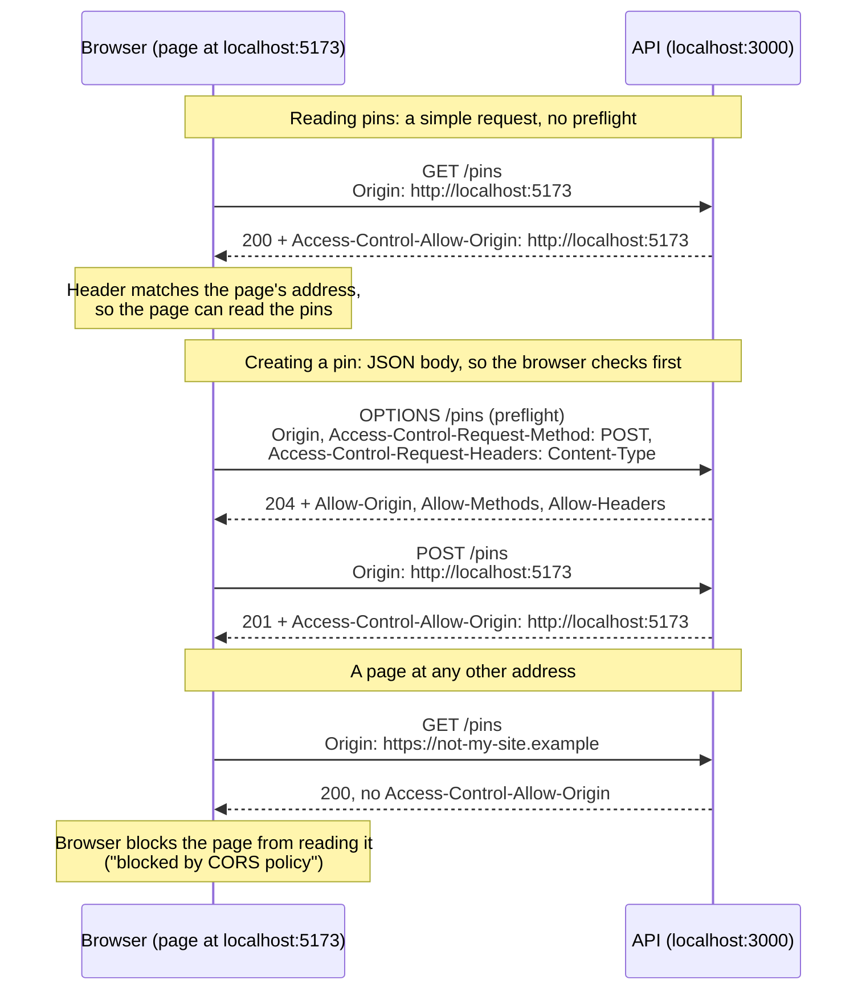

# Phase 2, Step 4 — Map data endpoint

Part of the [build plan](../build-plan.md#phase-2--the-api-serves-the-map).

- Starting point: [step 3](phase-1-step-3-store-pins-in-a-database.md) is built. `POST /pins`, `GET /pins` and `GET /pins/:id` read and write the database, and every pin comes back in full
- This step does two things: `GET /pins` returns only what the map needs, and a web app on a different address (like `http://localhost:5173`) is allowed to call the API from a browser
- No new endpoints, no new field rules and no new error codes

## What to build

The build checklist below is the definition of done. The step is complete when every case in it passes.

Task list

- Status: ✅ passes, 🟡 partly checked, ❌ needs rework, ⬜ not done
- Last reviewed 2026-10-28 (fourth pass): the empty-database and create-a-pin cases were run against an empty table and pass, so tasks 1 to 6 are done. Tasks 7 and 8 were accepted without being run, so the step is provisionally done

Deferred (28 Oct 2026): these were accepted without being run when step 4 was signed off. They are still untested:

- In a real browser → A page at the web app's address can read the pins
- In a real browser → A page at another address is blocked by the browser
- Every earlier case still passes (the step 2 and step 3 checklists, with `GET /pins` now trimmed)

| #   | Task                                                                                                             | Proved by these checklist cases                                                                                                                                                                                                            | Status                                                                       |
| --- | ---------------------------------------------------------------------------------------------------------------- | ------------------------------------------------------------------------------------------------------------------------------------------------------------------------------------------------------------------------------------------ | ---------------------------------------------------------------------------- |
| 1   | Make `GET /pins` return only `id`, `type` and `coords` for each pin                                              | Every case under [`GET /pins`](#get-pins)                                                                                                                                                                                                  | ✅ Passes                                                                    |
| 2   | Keep `GET /pins/:id` and `POST /pins` returning the full pin                                                     | Every case under [`GET /pins/:id`](#get-pinsid) and [`POST /pins`](#post-pins)                                                                                                                                                             | ✅ Passes                                                                    |
| 3   | Read the allowed web addresses from a `CORS_ORIGIN` list, and refuse to start without at least one           | Every case under [Configuration](#configuration)                                                                                                                                                                                           | ✅ Passes (missing, blank and list)                                          |
| 4   | Tell browsers that an allowed address may read the API's responses, and give no permission to any other address | [Allows the web app's address](#allows-the-web-apps-address) to [Still works with no Origin header](#still-works-with-no-origin-header)                                                                                                    | ✅ Passes                                                                    |
| 5   | Answer the browser's permission check (the preflight `OPTIONS` request) that comes before creating a pin         | [Answers the browser's preflight before creating a pin](#answers-the-browsers-preflight-before-creating-a-pin) and [Gives no permission in a preflight from any other address](#gives-no-permission-in-a-preflight-from-any-other-address) | ✅ Passes                                                                    |
| 6   | Send the permission on every response to an allowed address, including created pins, `400`s, `404`s and `500`s  | [Allows the web app to read a created pin](#allows-the-web-app-to-read-a-created-pin) to [Allows the web app to read a 500](#allows-the-web-app-to-read-a-500)                                                                             | ✅ Passes                                                                    |
| 7   | Check it in a real browser                                                                                       | Every case under [In a real browser](#in-a-real-browser)                                                                                                                                                                                   | 🟡 Accepted, not run (deferred) |
| 8   | Make sure nothing else changed                                                                                   | [Every earlier case still passes](#every-earlier-case-still-passes)                                                                                                                                                                        | 🟡 Accepted, not run (deferred) |

Endpoints

| Method    | Path        | Does                          | What changes in this step                                                |
| --------- | ----------- | ----------------------------- | ------------------------------------------------------------------------ |
| `GET`     | `/pins`     | Lists all pins for the map    | Each pin has only `id`, `type` and `coords`; still oldest first          |
| `GET`     | `/pins/:id` | Returns one pin               | Nothing in the body (step 5 adds votes, replies and the poster)          |
| `POST`    | `/pins`     | Adds a pin                    | Nothing in the body (step 13 changes what comes back)                    |
| `OPTIONS` | any path    | The browser's preflight check | New: answers `204` with the CORS permission headers                      |
| any       | any path    | Everything                    | A request from an allowed address gets the CORS permission headers back |

Error codes

- None new. Every error from steps 2 and 3 still applies, with the same status and body
- Any other address is not an error: the API still answers normally (usually `200`), just without the permission header. The browser is what blocks the page from reading the answer

What `GET /pins` returns

- A list (can be `[]`), oldest pin first
- Each item has exactly three fields: `id`, `type`, `coords { lat, lng }`
- No `description` and no `createdAt`. The web app gets those from `GET /pins/:id` when someone opens a pin
- Later steps change this list: step 6 filters by map area and type, step 7 by suburb or postcode, step 13 leaves out pending pins

What CORS permission looks like

| Response header                | When                                          | Value                                                                       |
| ------------------------------ | --------------------------------------------- | --------------------------------------------------------------------------- |
| `Access-Control-Allow-Origin`  | The request's `Origin` is an allowed address | That exact address, like `http://localhost:5173`. Never `*`                 |
| `Access-Control-Allow-Origin`  | No `Origin`, or any other address             | Not sent at all                                                             |
| `Vary`                         | The request's `Origin` is an allowed address | Includes `Origin`, so a cache never hands one site's answer to another site |
| `Access-Control-Allow-Methods` | Preflight from an allowed address             | Includes `POST`                                                             |
| `Access-Control-Allow-Headers` | Preflight from an allowed address             | Includes `Content-Type`                                                     |

- An address is the scheme, host and port together. `http://localhost:5173`, `http://localhost:5174` and `https://localhost:5173` are three different addresses
- Matching is exact: no wildcards, no "starts with"

Configuration

- `CORS_ORIGIN` in `api/.env` holds the allowed addresses as a comma-separated list. Usually it's one, the web app's: `http://localhost:5173`
- More than one looks like `http://localhost:5173,http://localhost:4173`. Spaces around the commas are ignored
- Write each address exactly as the browser sends it in `Origin`: scheme, host and port, with no trailing slash
- `http://localhost:5173` and `http://127.0.0.1:5173` are different addresses, so open the web app at the address in `CORS_ORIGIN`
- The API won't start without at least one address in `CORS_ORIGIN`, and says why in the terminal. Missing, blank, or only spaces and commas all count as none
- Step 22 sets `CORS_ORIGIN` on Render to the live web app's address. Each environment has its own list

How the browser uses CORS



- CORS only protects people using a browser. Postman, curl and other servers ignore it, so it is not a way to stop anyone calling the API (step 9 adds sign-in for that)

## Consider these approaches

Suggestions only. These are not acceptance criteria; any approach that passes the build checklist is fine.

Already in place

- The `cors` package and its types are already installed
- `config.ts` already refuses to start without `CORS_ORIGIN` (missing or blank), and already splits it into a list
- `CORS_ORIGIN` is already set in your `api/.env`

The map list

- Have the list query select only the id, type, lat and lng columns, rather than fetching whole rows and dropping fields afterwards
- Give the map item its own type (the build plan calls it `PinMapItem`), so TypeScript stops you adding `description` back by accident
- A second small transform (row to map item) next to the existing one keeps the snake_case to camelCase mapping in one place

CORS

- Read `CORS_ORIGIN` with the same required-variable check as `DATABASE_URL`, so a missing value stops the API with the right message
- Give the `cors` middleware the addresses as a list, even when there's only one, never a plain string. With a plain string, `cors` sends that address back on every response, even to other addresses and to requests with no `Origin`. With a list, it sends back the matching address only (not `*`), adds `Vary: Origin`, answers preflights with `204`, and sends nothing to any other address
- Register `cors` before everything else in `app.ts`, including the JSON parser. Middleware registered after the JSON parser is skipped when the JSON is broken, so the `400` would go out without the header
- Don't turn on credentials (cookies). Step 9 sends the sign-in token in an `Authorization` header, which needs adding to the allowed headers then, not cookies
- Don't use `*` for the origin, even in development. It hides mistakes in the address list until you deploy

## Build checklist

These cases are the acceptance criteria and the definition of done for this step. Each case is one Postman request (left) and the response it should get (right).

- Base URL: `http://localhost:3000`
- Unless a case says otherwise, start from a fresh database and run the seed, so `GET /pins` returns the six [sample pins](phase-1-step-3-store-pins-in-a-database.md#seed-script) with their fixed ids
- `api/.env` has `CORS_ORIGIN=http://localhost:5173` unless a case says otherwise
- Postman doesn't send an `Origin` header by itself. Add it in the request's Headers tab when a case lists one
- Response headers are on the Headers tab of the response, next to Body. Postman shows them all; only the ones listed matter
- Postman never blocks a response because of CORS, so these cases check the headers. The [real browser](#in-a-real-browser) cases check the browser actually lets the page read the data

## Every earlier case still passes

- Re-run the [step 2](phase-1-step-2-create-and-read-pins.md#build-checklist) and [step 3](phase-1-step-3-store-pins-in-a-database.md#build-checklist) build checklists
- Every `GET /pins` case in them now expects each item to have only `id`, `type` and `coords`, in the same order as before
- Every other case must get exactly the same response as before

## `GET /pins`

### Returns only id, type and coords for each pin

- The main test for this step
- Same six pins, same order (oldest first) as step 3's "Fills an empty database with the sample pins", minus `description` and `createdAt`

Request: `GET /pins`

<table class="req-res" style="table-layout: fixed; width: 100%;">
<colgroup><col style="width: 50%;"><col style="width: 50%;"></colgroup>
<tr><th style="width: 50%;">Request body</th><th style="width: 50%;">Response body — <code>200 OK</code></th></tr>
<tr><td style="width: 50%; vertical-align: top;">None</td><td style="width: 50%; vertical-align: top;">

```json
[
  {
    "id": "00000000-0000-4000-8000-000000000001",
    "type": "drainage",
    "coords": { "lat": -27.5098, "lng": 153.0331 }
  },
  {
    "id": "00000000-0000-4000-8000-000000000002",
    "type": "flooding",
    "coords": { "lat": -27.5085, "lng": 153.023 }
  },
  {
    "id": "00000000-0000-4000-8000-000000000003",
    "type": "wildlife",
    "coords": { "lat": -27.518, "lng": 153.016 }
  },
  {
    "id": "00000000-0000-4000-8000-000000000004",
    "type": "amenity",
    "coords": { "lat": -27.5352, "lng": 153.0241 }
  },
  {
    "id": "00000000-0000-4000-8000-000000000005",
    "type": "parking",
    "coords": { "lat": -27.481, "lng": 153.009 }
  },
  {
    "id": "00000000-0000-4000-8000-000000000006",
    "type": "recreation",
    "coords": { "lat": -27.4875, "lng": 153.0035 }
  }
]
```

</td></tr>
</table>

### Shows a new pin in the map list straight away

- Steps: start from a fresh database (no seed), create the pin below with `POST /pins`, then send `GET /pins`
- The `POST` still returns the full pin; only the list is trimmed

Request: `POST /pins`

<table class="req-res" style="table-layout: fixed; width: 100%;">
<colgroup><col style="width: 50%;"><col style="width: 50%;"></colgroup>
<tr><th style="width: 50%;">Request body</th><th style="width: 50%;">Response body — <code>201 Created</code></th></tr>
<tr><td style="width: 50%; vertical-align: top;">

```json
{
  "type": "drainage",
  "description": "Kerb near the drain fills fast in heavy rain",
  "coords": { "lat": -27.5098, "lng": 153.0331 }
}
```

</td><td style="width: 50%; vertical-align: top;">

```json
{
  "id": "8f1c2a90-4b7e-4d2a-9c11-3e5f6a7b8c9d",
  "type": "drainage",
  "description": "Kerb near the drain fills fast in heavy rain",
  "coords": { "lat": -27.5098, "lng": 153.0331 },
  "createdAt": "2026-10-24T09:30:00.000Z"
}
```

</td></tr>
</table>

Then: `GET /pins`

<table class="req-res" style="table-layout: fixed; width: 100%;">
<colgroup><col style="width: 50%;"><col style="width: 50%;"></colgroup>
<tr><th style="width: 50%;">Request body</th><th style="width: 50%;">Response body — <code>200 OK</code></th></tr>
<tr><td style="width: 50%; vertical-align: top;">None</td><td style="width: 50%; vertical-align: top;">

```json
[
  {
    "id": "8f1c2a90-4b7e-4d2a-9c11-3e5f6a7b8c9d",
    "type": "drainage",
    "coords": { "lat": -27.5098, "lng": 153.0331 }
  }
]
```

</td></tr>
</table>

### Returns an empty list, not a 404, when there are no pins

- Steps: start from a fresh database (no seed)

Request: `GET /pins`

<table class="req-res" style="table-layout: fixed; width: 100%;">
<colgroup><col style="width: 50%;"><col style="width: 50%;"></colgroup>
<tr><th style="width: 50%;">Request body</th><th style="width: 50%;">Response body — <code>200 OK</code></th></tr>
<tr><td style="width: 50%; vertical-align: top;">None</td><td style="width: 50%; vertical-align: top;">

```json
[]
```

</td></tr>
</table>

## `GET /pins/:id`

### Still returns the full pin

- Guards against trimming the wrong endpoint: one pin still has `description` and `createdAt`

Request: `GET /pins/00000000-0000-4000-8000-000000000003`

<table class="req-res" style="table-layout: fixed; width: 100%;">
<colgroup><col style="width: 50%;"><col style="width: 50%;"></colgroup>
<tr><th style="width: 50%;">Request body</th><th style="width: 50%;">Response body — <code>200 OK</code></th></tr>
<tr><td style="width: 50%; vertical-align: top;">None</td><td style="width: 50%; vertical-align: top;">

```json
{
  "id": "00000000-0000-4000-8000-000000000003",
  "type": "wildlife",
  "description": "Magpie swoops cyclists near the Yeronga park path in spring",
  "coords": { "lat": -27.518, "lng": 153.016 },
  "createdAt": "2026-10-03T08:00:00.000Z"
}
```

</td></tr>
</table>

## `POST /pins`

Content-Type: application/json

- In Postman: Body → raw → JSON

### Still returns the full pin after creating it

- Covered by the `POST` in [Shows a new pin in the map list straight away](#shows-a-new-pin-in-the-map-list-straight-away): the `201` body still has `description` and `createdAt`

## CORS

Every case here sets an `Origin` header in Postman. The right-hand side shows the response headers that matter, then the body.

### Allows the web app's address

- The response must name the address exactly. `*` fails this case
- Body: the same six pins as [Returns only id, type and coords for each pin](#returns-only-id-type-and-coords-for-each-pin)

Request: `GET /pins`

<table class="req-res" style="table-layout: fixed; width: 100%;">
<colgroup><col style="width: 50%;"><col style="width: 50%;"></colgroup>
<tr><th style="width: 50%;">Request headers</th><th style="width: 50%;">Response headers — <code>200 OK</code></th></tr>
<tr><td style="width: 50%; vertical-align: top;">

```text
Origin: http://localhost:5173
```

</td><td style="width: 50%; vertical-align: top;">

```text
Access-Control-Allow-Origin: http://localhost:5173
Vary: Origin
```

</td></tr>
</table>

### Gives no permission to any other address

- The API still answers `200` with the pins; it just leaves out the permission header
- Not a `403`: CORS is the browser's rule, and the browser is what refuses to hand the data to the page
- Body: the same six pins

Request: `GET /pins`

<table class="req-res" style="table-layout: fixed; width: 100%;">
<colgroup><col style="width: 50%;"><col style="width: 50%;"></colgroup>
<tr><th style="width: 50%;">Request headers</th><th style="width: 50%;">Response headers — <code>200 OK</code></th></tr>
<tr><td style="width: 50%; vertical-align: top;">

```text
Origin: https://not-my-site.example
```

</td><td style="width: 50%; vertical-align: top;">

```text
No Access-Control-Allow-Origin header
```

</td></tr>
</table>

### Treats a different port as a different address

- Guards against matching on "starts with `http://localhost`"
- Body: the same six pins

Request: `GET /pins`

<table class="req-res" style="table-layout: fixed; width: 100%;">
<colgroup><col style="width: 50%;"><col style="width: 50%;"></colgroup>
<tr><th style="width: 50%;">Request headers</th><th style="width: 50%;">Response headers — <code>200 OK</code></th></tr>
<tr><td style="width: 50%; vertical-align: top;">

```text
Origin: http://localhost:5174
```

</td><td style="width: 50%; vertical-align: top;">

```text
No Access-Control-Allow-Origin header
```

</td></tr>
</table>

### Still works with no Origin header

- Postman, curl and other servers don't send `Origin`, and must keep working
- Body: the same six pins

Request: `GET /pins`

<table class="req-res" style="table-layout: fixed; width: 100%;">
<colgroup><col style="width: 50%;"><col style="width: 50%;"></colgroup>
<tr><th style="width: 50%;">Request headers</th><th style="width: 50%;">Response headers — <code>200 OK</code></th></tr>
<tr><td style="width: 50%; vertical-align: top;">None</td><td style="width: 50%; vertical-align: top;">

```text
No Access-Control-Allow-Origin header
```

</td></tr>
</table>

### Answers the browser's preflight before creating a pin

- A browser sends this by itself before any `POST` with a JSON body from another address. In Postman, pick `OPTIONS` as the method
- `Access-Control-Allow-Methods` may list other methods too; it must include `POST`
- No body

Request: `OPTIONS /pins`

<table class="req-res" style="table-layout: fixed; width: 100%;">
<colgroup><col style="width: 50%;"><col style="width: 50%;"></colgroup>
<tr><th style="width: 50%;">Request headers</th><th style="width: 50%;">Response headers — <code>204 No Content</code></th></tr>
<tr><td style="width: 50%; vertical-align: top;">

```text
Origin: http://localhost:5173
Access-Control-Request-Method: POST
Access-Control-Request-Headers: Content-Type
```

</td><td style="width: 50%; vertical-align: top;">

```text
Access-Control-Allow-Origin: http://localhost:5173
Access-Control-Allow-Methods: GET,HEAD,PUT,PATCH,POST,DELETE
Access-Control-Allow-Headers: Content-Type
Vary: Origin
```

</td></tr>
</table>

### Gives no permission in a preflight from any other address

- The browser then never sends the `POST`, so no pin is created
- No body

Request: `OPTIONS /pins`

<table class="req-res" style="table-layout: fixed; width: 100%;">
<colgroup><col style="width: 50%;"><col style="width: 50%;"></colgroup>
<tr><th style="width: 50%;">Request headers</th><th style="width: 50%;">Response headers — <code>204 No Content</code></th></tr>
<tr><td style="width: 50%; vertical-align: top;">

```text
Origin: https://not-my-site.example
Access-Control-Request-Method: POST
Access-Control-Request-Headers: Content-Type
```

</td><td style="width: 50%; vertical-align: top;">

```text
No Access-Control-Allow-Origin header
```

</td></tr>
</table>

### Allows the web app to read a created pin

- Headers: `Origin: http://localhost:5173` and `Content-Type: application/json`

Request: `POST /pins`

<table class="req-res" style="table-layout: fixed; width: 100%;">
<colgroup><col style="width: 50%;"><col style="width: 50%;"></colgroup>
<tr><th style="width: 50%;">Request body</th><th style="width: 50%;">Response — <code>201 Created</code></th></tr>
<tr><td style="width: 50%; vertical-align: top;">

```json
{
  "type": "flooding",
  "description": "Water over the footpath after storms",
  "coords": { "lat": -27.5121, "lng": 153.0298 }
}
```

</td><td style="width: 50%; vertical-align: top;">

```text
Access-Control-Allow-Origin: http://localhost:5173
Vary: Origin
```

```json
{
  "id": "2b7d4e11-9a3c-4f5e-8d21-7c6b5a4e3f2d",
  "type": "flooding",
  "description": "Water over the footpath after storms",
  "coords": { "lat": -27.5121, "lng": 153.0298 },
  "createdAt": "2026-10-24T09:31:00.000Z"
}
```

</td></tr>
</table>

### Allows the web app to read a 404

- Without the header, the web app couldn't tell "pin not found" from "network down"
- Header: `Origin: http://localhost:5173`

Request: `GET /pins/7c1e9b2a-3d4f-4a5b-8c6d-9e0f1a2b3c4d`

<table class="req-res" style="table-layout: fixed; width: 100%;">
<colgroup><col style="width: 50%;"><col style="width: 50%;"></colgroup>
<tr><th style="width: 50%;">Request body</th><th style="width: 50%;">Response — <code>404 Not Found</code></th></tr>
<tr><td style="width: 50%; vertical-align: top;">None</td><td style="width: 50%; vertical-align: top;">

```text
Access-Control-Allow-Origin: http://localhost:5173
```

```json
{ "error": "Pin not found" }
```

</td></tr>
</table>

### Allows the web app to read a 404 for an unknown route

- Header: `Origin: http://localhost:5173`

Request: `GET /nothing-here`

<table class="req-res" style="table-layout: fixed; width: 100%;">
<colgroup><col style="width: 50%;"><col style="width: 50%;"></colgroup>
<tr><th style="width: 50%;">Request body</th><th style="width: 50%;">Response — <code>404 Not Found</code></th></tr>
<tr><td style="width: 50%; vertical-align: top;">None</td><td style="width: 50%; vertical-align: top;">

```text
Access-Control-Allow-Origin: http://localhost:5173
```

```json
{ "error": "Not found" }
```

</td></tr>
</table>

### Allows the web app to read a 400 for a pin that breaks a field rule

- Headers: `Origin: http://localhost:5173` and `Content-Type: application/json`

Request: `POST /pins`

<table class="req-res" style="table-layout: fixed; width: 100%;">
<colgroup><col style="width: 50%;"><col style="width: 50%;"></colgroup>
<tr><th style="width: 50%;">Request body</th><th style="width: 50%;">Response — <code>400 Bad Request</code></th></tr>
<tr><td style="width: 50%; vertical-align: top;">

```json
{}
```

</td><td style="width: 50%; vertical-align: top;">

```text
Access-Control-Allow-Origin: http://localhost:5173
```

```json
{
  "error": "Invalid pin",
  "details": [
    { "field": "type", "message": "Type is required" },
    { "field": "description", "message": "Description is required" },
    { "field": "coords", "message": "Location is required" }
  ]
}
```

</td></tr>
</table>

### Allows the web app to read a 400 for broken JSON

- Guards against the JSON parser failing before the CORS headers are added
- Headers: `Origin: http://localhost:5173` and `Content-Type: application/json`
- In Postman: Body → raw → JSON, and type the broken body below exactly (missing closing brace)
- The `error` message must match what step 2's broken-JSON case returns

Request: `POST /pins`

<table class="req-res" style="table-layout: fixed; width: 100%;">
<colgroup><col style="width: 50%;"><col style="width: 50%;"></colgroup>
<tr><th style="width: 50%;">Request body</th><th style="width: 50%;">Response — <code>400 Bad Request</code></th></tr>
<tr><td style="width: 50%; vertical-align: top;">

```text
{ "type": "drainage", "description": "Kerb near the drain fills fast"
```

</td><td style="width: 50%; vertical-align: top;">

```text
Access-Control-Allow-Origin: http://localhost:5173
```

```json
{ "error": "Request body is not valid JSON" }
```

</td></tr>
</table>

### Allows the web app to read a 500

- Steps: make the database unreachable (turn off Wi-Fi), send the request below, then turn Wi-Fi back on
- Header: `Origin: http://localhost:5173`
- Never send the stack trace, the SQL error or the database address

Request: `GET /pins`

<table class="req-res" style="table-layout: fixed; width: 100%;">
<colgroup><col style="width: 50%;"><col style="width: 50%;"></colgroup>
<tr><th style="width: 50%;">Request body</th><th style="width: 50%;">Response — <code>500 Internal Server Error</code></th></tr>
<tr><td style="width: 50%; vertical-align: top;">None</td><td style="width: 50%; vertical-align: top;">

```text
Access-Control-Allow-Origin: http://localhost:5173
```

```json
{ "error": "Something went wrong" }
```

</td></tr>
</table>

## Configuration

### Refuses to start without CORS_ORIGIN

- Steps:
  1. Comment out `CORS_ORIGIN` in `api/.env`
  2. Run `npm run dev` in `api/`
  3. Put `CORS_ORIGIN` back afterwards
- The API must not start listening on port 3000
- Guards against going live with no allowed address and a web app that silently can't load any pins

<table class="req-res" style="table-layout: fixed; width: 100%;">
<colgroup><col style="width: 50%;"><col style="width: 50%;"></colgroup>
<tr><th style="width: 50%;">Do this</th><th style="width: 50%;">Terminal shows</th></tr>
<tr><td style="width: 50%; vertical-align: top;">

```bash
npm run dev
```

</td><td style="width: 50%; vertical-align: top;">

```text
CORS_ORIGIN is not set.
```

</td></tr>
</table>

### Refuses to start when CORS_ORIGIN has no addresses in it

- Steps:
  1. Change the line in `api/.env` to `CORS_ORIGIN= , `
  2. Run `npm run dev` in `api/`
  3. Put `CORS_ORIGIN` back afterwards
- The API must not start listening on port 3000, and must say why. Stopping with no message fails this case

<table class="req-res" style="table-layout: fixed; width: 100%;">
<colgroup><col style="width: 50%;"><col style="width: 50%;"></colgroup>
<tr><th style="width: 50%;">Do this</th><th style="width: 50%;">Terminal shows</th></tr>
<tr><td style="width: 50%; vertical-align: top;">

```bash
npm run dev
```

</td><td style="width: 50%; vertical-align: top;">

```text
CORS_ORIGIN is not set.
```

</td></tr>
</table>

### Allows every address in a list

- Steps:
  1. Change the line in `api/.env` to `CORS_ORIGIN=http://localhost:5173, http://localhost:4173` (the space is on purpose)
  2. Restart the API and send the request below twice, once with each `Origin`
  3. Put `CORS_ORIGIN` back afterwards
- Each response names only the address that asked, never both
- `Origin: http://localhost:5174` still gets no `Access-Control-Allow-Origin` header
- Body: the same six pins

Request: `GET /pins`

<table class="req-res" style="table-layout: fixed; width: 100%;">
<colgroup><col style="width: 50%;"><col style="width: 50%;"></colgroup>
<tr><th style="width: 50%;">Request headers</th><th style="width: 50%;">Response headers — <code>200 OK</code></th></tr>
<tr><td style="width: 50%; vertical-align: top;">

```text
Origin: http://localhost:5173
```

```text
Origin: http://localhost:4173
```

</td><td style="width: 50%; vertical-align: top;">

```text
Access-Control-Allow-Origin: http://localhost:5173
Vary: Origin
```

```text
Access-Control-Allow-Origin: http://localhost:4173
Vary: Origin
```

</td></tr>
</table>

## In a real browser

These two cases are the build plan's "done when": a page on another address can fetch the pins without a CORS error. They need a page served from `http://localhost:5173`. If the web app isn't running yet, serve an empty folder instead.

- Use Chrome (other browsers word the error differently)
- Keep the API running on port 3000 with `CORS_ORIGIN=http://localhost:5173`

### A page at the web app's address can read the pins

- Steps:
  1. In a new terminal, from an empty folder, run the first command below
  2. Open `http://localhost:5173` in Chrome, then open DevTools → Console
  3. Paste the second line into the console and press Enter
- The console prints the six sample pins, each with only `id`, `type` and `coords`
- No red CORS error in the console

<table class="req-res" style="table-layout: fixed; width: 100%;">
<colgroup><col style="width: 50%;"><col style="width: 50%;"></colgroup>
<tr><th style="width: 50%;">Do this</th><th style="width: 50%;">Console shows</th></tr>
<tr><td style="width: 50%; vertical-align: top;">

```bash
python3 -m http.server 5173
```

```text
fetch('http://localhost:3000/pins').then((r) => r.json()).then(console.log)
```

</td><td style="width: 50%; vertical-align: top;">

```text
(6) [{…}, {…}, {…}, {…}, {…}, {…}]
```

</td></tr>
</table>

- Chrome shortens the list on one line; click the arrow to expand it and check the fields

### A page at another address is blocked by the browser

- Steps: stop the server from the case above, run it on port 8080 instead, open `http://localhost:8080`, and paste the same line into the console
- Then open DevTools → Network and click the `pins` request: it shows `200`. The API answered; the browser is what refused to hand the data to the page

<table class="req-res" style="table-layout: fixed; width: 100%;">
<colgroup><col style="width: 50%;"><col style="width: 50%;"></colgroup>
<tr><th style="width: 50%;">Do this</th><th style="width: 50%;">Console shows</th></tr>
<tr><td style="width: 50%; vertical-align: top;">

```bash
python3 -m http.server 8080
```

```text
fetch('http://localhost:3000/pins').then((r) => r.json()).then(console.log)
```

</td><td style="width: 50%; vertical-align: top;">

```text
Access to fetch at 'http://localhost:3000/pins' from origin 'http://localhost:8080' has been blocked by CORS policy: No 'Access-Control-Allow-Origin' header is present on the requested resource.

Uncaught (in promise) TypeError: Failed to fetch
```

</td></tr>
</table>

## Every response

- Same rules as steps 2 and 3: sent as is, with no `status` / `message` / `data` wrapper, and no stack trace, SQL error or database address in a `500`
- Items in `GET /pins` have exactly `id`, `type` and `coords`, nothing more
- A request from an allowed address gets `Access-Control-Allow-Origin` set to that exact address on every response, success or error
- A request with no `Origin`, or from any other address, never gets `Access-Control-Allow-Origin`
- `Access-Control-Allow-Origin` is never `*`
