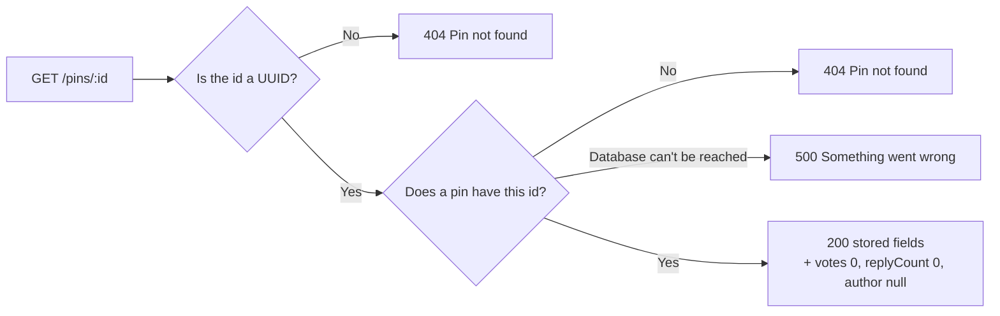

# Phase 2, Step 5 — Get one pin

Part of the [build plan](../build-plan.md#phase-2--the-api-serves-the-map).

- Starting point: [step 4](phase-2-step-4-map-data-endpoint.md) is built. `GET /pins` returns only `id`, `type` and `coords`, CORS is on, and `GET /pins/:id` already returns the stored pin or `404`
- This step does one thing: `GET /pins/:id` returns the full pin details the web app's pin page needs, in their final shape, so the web app can open a pin straight from a link
- Votes, replies and posters don't exist yet. `votes`, `replyCount` and `author` are added now with their "nothing yet" values (`0`, `0` and `null`). Step 11 fills in `author`, step 14 `replyCount` and step 15 `votes`
- No new endpoints, no new field rules and no new error codes

## What to build

The build checklist below is the definition of done. The step is complete when every case in it passes.

Task list

- Status: ✅ passes, 🟡 partly checked, ❌ needs rework, ⬜ not done

| #   | Task                                                                                          | Proved by these checklist cases                                                                                                                                                 | Status      |
| --- | --------------------------------------------------------------------------------------------- | ------------------------------------------------------------------------------------------------------------------------------------------------------------------------------- | ----------- |
| 1   | Make `GET /pins/:id` return the pin details: the stored fields plus `votes`, `replyCount` and `author` | [Returns a seed pin's full details](#returns-a-seed-pins-full-details) to [Returns the same shape for every pin](#returns-the-same-shape-for-every-pin)                          | ⬜ Not done |
| 2   | Return the details for a pin created through the API                                          | [Returns full details for a pin created through the API](#returns-full-details-for-a-pin-created-through-the-api)                                                               | ⬜ Not done |
| 3   | Find a pin whatever the case of its id                                                        | [Finds a pin when the id is in capitals](#finds-a-pin-when-the-id-is-in-capitals)                                                                                               | ⬜ Not done |
| 4   | Keep returning `404` for a pin that doesn't exist, and `500` when the database is down         | [Returns 404 for a UUID that no pin has](#returns-404-for-a-uuid-that-no-pin-has) to [Returns a generic 500 when the database is down](#returns-a-generic-500-when-the-database-is-down) | ⬜ Not done |
| 5   | Keep paths and methods under a pin that don't exist yet returning the unknown-route `404`      | Every case under [Paths and methods that don't exist yet](#paths-and-methods-that-dont-exist-yet)                                                                               | ⬜ Not done |
| 6   | Keep the CORS permission on the pin details                                                   | Every case under [CORS](#cors)                                                                                                                                                  | ⬜ Not done |
| 7   | Make sure nothing else changed, including `GET /pins` and `POST /pins`                         | [Every earlier case still passes](#every-earlier-case-still-passes), and every case under [`GET /pins`](#get-pins) and [`POST /pins`](#post-pins)                                | ⬜ Not done |

Endpoints

| Method | Path        | Does                       | What changes in this step                                                 |
| ------ | ----------- | -------------------------- | ------------------------------------------------------------------------- |
| `GET`  | `/pins/:id` | Returns one pin's details  | Adds `votes`, `replyCount` and `author` after the stored fields            |
| `GET`  | `/pins`     | Lists all pins for the map | Nothing. Items still have only `id`, `type` and `coords`                   |
| `POST` | `/pins`     | Adds a pin                 | Nothing. Still returns the stored pin without the new fields (step 13 changes what comes back) |

Error codes

| Status | When                                                                 | Body                                  |
| ------ | -------------------------------------------------------------------- | ------------------------------------- |
| `404`  | The id isn't a UUID, or it's a UUID no pin has                        | `{ "error": "Pin not found" }`        |
| `404`  | A path or method under `/pins/:id` with no route yet (like `/replies`) | `{ "error": "Not found" }`            |
| `500`  | The database can't be reached, or anything else breaks                | `{ "error": "Something went wrong" }` |

- None of these are new. They must keep the same status and body as in steps 2 to 4

What `GET /pins/:id` returns

| Field         | What it is                                     | Value in this step                                   | Filled in by |
| ------------- | ---------------------------------------------- | ---------------------------------------------------- | ------------ |
| `id`          | The pin's UUID, always lowercase               | As stored                                            | Step 2       |
| `type`        | One of the pin types                           | As stored                                            | Step 2       |
| `description` | The trimmed description                        | As stored                                            | Step 2       |
| `coords`      | `{ lat, lng }`, both numbers                   | As stored                                            | Step 2       |
| `createdAt`   | ISO date string in UTC, ending in `Z`          | As stored                                            | Step 2       |
| `votes`       | Total of up and down votes, a whole number     | Always `0`                                           | Step 15      |
| `replyCount`  | How many replies the pin has, a whole number   | Always `0`                                           | Step 14      |
| `author`      | The poster's public details, or `null`         | Always `null` (no pin has a poster yet)              | Step 11      |

- Fields come back in the order above
- `votes` and `replyCount` are numbers, never text, and never missing
- `author` is `null`, never missing and never `{}`. The web app shows a pin with no poster without crashing
- Step 11 makes `author` `{ displayName, livesNearby, yearsAtAddress }` for pins posted by a signed-in user. Pins posted before then (like the seed pins) keep `author: null`
- Step 20 adds an optional `label` for approved pins from someone who doesn't live nearby
- Nothing here is stored in the database yet. No new columns and no migration

How a request for one pin flows



## Consider these approaches

Suggestions only. These are not acceptance criteria; any approach that passes the build checklist is fine.

- Give the details their own type (the build plan calls it `PinDetail`), built on the existing `Pin` type, so TypeScript stops `votes`, `replyCount` or `author` going missing
- Add a small transform from a stored pin to its details, next to the existing ones, and put the `0`, `0` and `null` values there in one place. Steps 11, 14 and 15 then only change that one spot
- Use the transform only in the `GET /pins/:id` route, so `POST /pins` and `GET /pins` keep their current bodies
- Don't add `votes` or `reply_count` columns. In steps 14 and 15 the numbers come from counting rows in the replies and votes tables
- Make `author` its own small type now (`PublicAuthor`, allowed to be `null`), so step 11 only has to fill it in

## Build checklist

These cases are the acceptance criteria and the definition of done for this step. Each case is one Postman request (left) and the response it should get (right).

- Base URL: `http://localhost:3000`
- Unless a case says otherwise, start from a fresh database and run the seed, so the six [sample pins](phase-1-step-3-store-pins-in-a-database.md#seed-script) exist with their fixed ids
- `api/.env` has `CORS_ORIGIN=http://localhost:5173`
- No headers are needed unless a case lists them

## Every earlier case still passes

- Re-run the [step 2](phase-1-step-2-create-and-read-pins.md#build-checklist), [step 3](phase-1-step-3-store-pins-in-a-database.md#build-checklist) and [step 4](phase-2-step-4-map-data-endpoint.md#build-checklist) build checklists
- Every `200` case for `GET /pins/:id` in them now also expects `"votes": 0`, `"replyCount": 0` and `"author": null` at the end of the body
- Every other case must get exactly the same response as before, including every `GET /pins` and `POST /pins` case

## `GET /pins/:id`

### Returns a seed pin's full details

- The main test for this step
- The stored fields are exactly as in step 3's "Returns a sample pin from the seed", with the three new fields after them

Request: `GET /pins/00000000-0000-4000-8000-000000000001`

<table class="req-res" style="table-layout: fixed; width: 100%;">
<colgroup><col style="width: 50%;"><col style="width: 50%;"></colgroup>
<tr><th style="width: 50%;">Request body</th><th style="width: 50%;">Response body — <code>200 OK</code></th></tr>
<tr><td style="width: 50%; vertical-align: top;">None</td><td style="width: 50%; vertical-align: top;">

```json
{
  "id": "00000000-0000-4000-8000-000000000001",
  "type": "drainage",
  "description": "Gutter on Ipswich Road overflows in every big storm",
  "coords": { "lat": -27.5098, "lng": 153.0331 },
  "createdAt": "2026-10-01T08:00:00.000Z",
  "votes": 0,
  "replyCount": 0,
  "author": null
}
```

</td></tr>
</table>

### Sends votes and replyCount as numbers and author as null

- Guards against `"0"` as text, a missing `author`, or `"author": {}`
- In Postman, check the Pretty view: `0` is not in quotes, and `null` is not in quotes
- Same request and body as [Returns a seed pin's full details](#returns-a-seed-pins-full-details), using a different pin

Request: `GET /pins/00000000-0000-4000-8000-000000000004`

<table class="req-res" style="table-layout: fixed; width: 100%;">
<colgroup><col style="width: 50%;"><col style="width: 50%;"></colgroup>
<tr><th style="width: 50%;">Request body</th><th style="width: 50%;">Response body — <code>200 OK</code></th></tr>
<tr><td style="width: 50%; vertical-align: top;">None</td><td style="width: 50%; vertical-align: top;">

```json
{
  "id": "00000000-0000-4000-8000-000000000004",
  "type": "amenity",
  "description": "Clean public toilets with a parent room at Moorooka park",
  "coords": { "lat": -27.5352, "lng": 153.0241 },
  "createdAt": "2026-10-04T08:00:00.000Z",
  "votes": 0,
  "replyCount": 0,
  "author": null
}
```

</td></tr>
</table>

### Returns the same shape for every pin

- Guards against the new fields only being added for some pins
- Steps: send the request below for each seed id, from `00000000-0000-4000-8000-000000000001` to `00000000-0000-4000-8000-000000000006`
- Each response has the same eight fields in the same order, with that pin's stored values and `0`, `0`, `null` at the end
- The last pin is shown here

Request: `GET /pins/00000000-0000-4000-8000-000000000006`

<table class="req-res" style="table-layout: fixed; width: 100%;">
<colgroup><col style="width: 50%;"><col style="width: 50%;"></colgroup>
<tr><th style="width: 50%;">Request body</th><th style="width: 50%;">Response body — <code>200 OK</code></th></tr>
<tr><td style="width: 50%; vertical-align: top;">None</td><td style="width: 50%; vertical-align: top;">

```json
{
  "id": "00000000-0000-4000-8000-000000000006",
  "type": "recreation",
  "description": "Shady picnic tables by the river at Orleigh Park",
  "coords": { "lat": -27.4875, "lng": 153.0035 },
  "createdAt": "2026-10-06T08:00:00.000Z",
  "votes": 0,
  "replyCount": 0,
  "author": null
}
```

</td></tr>
</table>

### Returns full details for a pin created through the API

- Guards against the new fields only appearing for seed pins
- Steps: create the pin below with `POST /pins` (Body → raw → JSON), then send `GET /pins/<id>` with the `id` it returns
- The `POST` response is unchanged: no `votes`, `replyCount` or `author`
- Your `id` and `createdAt` will differ; the `GET` must match the `POST` for both

Request: `POST /pins`

<table class="req-res" style="table-layout: fixed; width: 100%;">
<colgroup><col style="width: 50%;"><col style="width: 50%;"></colgroup>
<tr><th style="width: 50%;">Request body</th><th style="width: 50%;">Response body — <code>201 Created</code></th></tr>
<tr><td style="width: 50%; vertical-align: top;">

```json
{
  "type": "drainage",
  "description": "Kerb near the drain fills fast in heavy rain",
  "coords": { "lat": -27.5098, "lng": 153.0331 }
}
```

</td><td style="width: 50%; vertical-align: top;">

```json
{
  "id": "8f1c2a90-4b7e-4d2a-9c11-3e5f6a7b8c9d",
  "type": "drainage",
  "description": "Kerb near the drain fills fast in heavy rain",
  "coords": { "lat": -27.5098, "lng": 153.0331 },
  "createdAt": "2026-10-24T09:30:00.000Z"
}
```

</td></tr>
</table>

Then: `GET /pins/8f1c2a90-4b7e-4d2a-9c11-3e5f6a7b8c9d`

<table class="req-res" style="table-layout: fixed; width: 100%;">
<colgroup><col style="width: 50%;"><col style="width: 50%;"></colgroup>
<tr><th style="width: 50%;">Request body</th><th style="width: 50%;">Response body — <code>200 OK</code></th></tr>
<tr><td style="width: 50%; vertical-align: top;">None</td><td style="width: 50%; vertical-align: top;">

```json
{
  "id": "8f1c2a90-4b7e-4d2a-9c11-3e5f6a7b8c9d",
  "type": "drainage",
  "description": "Kerb near the drain fills fast in heavy rain",
  "coords": { "lat": -27.5098, "lng": 153.0331 },
  "createdAt": "2026-10-24T09:30:00.000Z",
  "votes": 0,
  "replyCount": 0,
  "author": null
}
```

</td></tr>
</table>

### Finds a pin when the id is in capitals

- A link can be copied or typed with a capitalised id. UUIDs aren't case-sensitive, so it's the same pin
- Steps: use the pin from [Returns full details for a pin created through the API](#returns-full-details-for-a-pin-created-through-the-api), with its id in capitals
- The `id` in the response is lowercase, as stored

Request: `GET /pins/8F1C2A90-4B7E-4D2A-9C11-3E5F6A7B8C9D`

<table class="req-res" style="table-layout: fixed; width: 100%;">
<colgroup><col style="width: 50%;"><col style="width: 50%;"></colgroup>
<tr><th style="width: 50%;">Request body</th><th style="width: 50%;">Response body — <code>200 OK</code></th></tr>
<tr><td style="width: 50%; vertical-align: top;">None</td><td style="width: 50%; vertical-align: top;">

```json
{
  "id": "8f1c2a90-4b7e-4d2a-9c11-3e5f6a7b8c9d",
  "type": "drainage",
  "description": "Kerb near the drain fills fast in heavy rain",
  "coords": { "lat": -27.5098, "lng": 153.0331 },
  "createdAt": "2026-10-24T09:30:00.000Z",
  "votes": 0,
  "replyCount": 0,
  "author": null
}
```

</td></tr>
</table>

### Ignores a query string

- A shared link might have tracking added to it, like `?utm_source=facebook`
- Body: the same as [Returns a seed pin's full details](#returns-a-seed-pins-full-details)

Request: `GET /pins/00000000-0000-4000-8000-000000000001?utm_source=facebook`

<table class="req-res" style="table-layout: fixed; width: 100%;">
<colgroup><col style="width: 50%;"><col style="width: 50%;"></colgroup>
<tr><th style="width: 50%;">Request body</th><th style="width: 50%;">Response body — <code>200 OK</code></th></tr>
<tr><td style="width: 50%; vertical-align: top;">None</td><td style="width: 50%; vertical-align: top;">

```json
{
  "id": "00000000-0000-4000-8000-000000000001",
  "type": "drainage",
  "description": "Gutter on Ipswich Road overflows in every big storm",
  "coords": { "lat": -27.5098, "lng": 153.0331 },
  "createdAt": "2026-10-01T08:00:00.000Z",
  "votes": 0,
  "replyCount": 0,
  "author": null
}
```

</td></tr>
</table>

### Returns 404 for a UUID that no pin has

- The build plan's "done when": a made-up id returns `404`
- The body is the same as before, with no `votes`, `replyCount` or `author`

Request: `GET /pins/7c1e9b2a-3d4f-4a5b-8c6d-9e0f1a2b3c4d`

<table class="req-res" style="table-layout: fixed; width: 100%;">
<colgroup><col style="width: 50%;"><col style="width: 50%;"></colgroup>
<tr><th style="width: 50%;">Request body</th><th style="width: 50%;">Response body — <code>404 Not Found</code></th></tr>
<tr><td style="width: 50%; vertical-align: top;">None</td><td style="width: 50%; vertical-align: top;">

```json
{ "error": "Pin not found" }
```

</td></tr>
</table>

### Returns 404, not 500, for an id that isn't a UUID

- Guards against the database error for a bad UUID turning into a `500`

Request: `GET /pins/does-not-exist`

<table class="req-res" style="table-layout: fixed; width: 100%;">
<colgroup><col style="width: 50%;"><col style="width: 50%;"></colgroup>
<tr><th style="width: 50%;">Request body</th><th style="width: 50%;">Response body — <code>404 Not Found</code></th></tr>
<tr><td style="width: 50%; vertical-align: top;">None</td><td style="width: 50%; vertical-align: top;">

```json
{ "error": "Pin not found" }
```

</td></tr>
</table>

### Returns 404 for an id one character short

- A link cut off when it was copied. Looks like a UUID, but isn't one

Request: `GET /pins/00000000-0000-4000-8000-00000000000`

<table class="req-res" style="table-layout: fixed; width: 100%;">
<colgroup><col style="width: 50%;"><col style="width: 50%;"></colgroup>
<tr><th style="width: 50%;">Request body</th><th style="width: 50%;">Response body — <code>404 Not Found</code></th></tr>
<tr><td style="width: 50%; vertical-align: top;">None</td><td style="width: 50%; vertical-align: top;">

```json
{ "error": "Pin not found" }
```

</td></tr>
</table>

### Returns 404 for the all-zero UUID

- A valid UUID that no pin will ever have. Guards against treating it as "no id" and returning the first pin

Request: `GET /pins/00000000-0000-0000-0000-000000000000`

<table class="req-res" style="table-layout: fixed; width: 100%;">
<colgroup><col style="width: 50%;"><col style="width: 50%;"></colgroup>
<tr><th style="width: 50%;">Request body</th><th style="width: 50%;">Response body — <code>404 Not Found</code></th></tr>
<tr><td style="width: 50%; vertical-align: top;">None</td><td style="width: 50%; vertical-align: top;">

```json
{ "error": "Pin not found" }
```

</td></tr>
</table>

### Returns a generic 500 when the database is down

- Steps: make the database unreachable (turn off Wi-Fi), send the request below, then turn Wi-Fi back on
- The API must keep running, and answers within a few seconds
- Never send the stack trace, the SQL error or the database address

Request: `GET /pins/00000000-0000-4000-8000-000000000001`

<table class="req-res" style="table-layout: fixed; width: 100%;">
<colgroup><col style="width: 50%;"><col style="width: 50%;"></colgroup>
<tr><th style="width: 50%;">Request body</th><th style="width: 50%;">Response body — <code>500 Internal Server Error</code></th></tr>
<tr><td style="width: 50%; vertical-align: top;">None</td><td style="width: 50%; vertical-align: top;">

```json
{ "error": "Something went wrong" }
```

</td></tr>
</table>

## Paths and methods that don't exist yet

- These come in later steps. Until then they get the same unknown-route `404` as any other path, not `Pin not found` and not a `500`

### Returns 404 for a pin's replies before step 14

Request: `GET /pins/00000000-0000-4000-8000-000000000001/replies`

<table class="req-res" style="table-layout: fixed; width: 100%;">
<colgroup><col style="width: 50%;"><col style="width: 50%;"></colgroup>
<tr><th style="width: 50%;">Request body</th><th style="width: 50%;">Response body — <code>404 Not Found</code></th></tr>
<tr><td style="width: 50%; vertical-align: top;">None</td><td style="width: 50%; vertical-align: top;">

```json
{ "error": "Not found" }
```

</td></tr>
</table>

### Returns 404 for deleting a pin before step 18

- In Postman, pick `DELETE` as the method
- Steps: afterwards, send `GET /pins/00000000-0000-4000-8000-000000000001` and check the pin is still there

Request: `DELETE /pins/00000000-0000-4000-8000-000000000001`

<table class="req-res" style="table-layout: fixed; width: 100%;">
<colgroup><col style="width: 50%;"><col style="width: 50%;"></colgroup>
<tr><th style="width: 50%;">Request body</th><th style="width: 50%;">Response body — <code>404 Not Found</code></th></tr>
<tr><td style="width: 50%; vertical-align: top;">None</td><td style="width: 50%; vertical-align: top;">

```json
{ "error": "Not found" }
```

</td></tr>
</table>

## `GET /pins`

### Still returns only id, type and coords for each pin

- Guards against the new fields leaking into the map list
- Same six pins, same order, same body as step 4's [Returns only id, type and coords for each pin](phase-2-step-4-map-data-endpoint.md#returns-only-id-type-and-coords-for-each-pin). The first two are shown here

Request: `GET /pins`

<table class="req-res" style="table-layout: fixed; width: 100%;">
<colgroup><col style="width: 50%;"><col style="width: 50%;"></colgroup>
<tr><th style="width: 50%;">Request body</th><th style="width: 50%;">Response body — <code>200 OK</code></th></tr>
<tr><td style="width: 50%; vertical-align: top;">None</td><td style="width: 50%; vertical-align: top;">

```json
[
  {
    "id": "00000000-0000-4000-8000-000000000001",
    "type": "drainage",
    "coords": { "lat": -27.5098, "lng": 153.0331 }
  },
  {
    "id": "00000000-0000-4000-8000-000000000002",
    "type": "flooding",
    "coords": { "lat": -27.5085, "lng": 153.023 }
  }
]
```

</td></tr>
</table>

## `POST /pins`

Content-Type: application/json

### Still returns the stored pin without the new fields

- Covered by the `POST` in [Returns full details for a pin created through the API](#returns-full-details-for-a-pin-created-through-the-api): the `201` body has exactly `id`, `type`, `description`, `coords` and `createdAt`

## CORS

### Allows the web app to read a pin's details

- Header: `Origin: http://localhost:5173`
- Body: the same as [Returns a seed pin's full details](#returns-a-seed-pins-full-details)

Request: `GET /pins/00000000-0000-4000-8000-000000000001`

<table class="req-res" style="table-layout: fixed; width: 100%;">
<colgroup><col style="width: 50%;"><col style="width: 50%;"></colgroup>
<tr><th style="width: 50%;">Request headers</th><th style="width: 50%;">Response headers — <code>200 OK</code></th></tr>
<tr><td style="width: 50%; vertical-align: top;">

```text
Origin: http://localhost:5173
```

</td><td style="width: 50%; vertical-align: top;">

```text
Access-Control-Allow-Origin: http://localhost:5173
Vary: Origin
```

</td></tr>
</table>

### Gives no permission to any other address

- The API still answers `200` with the details; it just leaves out the permission header
- Body: the same as [Returns a seed pin's full details](#returns-a-seed-pins-full-details)

Request: `GET /pins/00000000-0000-4000-8000-000000000001`

<table class="req-res" style="table-layout: fixed; width: 100%;">
<colgroup><col style="width: 50%;"><col style="width: 50%;"></colgroup>
<tr><th style="width: 50%;">Request headers</th><th style="width: 50%;">Response headers — <code>200 OK</code></th></tr>
<tr><td style="width: 50%; vertical-align: top;">

```text
Origin: https://not-my-site.example
```

</td><td style="width: 50%; vertical-align: top;">

```text
No Access-Control-Allow-Origin header
```

</td></tr>
</table>

## Every response

- Same rules as steps 2 to 4: sent as is, with no `status` / `message` / `data` wrapper, and no stack trace, SQL error or database address in a `500`
- A `200` from `GET /pins/:id` has exactly eight fields: `id`, `type`, `description`, `coords`, `createdAt`, `votes`, `replyCount` and `author`
- `votes` and `replyCount` are always whole numbers, and `author` is always present (`null` in this step)
- No other endpoint gains `votes`, `replyCount` or `author` in this step
- A request from an allowed address gets `Access-Control-Allow-Origin` set to that exact address; any other address, or no `Origin`, never gets it
