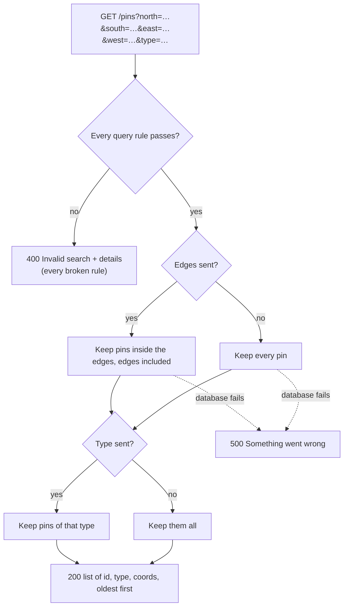

# Phase 2, Step 5 — Pins in an area, filtered by type

Part of the [build plan](../build-plan.md#phase-2--the-api-serves-the-map).

- Starting point: [step 4](phase-2-step-4-map-data-endpoint.md) is built. `GET /pins` returns every pin with only `id`, `type` and `coords`, and allowed web addresses get CORS permission
- This step does one thing: `GET /pins` accepts the map's four edges and an optional type, and returns only the pins that match. A database index on location keeps the area lookup fast
- No new endpoints. `GET /pins` with no query parameters works exactly as before

## What to build

The build checklist below is the definition of done. The step is complete when every case in it passes.

Task list

- Status: ✅ passes, 🟡 partly checked, ❌ needs rework, ⬜ not done

| #   | Task                                                                         | Proved by these checklist cases                                                                                                                                                                                                | Status      |
| --- | ---------------------------------------------------------------------------- | ------------------------------------------------------------------------------------------------------------------------------------------------------------------------------------------------------------------------------ | ----------- |
| 1   | Return only the pins inside the four map edges, edges included               | [Returns only the pins inside the map area](#returns-only-the-pins-inside-the-map-area) to [Ignores query parameters it doesn't know](#ignores-query-parameters-it-doesnt-know)                                               | ⬜ Not done |
| 2   | Filter by type, with or without an area                                      | [Filters by type inside the map area](#filters-by-type-inside-the-map-area) to [Returns an empty list for a type with no pins](#returns-an-empty-list-for-a-type-with-no-pins)                                                 | ⬜ Not done |
| 3   | Reject a search that breaks a query rule, with every broken rule in one `400` | Every case under [Rejects a bad search](#rejects-a-bad-search)                                                                                                                                                                 | ⬜ Not done |
| 4   | Add a database index on location, through a migration                        | [The migration adds an index on location](#the-migration-adds-an-index-on-location)                                                                                                                                            | ⬜ Not done |
| 5   | Make sure nothing else changed                                               | [Every earlier case still passes](#every-earlier-case-still-passes)                                                                                                                                                            | ⬜ Not done |

Endpoints

| Method | Path        | Does                       | What changes in this step                                                        |
| ------ | ----------- | -------------------------- | -------------------------------------------------------------------------------- |
| `GET`  | `/pins`     | Lists pins for the map     | New optional query parameters: `north`, `south`, `east`, `west` and `type`       |
| `GET`  | `/pins/:id` | Returns one pin            | Nothing                                                                          |
| `POST` | `/pins`     | Adds a pin                 | Nothing                                                                          |

Error codes

| Code  | `error` message              | When                                      | Endpoint    |
| ----- | ---------------------------- | ----------------------------------------- | ----------- |
| `400` | "Invalid search" + `details` | A query parameter breaks a rule below     | `GET /pins` |

- Every error from steps 2, 3 and 4 still applies, with the same status and body
- `details` has the same shape as "Invalid pin": a list of `{ field, message }`, where `field` is the query parameter's name

Query rules for `GET /pins`

| Parameter                        | Rule                                                        | Message when it breaks                                                                                                          |
| -------------------------------- | ----------------------------------------------------------- | ------------------------------------------------------------------------------------------------------------------------------- |
| `north`, `south`, `east`, `west` | All four together, or none                                  | One detail per missing edge, like "West is required when searching by map area"                                                |
| `north`                          | A number (not empty, not text)                              | "North must be a number"                                                                                                        |
| `south`                          | A number (not empty, not text)                              | "South must be a number"                                                                                                        |
| `east`                           | A number (not empty, not text)                              | "East must be a number"                                                                                                         |
| `west`                           | A number (not empty, not text)                              | "West must be a number"                                                                                                         |
| `north`                          | -90 to 90                                                   | "North must be between -90 and 90"                                                                                              |
| `south`                          | -90 to 90                                                   | "South must be between -90 and 90"                                                                                              |
| `east`                           | -180 to 180                                                 | "East must be between -180 and 180"                                                                                             |
| `west`                           | -180 to 180                                                 | "West must be between -180 and 180"                                                                                             |
| `south`                          | Not greater than `north` (checked once both are valid)      | "South can't be greater than north"                                                                                             |
| `west`                           | Not greater than `east` (checked once both are valid)       | "West can't be greater than east"                                                                                               |
| `type`                           | Optional; one of `PIN_TYPES`, sent once, exact lower case   | "Type must be one of: drainage, flooding, wildlife, amenity, children, parking, traffic, recreation, disability, signage, none" |
| anything else                    | Ignored                                                     | —                                                                                                                               |

- Report every broken rule at once, not just the first
- An empty value (`north=`) is a broken rule, never `0`
- An area that crosses the 180° line (west greater than east) is left out of v1. Brisbane is nowhere near it

What `GET /pins` returns

- Same items as step 4: exactly `id`, `type` and `coords`, oldest pin first
- With the four edges: only pins where `south ≤ lat ≤ north` and `west ≤ lng ≤ east`. A pin exactly on an edge is inside
- With `type`: only pins of that type
- With both: pins that match both
- With neither: every pin, as in step 4
- No match is `200 []`, never a `404`
- Later steps change this list: step 6 adds `suburb` and `postcode`, step 13 leaves out pending pins

How a `GET /pins` request flows



Behaviour that carries over unchanged

These need no new cases. Claude's regression run of the step 2, 3 and 4 checklists covers them.

- `GET /pins` with no query parameters returns every pin, oldest first
- A database failure during a search returns the generic `500`, with no stack trace or SQL error
- An allowed address gets `Access-Control-Allow-Origin` on a search, including a `400` "Invalid search"
- `GET /pins/:id` and `POST /pins` don't read query parameters

## Consider these approaches

Suggestions only. These are not acceptance criteria; any approach that passes the build checklist is fine.

Reading the query

- A zod schema for the query, next to `CreatePinSchema`, with one error message per rule. Use the same pin type list and limits from `constants.ts` that `POST /pins` uses, so the two can't drift apart
- Query values always arrive as text. Turning text into numbers with `z.coerce.number()` turns an empty value into `0`, which would quietly search a strip at the equator. Check for a real number first, then convert
- Express 5 makes `req.query` read-only, so you can't swap in the parsed values the way `validatePinBody` swaps `req.body`. Keep the parsed values in a variable (or `res.locals`) instead
- The "all four or none" and "south not above north" rules involve more than one field, so they suit a check on the whole object after the single-field checks pass
- A small mapper from zod issues to `{ field, message }` is already inside `validatePinBody`. Sharing it keeps the two `400`s the same shape

The database query

- Build a list of conditions (edges, type) and join them with Drizzle's `and`, so "no filters" is just an empty list. `gte` and `lte` on `lat` and `lng` give the inclusive edges
- Keep selecting only the columns the map needs, and keep ordering by `created_at`
- An index on `(lat, lng)` can be declared in the table's extra-config callback in `schema.ts`, next to the existing check, then turned into a migration with `npm run db:generate` and applied with `npm run db:migrate`

Migrations

- `api/src/drizzle/migrations/` is empty since the last commit. Generating now would write a migration that creates the whole `pins` table again, which fails on a database that already has it. Either regenerate the baseline migration first (and mark it as applied in your dev database), or start from an empty database so both migrations run from scratch
- With six pins, Postgres reads the whole table anyway because that's quicker than using an index. The index starts to matter once there are thousands of pins

## Build checklist

These cases are the acceptance criteria and the definition of done for this step. Each case is one Postman request (left) and the response it should get (right).

- Base URL: `http://localhost:3000`
- Unless a case says otherwise, start from a fresh database and run the seed, so the table holds the six [sample pins](phase-1-step-3-store-pins-in-a-database.md#seed-script) with their fixed ids
- In Postman, type the query parameters in the Params tab; Postman builds the URL. The left-hand side lists them one per line, as they appear there
- No request in this step has a body

Where the sample pins are

| Pin | Type         | lat      | lng      |
| --- | ------------ | -------- | -------- |
| 1   | `drainage`   | -27.5098 | 153.0331 |
| 2   | `flooding`   | -27.5085 | 153.023  |
| 3   | `wildlife`   | -27.518  | 153.016  |
| 4   | `amenity`    | -27.5352 | 153.0241 |
| 5   | `parking`    | -27.481  | 153.009  |
| 6   | `recreation` | -27.4875 | 153.0035 |

- Pin 1 has id `00000000-0000-4000-8000-000000000001`, pin 2 ends in `0002`, and so on

## Every earlier case still passes

- Claude re-runs the [step 2](phase-1-step-2-create-and-read-pins.md#build-checklist), [step 3](phase-1-step-3-store-pins-in-a-database.md#build-checklist) and [step 4](phase-2-step-4-map-data-endpoint.md#build-checklist) build checklists as a regression test during `/review-this`
- No earlier expected response changes in this step. Every case must get exactly the same response as before

## `GET /pins` — map area

### Returns only the pins inside the map area

- The main test for this step
- Pins 1, 2 and 3 are inside. Pin 4 is too far south, pins 5 and 6 too far north
- Same order as always: oldest first

Request: `GET /pins?north=-27.49&south=-27.53&east=153.05&west=153.01`

<table class="req-res" style="table-layout: fixed; width: 100%;">
<colgroup><col style="width: 50%;"><col style="width: 50%;"></colgroup>
<tr><th style="width: 50%;">Query parameters</th><th style="width: 50%;">Response body — <code>200 OK</code></th></tr>
<tr><td style="width: 50%; vertical-align: top;">

```text
north=-27.49
south=-27.53
east=153.05
west=153.01
```

</td><td style="width: 50%; vertical-align: top;">

```json
[
  {
    "id": "00000000-0000-4000-8000-000000000001",
    "type": "drainage",
    "coords": { "lat": -27.5098, "lng": 153.0331 }
  },
  {
    "id": "00000000-0000-4000-8000-000000000002",
    "type": "flooding",
    "coords": { "lat": -27.5085, "lng": 153.023 }
  },
  {
    "id": "00000000-0000-4000-8000-000000000003",
    "type": "wildlife",
    "coords": { "lat": -27.518, "lng": 153.016 }
  }
]
```

</td></tr>
</table>

### Includes a pin that sits exactly on an edge

- Guards against using "less than" where it should be "less than or equal to"
- The edges are drawn through the pins themselves: pin 1 is on the north and east edges, pin 4 on the south and west edges
- Pin 2 is just north of the area and pin 3 just west, so they're left out

Request: `GET /pins?north=-27.5098&south=-27.5352&east=153.0331&west=153.0241`

<table class="req-res" style="table-layout: fixed; width: 100%;">
<colgroup><col style="width: 50%;"><col style="width: 50%;"></colgroup>
<tr><th style="width: 50%;">Query parameters</th><th style="width: 50%;">Response body — <code>200 OK</code></th></tr>
<tr><td style="width: 50%; vertical-align: top;">

```text
north=-27.5098
south=-27.5352
east=153.0331
west=153.0241
```

</td><td style="width: 50%; vertical-align: top;">

```json
[
  {
    "id": "00000000-0000-4000-8000-000000000001",
    "type": "drainage",
    "coords": { "lat": -27.5098, "lng": 153.0331 }
  },
  {
    "id": "00000000-0000-4000-8000-000000000004",
    "type": "amenity",
    "coords": { "lat": -27.5352, "lng": 153.0241 }
  }
]
```

</td></tr>
</table>

### Returns an empty list, not a 404, for an area with no pins

- The area is in Sydney, far from every sample pin

Request: `GET /pins?north=-33.85&south=-33.89&east=151.23&west=151.19`

<table class="req-res" style="table-layout: fixed; width: 100%;">
<colgroup><col style="width: 50%;"><col style="width: 50%;"></colgroup>
<tr><th style="width: 50%;">Query parameters</th><th style="width: 50%;">Response body — <code>200 OK</code></th></tr>
<tr><td style="width: 50%; vertical-align: top;">

```text
north=-33.85
south=-33.89
east=151.23
west=151.19
```

</td><td style="width: 50%; vertical-align: top;">

```json
[]
```

</td></tr>
</table>

### Ignores query parameters it doesn't know

- The web app may send extras like the map's zoom level. They must not cause a `400`
- Same three pins as [Returns only the pins inside the map area](#returns-only-the-pins-inside-the-map-area)

Request: `GET /pins?north=-27.49&south=-27.53&east=153.05&west=153.01&zoom=14`

<table class="req-res" style="table-layout: fixed; width: 100%;">
<colgroup><col style="width: 50%;"><col style="width: 50%;"></colgroup>
<tr><th style="width: 50%;">Query parameters</th><th style="width: 50%;">Response body — <code>200 OK</code></th></tr>
<tr><td style="width: 50%; vertical-align: top;">

```text
north=-27.49
south=-27.53
east=153.05
west=153.01
zoom=14
```

</td><td style="width: 50%; vertical-align: top;">

```json
[
  {
    "id": "00000000-0000-4000-8000-000000000001",
    "type": "drainage",
    "coords": { "lat": -27.5098, "lng": 153.0331 }
  },
  {
    "id": "00000000-0000-4000-8000-000000000002",
    "type": "flooding",
    "coords": { "lat": -27.5085, "lng": 153.023 }
  },
  {
    "id": "00000000-0000-4000-8000-000000000003",
    "type": "wildlife",
    "coords": { "lat": -27.518, "lng": 153.016 }
  }
]
```

</td></tr>
</table>

## `GET /pins` — type

### Filters by type inside the map area

- The build plan's example request for step 5
- Of the three pins in this area, only pin 1 is drainage

Request: `GET /pins?north=-27.49&south=-27.53&east=153.05&west=153.01&type=drainage`

<table class="req-res" style="table-layout: fixed; width: 100%;">
<colgroup><col style="width: 50%;"><col style="width: 50%;"></colgroup>
<tr><th style="width: 50%;">Query parameters</th><th style="width: 50%;">Response body — <code>200 OK</code></th></tr>
<tr><td style="width: 50%; vertical-align: top;">

```text
north=-27.49
south=-27.53
east=153.05
west=153.01
type=drainage
```

</td><td style="width: 50%; vertical-align: top;">

```json
[
  {
    "id": "00000000-0000-4000-8000-000000000001",
    "type": "drainage",
    "coords": { "lat": -27.5098, "lng": 153.0331 }
  }
]
```

</td></tr>
</table>

### Filters by type with no map area

- Guards against the type filter only working when edges are sent
- Pin 6 is outside every area used above, so this proves no area is applied

Request: `GET /pins?type=recreation`

<table class="req-res" style="table-layout: fixed; width: 100%;">
<colgroup><col style="width: 50%;"><col style="width: 50%;"></colgroup>
<tr><th style="width: 50%;">Query parameters</th><th style="width: 50%;">Response body — <code>200 OK</code></th></tr>
<tr><td style="width: 50%; vertical-align: top;">

```text
type=recreation
```

</td><td style="width: 50%; vertical-align: top;">

```json
[
  {
    "id": "00000000-0000-4000-8000-000000000006",
    "type": "recreation",
    "coords": { "lat": -27.4875, "lng": 153.0035 }
  }
]
```

</td></tr>
</table>

### Returns an empty list for a type with no pins

- `children` is a real type, but no sample pin has it, so this is `200 []`, not a `400`

Request: `GET /pins?type=children`

<table class="req-res" style="table-layout: fixed; width: 100%;">
<colgroup><col style="width: 50%;"><col style="width: 50%;"></colgroup>
<tr><th style="width: 50%;">Query parameters</th><th style="width: 50%;">Response body — <code>200 OK</code></th></tr>
<tr><td style="width: 50%; vertical-align: top;">

```text
type=children
```

</td><td style="width: 50%; vertical-align: top;">

```json
[]
```

</td></tr>
</table>

## Rejects a bad search

### Rejects an area with an edge missing

- A map always has four edges. Three means the web app has a bug, and guessing the fourth would return the wrong pins

Request: `GET /pins?north=-27.49&south=-27.53&east=153.05`

<table class="req-res" style="table-layout: fixed; width: 100%;">
<colgroup><col style="width: 50%;"><col style="width: 50%;"></colgroup>
<tr><th style="width: 50%;">Query parameters</th><th style="width: 50%;">Response body — <code>400 Bad Request</code></th></tr>
<tr><td style="width: 50%; vertical-align: top;">

```text
north=-27.49
south=-27.53
east=153.05
```

</td><td style="width: 50%; vertical-align: top;">

```json
{
  "error": "Invalid search",
  "details": [
    {
      "field": "west",
      "message": "West is required when searching by map area"
    }
  ]
}
```

</td></tr>
</table>

### Rejects an edge that isn't a number

- Guards against text turning into `NaN` and matching nothing, which would look like an empty area

Request: `GET /pins?north=abc&south=-27.53&east=153.05&west=153.01`

<table class="req-res" style="table-layout: fixed; width: 100%;">
<colgroup><col style="width: 50%;"><col style="width: 50%;"></colgroup>
<tr><th style="width: 50%;">Query parameters</th><th style="width: 50%;">Response body — <code>400 Bad Request</code></th></tr>
<tr><td style="width: 50%; vertical-align: top;">

```text
north=abc
south=-27.53
east=153.05
west=153.01
```

</td><td style="width: 50%; vertical-align: top;">

```json
{
  "error": "Invalid search",
  "details": [{ "field": "north", "message": "North must be a number" }]
}
```

</td></tr>
</table>

### Rejects an empty edge instead of reading it as 0

- Guards against an empty value becoming `0`, which would search a strip at the equator and return `200 []`
- In Postman: tick the `north` row in Params and leave its value blank

Request: `GET /pins?north=&south=-27.53&east=153.05&west=153.01`

<table class="req-res" style="table-layout: fixed; width: 100%;">
<colgroup><col style="width: 50%;"><col style="width: 50%;"></colgroup>
<tr><th style="width: 50%;">Query parameters</th><th style="width: 50%;">Response body — <code>400 Bad Request</code></th></tr>
<tr><td style="width: 50%; vertical-align: top;">

```text
north=
south=-27.53
east=153.05
west=153.01
```

</td><td style="width: 50%; vertical-align: top;">

```json
{
  "error": "Invalid search",
  "details": [{ "field": "north", "message": "North must be a number" }]
}
```

</td></tr>
</table>

### Reports every broken rule at once

- Each edge is just outside its real-world range, and the type isn't in the list
- Five details, one per parameter, in the order the rules are checked. The south-above-north and west-above-east rules aren't checked because the edges themselves are invalid

Request: `GET /pins?north=91&south=-91&east=181&west=-181&type=puddles`

<table class="req-res" style="table-layout: fixed; width: 100%;">
<colgroup><col style="width: 50%;"><col style="width: 50%;"></colgroup>
<tr><th style="width: 50%;">Query parameters</th><th style="width: 50%;">Response body — <code>400 Bad Request</code></th></tr>
<tr><td style="width: 50%; vertical-align: top;">

```text
north=91
south=-91
east=181
west=-181
type=puddles
```

</td><td style="width: 50%; vertical-align: top;">

```json
{
  "error": "Invalid search",
  "details": [
    { "field": "north", "message": "North must be between -90 and 90" },
    { "field": "south", "message": "South must be between -90 and 90" },
    { "field": "east", "message": "East must be between -180 and 180" },
    { "field": "west", "message": "West must be between -180 and 180" },
    {
      "field": "type",
      "message": "Type must be one of: drainage, flooding, wildlife, amenity, children, parking, traffic, recreation, disability, signage, none"
    }
  ]
}
```

</td></tr>
</table>

### Rejects south above north

- Guards against swapped edges quietly returning `200 []`
- These are the edges from [Returns only the pins inside the map area](#returns-only-the-pins-inside-the-map-area) with north and south swapped

Request: `GET /pins?north=-27.53&south=-27.49&east=153.05&west=153.01`

<table class="req-res" style="table-layout: fixed; width: 100%;">
<colgroup><col style="width: 50%;"><col style="width: 50%;"></colgroup>
<tr><th style="width: 50%;">Query parameters</th><th style="width: 50%;">Response body — <code>400 Bad Request</code></th></tr>
<tr><td style="width: 50%; vertical-align: top;">

```text
north=-27.53
south=-27.49
east=153.05
west=153.01
```

</td><td style="width: 50%; vertical-align: top;">

```json
{
  "error": "Invalid search",
  "details": [
    { "field": "south", "message": "South can't be greater than north" }
  ]
}
```

</td></tr>
</table>

### Rejects west east of east

- Same edges again, with east and west swapped

Request: `GET /pins?north=-27.49&south=-27.53&east=153.01&west=153.05`

<table class="req-res" style="table-layout: fixed; width: 100%;">
<colgroup><col style="width: 50%;"><col style="width: 50%;"></colgroup>
<tr><th style="width: 50%;">Query parameters</th><th style="width: 50%;">Response body — <code>400 Bad Request</code></th></tr>
<tr><td style="width: 50%; vertical-align: top;">

```text
north=-27.49
south=-27.53
east=153.01
west=153.05
```

</td><td style="width: 50%; vertical-align: top;">

```json
{
  "error": "Invalid search",
  "details": [{ "field": "west", "message": "West can't be greater than east" }]
}
```

</td></tr>
</table>

### Rejects a type sent twice, with a 400 not a 500

- Express reads a repeated parameter as a list, not as text. Code that expects text crashes on it
- In Postman: add two `type` rows in Params

Request: `GET /pins?type=drainage&type=flooding`

<table class="req-res" style="table-layout: fixed; width: 100%;">
<colgroup><col style="width: 50%;"><col style="width: 50%;"></colgroup>
<tr><th style="width: 50%;">Query parameters</th><th style="width: 50%;">Response body — <code>400 Bad Request</code></th></tr>
<tr><td style="width: 50%; vertical-align: top;">

```text
type=drainage
type=flooding
```

</td><td style="width: 50%; vertical-align: top;">

```json
{
  "error": "Invalid search",
  "details": [
    {
      "field": "type",
      "message": "Type must be one of: drainage, flooding, wildlife, amenity, children, parking, traffic, recreation, disability, signage, none"
    }
  ]
}
```

</td></tr>
</table>

## Database

### The migration adds an index on location

- Steps:
  1. Run `npm run db:migrate` in `api/`
  2. In the Supabase dashboard of your development project, open SQL Editor and run the first query below
  3. Run the second block (all three lines at once)
- The first query shows one index on the pins table that covers `lat` and `lng`. Its name can differ; the columns can't
- It must be a plain index, not a unique one (`CREATE INDEX`, not `CREATE UNIQUE INDEX`). Many pins can share a spot, so a second pin at the same coordinates must still save
- The second block turns off reading the whole table for this one query, so Postgres has to show whether the index can be used. The plan must name the index. `Seq Scan on pins` fails this case
- `rollback` puts the setting back

<table class="req-res" style="table-layout: fixed; width: 100%;">
<colgroup><col style="width: 50%;"><col style="width: 50%;"></colgroup>
<tr><th style="width: 50%;">Do this</th><th style="width: 50%;">SQL Editor shows</th></tr>
<tr><td style="width: 50%; vertical-align: top;">

```sql
select indexname, indexdef
from pg_indexes
where tablename = 'pins' and indexdef like '%lat%';
```

```sql
begin;
set local enable_seqscan = off;
explain select id from pins where lat between -27.53 and -27.49 and lng between 153.01 and 153.05;
rollback;
```

</td><td style="width: 50%; vertical-align: top;">

```text
indexname         | indexdef
pins_lat_lng_idx  | CREATE INDEX pins_lat_lng_idx ON public.pins USING btree (lat, lng)
```

```text
Bitmap Heap Scan on pins
  Recheck Cond: ((lat >= '-27.53'::double precision) AND (lat <= '-27.49'::double precision) AND (lng >= '153.01'::double precision) AND (lng <= '153.05'::double precision))
  ->  Bitmap Index Scan on pins_lat_lng_idx
        Index Cond: ((lat >= '-27.53'::double precision) AND (lat <= '-27.49'::double precision) AND (lng >= '153.01'::double precision) AND (lng <= '153.05'::double precision))
```

</td></tr>
</table>

- `Index Scan using pins_lat_lng_idx` instead of the bitmap lines also passes

## Every response

- Same rules as steps 2, 3 and 4: sent as is, with no `status` / `message` / `data` wrapper, and no stack trace, SQL error or database address in a `500`
- Items in `GET /pins` have exactly `id`, `type` and `coords`, oldest first, whatever the filters
- A search with no match is `200 []`, never a `404`
- A bad search is `400` "Invalid search" with every broken rule in `details`, never a `500` and never a quiet `200 []`
